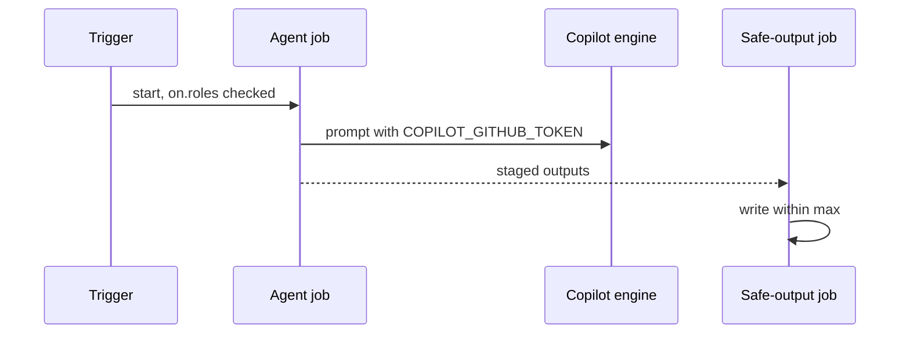
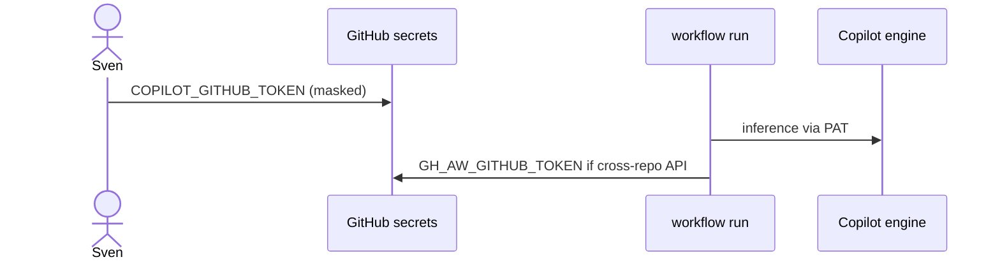

# C04: Auth: COPILOT_GITHUB_TOKEN, GH_AW_GITHUB_TOKEN, GitHub App
- Status: done
- PR: #4
- Area: core
- Wave: W1
- Block: 1
- Lane: Builder
- Depends on: C03
- proof: make verify
- door: one-way
- one-way gate: Sven's exact yes required (named ask in its block). Rollback: revoke PAT in GitHub settings and remove repo secrets
## Goal
Document and wire auth seams: fine-grained PAT `COPILOT_GITHUB_TOKEN` for Copilot engine on a personal account, `GH_AW_GITHUB_TOKEN` for cross-repo GitHub API fallbacks, optional GitHub App for short-lived cross-repo writes, and `ignore-if-missing` for local compile where appropriate.
## Context
gh-aw separates inference auth from GitHub API auth. Personal accounts cannot use org `copilot-requests` billing; PAT owner must have Copilot entitlement. Secrets never go in repo files (secret names only).
## Steps
1. Document required secrets and repo/org settings in shared auth fragment (no secret values).
2. Configure workflows to use `copilot-requests: none` where needed to silence org-only tips.
3. Plan GitHub App installation scope for cross-repo safe outputs (implementation after Q3).
4. Add compile-time checks that workflows do not embed tokens.
## Definition of Done
- [ ] Auth documented in shared fragment; no tokens in git
- [ ] Copilot engine paths use PAT model from gh-aw auth reference
- [ ] Cross-repo workflows declare `target-repo` / `allowed-repos` in frontmatter
- [ ] Q3 decision recorded before App rollout
## Technical design
- Components and files: `docs/reference/auth.md` (from the ARC03 table)
- Interfaces: Secrets COPILOT_GITHUB_TOKEN, GH_AW_GITHUB_TOKEN, `ignore-if-missing` (Q3)
- Sequence:

- Failure modes: Missing secret, so the run fails at start with a clear message
- Security: Fine-grained PAT, one repo, set by Sven through the masked secret field; never in files
- Observability: Run log shows which secret is missing, not its value
- Cost: 0 AIC
- Rollback: Revoke the PAT
- Proof: Doc plus secret names in `gh secret list` (names only)
- Door: one-way (Sven sets the secret)
## Evidence

Shipped in PR #4 (Block 1). Gate: `make verify` log on the exact head SHA, posted as a PR comment (Q0, Actions billing blocked).
(commands, logs, verify log on SHA, run links)
## Flow

## Named asks for Sven
Q3 (PAT plus GitHub App scope)
## Cost
n/a
## Sources
- https://github.github.com/gh-aw/guides/sharing-workflows/
- https://github.github.com/gh-aw/reference/auth/
- https://github.github.com/gh-aw/reference/cost-management/
- https://github.github.com/gh-aw/reference/imports/
- https://github.github.com/gh-aw/reference/engines/copilot/
- https://github.github.com/svennijhuis/agentic-workflows
