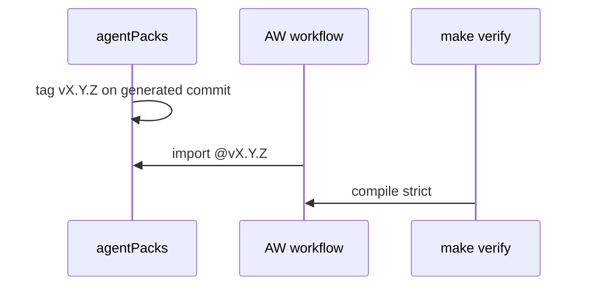
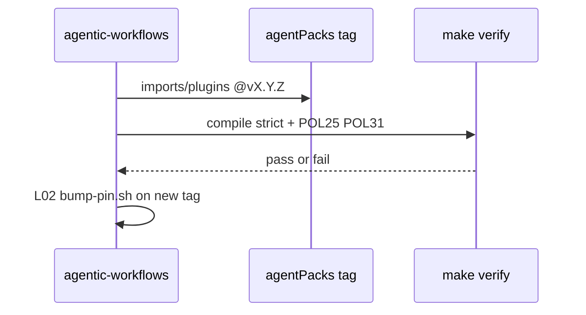

# C12: agentPacks import contract v1.1
- Status: done
- PR: #4
- Area: core
- Wave: W1
- Block: 1
- Lane: Builder
- Depends on: C05, G00a
- proof: gh aw compile --dir workflows --strict && make verify
- door: two-way
## Goal
Implement and test the shared agentPacks import contract v1.1 in this repo: pins, allowlist, caps, semver bumps, and compile strict. agentPacks owns the canonical contract doc; we link, mirror allowlist in `aw.yml`, and test via compile.
## Context
Twin track: agentPacks [PR #80](https://github.com/svennijhuis/agentPacks/pull/80) and plan v3.3 to v3.5. Personal account only; org features in G05, not used.
### Contract v1.1 (summary)
1. **Pins**: `imports:` and `plugins:` use `@vX.Y.Z` tag on the generated agentPacks marketplace commit or its 40-hex SHA. Never a branch. Never `plugins:` at a main SHA. Bump only via L02 `scripts/bump-pin.sh <ref>` (tags only).
2. **Inputs**: per-stack bundles first; `import-schema` typed inputs later. No edits to imported files in consumer repos (G00a).
3. **Allowlist v1** (agentPacks owns, mirrored in our `aw.yml`): standards and squad paths per agentPacks PR #80.
4. **Caps**: `max-ai-credits`, `max-daily-ai-credits`, `max-turns`, `timeout-minutes` in each workflow's own frontmatter. Repo var fallback `GH_AW_DEFAULT_MAX_AI_CREDITS` and `GH_AW_DEFAULT_MAX_DAILY_AI_CREDITS`.
5. **Compat**: agentPacks semver; breaking contract change is major; CHANGELOG upgrade note; X01 test-repo run before we bump pin.
## Steps
1. Mirror allowlist in `aw.yml` when C02 lands.
2. Prove pin rules via `gh aw compile --strict` on catalog workflows.
3. One workflow imports a pinned allowlisted file and compiles `--strict` passes.
4. Link agentPacks contract doc from shared imports and D05.
## Definition of Done
- [x] Contract summary in repo docs links agentPacks PR #80
- [x] Pin rules documented; compile strict on catalog workflows
- [x] One workflow with pinned agentPacks import compiles `--strict`
- [x] Mermaid flow in this PBI
## Technical design
- Components and files: `aw.yml`, workflow frontmatter, agentPacks contract link
- Interfaces: `imports:` and `plugins:` pinned to a tag on the generated agentPacks commit
- Sequence:

- Failure modes: A main SHA is used, so compile strict fails
- Security: Allowlist v1 of importable files only
- Observability: Compile log on PR
- Cost: 0 AIC
- Rollback: Pin the previous tag
- Proof: One workflow imports a pinned agentPacks file and compiles `--strict`
- Door: two-way (pin)
## Evidence

Shipped in PR #4 (Block 1). Gate: `make verify` log on the exact head SHA, posted as a PR comment (Q0, Actions billing blocked).
## Flow

## Named asks for Sven
Q7 (tags, moving v1, drop @marketplace import)
## Cost
n/a
## Sources
- https://github.com/svennijhuis/agentPacks/pull/80
- Plan v3.3, v3.4, v3.5 C12
- `agentpacks-cloud-local-pbi-plan.md` section One contract (C12 v1.1)
