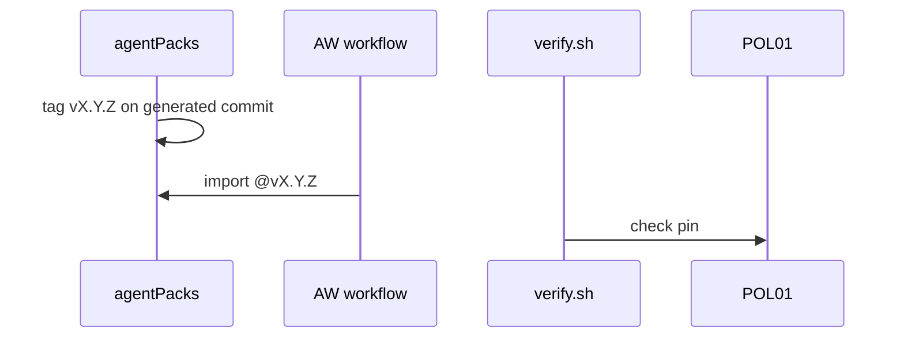
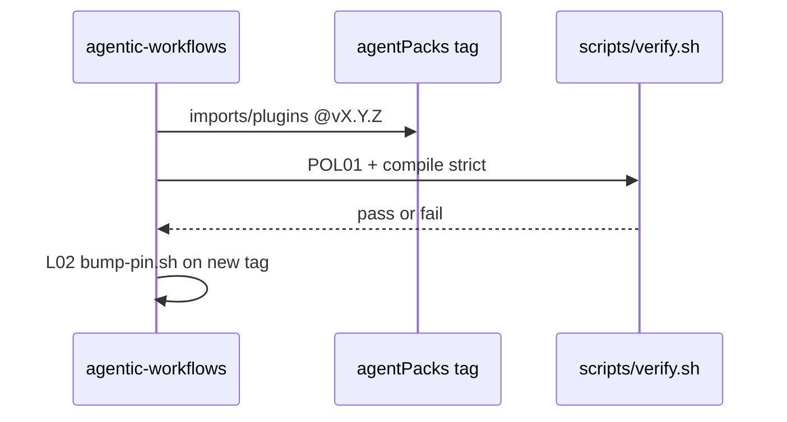

# C12: agentPacks import contract v1.1
- Status: done
- PR: #4
- Area: core
- Wave: W1
- Block: 1
- Lane: Builder
- Depends on: C05, G00a
- proof: gh aw compile --dir workflows --strict && ./scripts/verify.sh
- door: two-way
## Goal
Implement and test the shared agentPacks import contract v1.1 in this repo: pins, allowlist, caps, semver bumps, and verify fixtures. agentPacks owns the canonical contract doc; we link, mirror allowlist in `aw.yml`, and test it.
## Context
Twin track: agentPacks [PR #80](https://github.com/svennijhuis/agentPacks/pull/80) and plan v3.3 to v3.5. Contract text aligns with section "One contract (C12 v1.1, both repos)" in `agentpacks-cloud-local-pbi-plan.md` (workspace plain text). Personal account only; org features in G05, not used.
### Contract v1.1 (summary)
1. **Pins**: `imports:` and `plugins:` use `@vX.Y.Z` tag on the generated agentPacks marketplace commit or its 40-hex SHA. Never a branch. Never `plugins:` at a main SHA. POL01 checks both. Bump only via L02 `scripts/bump-pin.sh <ref>` (tags only).
2. **Inputs**: per-stack bundles first; `import-schema` typed inputs later. No edits to imported files in consumer repos (G00a).
3. **Allowlist v1** (agentPacks owns, mirrored in our `aw.yml`): `shared/standards/{http-api,testing-principles,design,engineering}.md`, `plugins/{dotnet,rust,typescript}/standards/*.md`, `plugins/squad/commands/squad-review.md`, `plugins: plugins/squad`, later `gh-aw/*.md`.
4. **Caps**: `max-ai-credits`, `max-daily-ai-credits`, `max-turns`, `timeout-minutes` in each workflow's own frontmatter (POL02). Repo var fallback `GH_AW_DEFAULT_MAX_AI_CREDITS` and `GH_AW_DEFAULT_MAX_DAILY_AI_CREDITS`.
5. **Compat**: agentPacks semver; breaking contract change is major; CHANGELOG upgrade note; X01 test-repo run before we bump pin.

### Correction: PBI 101 premise (agentPacks plugins pin)
[agentic-workflows PR #2](https://github.com/svennijhuis/agentic-workflows/pull/2) uses `plugins:` pin `@34e1dec` (a main SHA). That loads **zero** Copilot agents. After agentPacks PBI 04 (first release tag on generated commit), F01 and siblings move to a C12 v1.1 tag per L02 bump script.
## Steps
1. Mirror allowlist in `aw.yml` includes when C02 lands.
2. Extend POL01 check for `plugins:` pin rule (tag or tagged-commit SHA only).
3. Add verify good/bad fixtures for contract items 1 through 4 under `test/fixtures/`.
4. One workflow imports a pinned allowlisted file and `gh aw compile --dir workflows --strict` passes.
5. Link agentPacks contract doc from shared imports and D05.
6. Document import cache in C05: commit `.github/aw/imports/` or `inlined-imports: true`, proven in Block 2 trial.
## Definition of Done
- [ ] Contract summary in repo docs links agentPacks PR #80 and v1.1 text
- [ ] POL01 covers `imports:` and `plugins:` pin rules
- [ ] Verify fixtures good/bad for contract items 1 through 4
- [ ] One workflow with pinned agentPacks import compiles `--strict`
- [ ] Mermaid flow in this PBI
- [ ] X01 bump trial recorded before first pin change on main
## Technical design
- Components and files: `docs/pbi/core/C12-agentpacks-import-contract.md` (links agentPacks #80 README, the one source)
- Interfaces: `imports:` and `plugins:` pinned to a tag on the generated agentPacks commit (POL01)
- Sequence:

- Failure modes: A main SHA is used, so POL01 fails
- Security: Allowlist v1 of importable files only
- Observability: POL01 output line
- Cost: 0 AIC
- Rollback: Pin the previous tag
- Proof: One workflow imports a pinned agentPacks file and compiles `--strict`
- Door: two-way (pin)
## Evidence

Shipped in PR #4 (Block 1). Gate: `./scripts/verify.sh` log on the exact head SHA, posted as a PR comment (Q0, Actions billing blocked).
(compile log, POL01 fixture results, test-repo run link)
## Flow

## Named asks for Sven
Q7 (tags, moving v1, drop @marketplace import)
## Cost
n/a
## Sources
- https://github.com/svennijhuis/agentPacks/pull/80
- Plan v3.3, v3.4, v3.5 C12
- `agentpacks-cloud-local-pbi-plan.md` section One contract (C12 v1.1)
