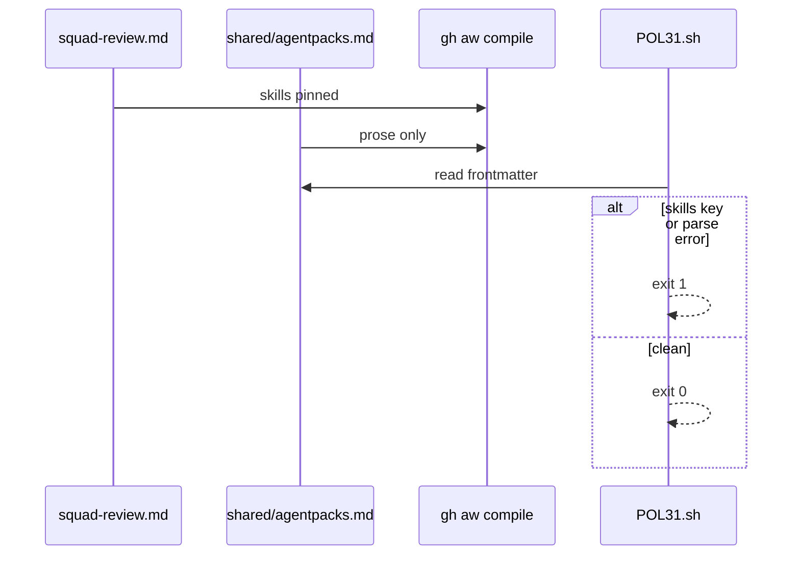
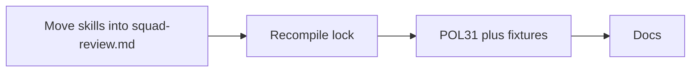

# C12b: skills: in the main workflow, not in a shared fragment
- Status: done
- PR: #26
- Area: core
- Wave: W3
- Block: 2
- Lane: Builder
- Depends on: C12, C05
- proof: `make verify` (exit 0); lock manifest lists the squad skill (grep in Evidence)
- door: two-way
- triage: build (real bug on main 14998b6: the squad skill never installs)
- feedback: `make verify` plus the lock manifest `skills` grep
- harness: none (script) for POL31; gh-aw v0.93.4 compile for the lock
- review-input: diff + this PBI + DoD (+ linked spec) + PR description, never builder session logs (PA6)
- kind: script
- Source: PA8 https://github.com/svennijhuis/agentic-workflows/pull/4 https://github.com/github/gh-aw/blob/main/docs/src/content/docs/reference/frontmatter.md
## Goal
Make the agentPacks squad skill actually install. gh-aw reads `skills:` only from the main workflow and silently drops it from an imported fragment, so `workflows/shared/agentpacks.md` installs nothing today.
## Context
The gh-aw frontmatter reference lists `skills:` as a main workflow key; it is not merged from imports. F01 builds on squad-review, so this lands before F01.
## Steps
1. Move the `skills:` list from `workflows/shared/agentpacks.md` into `workflows/squad-review.md` frontmatter, same 40-hex pin. Recompile the lock.
2. Add POL31 (`policies/POL31.yml`, `policies/checks/POL31.sh`) with good and bad fixtures under `test/fixtures/`.
3. Update reference docs: skills live in the consumer workflow.
## Definition of Done
- [x] Lock manifest lists the squad skill at the pinned SHA (grep in Evidence)
- [x] `workflows/shared/agentpacks.md` has no `skills:` key
- [x] POL31 bad fixtures exit 1 with one hit each; good fixture exits 0; all via `make verify`
- [x] Still `workflow_dispatch` only (POL25), `staged: true`, no new secrets
- [x] Docs updated, plus the "copy this" note
## Technical design
- Components and files: `workflows/squad-review.md`, lock, `policies/POL31.yml`, `policies/checks/POL31.sh`, fixtures, `scripts/verify.sh`
- Module boundary: consumer workflow frontmatter `skills:` is the interface; gh-aw install steps in the lock are the deep part
- Interfaces: frontmatter `skills:`; `POL31.sh [root]` exit 0 or 1, one line per hit
- Sequence:

- Failure modes: `skills:` back in a shared fragment (POL31 hit); lock not recompiled (compile drift fails)
- Security: same pin, no new secrets or triggers
- Observability: verify log lines per POL31 hit
- Cost: 0 (offline compile, no AIC)
- Rollback: revert the PR
- Proof: same as proof: above
- Door: two-way
## Evidence
Offline only (gh-aw v0.93.4 local compile). PR #26 head SHA: `make verify` rc 0; lock line 2 lists the squad skill; POL31 bad and good fixtures as in proof.
## Flow

## Named asks for Sven
none (offline only, two-way)
## Cost
0 (script, no AIC)
## Sources
- https://github.com/github/gh-aw/blob/main/docs/src/content/docs/reference/frontmatter.md
- [agentic-workflows PR #4](https://github.com/svennijhuis/agentic-workflows/pull/4)
