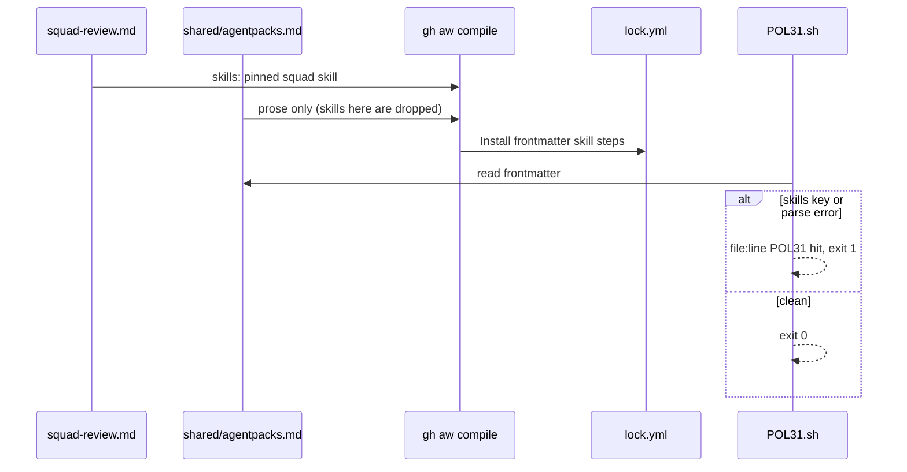

# C12b: skills: in the main workflow, not in a shared fragment
- Status: done
- PR: #26
- Area: core
- Wave: W3
- Block: 2
- Lane: Builder
- Depends on: C12, C05, POL01
- proof: `./scripts/verify.sh` exits 0 with `0 failures`; `sed -n 2p workflows/squad-review.lock.yml | grep -F '"skills":["svennijhuis/agentPacks/plugins/squad/skills/squad@34e1dec3535baa1d77cb441ea8c98498dc9b3684"]'` exits 0; `bash policies/checks/POL31.sh test/fixtures/bad/POL31/shared-skills` and `bash policies/checks/POL31.sh test/fixtures/bad/POL31/parse-error` each exit 1 with 1 hit; `bash policies/checks/POL31.sh test/fixtures/bad/POL31/` exits 1; `bash policies/checks/POL31.sh test/fixtures/good/POL31/` exits 0 with no output
- door: two-way
- triage: build (real bug on main 14998b6: the squad skill never installs)
- feedback: `./scripts/verify.sh` with `0 failures`, plus the lock manifest `skills` grep above
- harness: none (script) for POL31; gh-aw v0.93.4 compile for the lock
- review-input: diff + this PBI + DoD (+ linked spec) + PR description, never builder session logs (PA6)
- kind: script
- Source: PA8 https://github.com/svennijhuis/agentic-workflows/pull/4 https://github.com/github/gh-aw/blob/main/docs/src/content/docs/reference/frontmatter.md
## Goal
Make the agentPacks squad skill actually install. gh-aw reads `skills:` only from the main workflow and silently drops it from an imported fragment, so `workflows/shared/agentpacks.md` installs nothing today.
## Context
The gh-aw [frontmatter reference](https://github.com/github/gh-aw/blob/main/docs/src/content/docs/reference/frontmatter.md) lists `skills:` as a main workflow key; it is not merged from imports. Strategy re-checked on the pinned v0.93.4: the committed `workflows/squad-review.lock.yml` manifest has no `skills` key; with `skills:` moved into `squad-review.md` the compile is clean (0 warnings) and the manifest lists the pinned skill. Two side findings: a `workflows/shared/` file with `applyTo`, `globs`, `license` or `name` in frontmatter is a compile schema error (compile already catches it, no new rule), and offline `compile --strict` on gh-aw v1.x needs a committed `.github/aw/actions-lock.json` (not needed on v0.93.4; todo row for the gh-aw bump, not this PBI). F01 builds on squad-review, so this lands before F01.
## Steps
1. Move the `skills:` list from `workflows/shared/agentpacks.md` into `workflows/squad-review.md` frontmatter, same 40-hex pin `34e1dec3535baa1d77cb441ea8c98498dc9b3684`. Keep the fragment import for its prose note; reword the note to say skills go in the consumer workflow.
2. Recompile the lock with the pinned gh-aw; commit md and lock together.
3. New rule POL31 (`policies/POL31.yml`, `policies/checks/POL31.sh`). No args: scan `workflows/shared/*.md`. Path arg: scan every `workflows/shared/*.md` found anywhere under that root (recursive, so the nested bad cases are seen from the parent). A `skills:` key in that frontmatter is one hit (`<file>:<line> POL31 skills in shared fragment is silently dropped`). Frontmatter that cannot be read or does not parse is also one hit (`<file>:<line> POL31 parse error`), never a skip (fail closed, same as `policies/checks/POL25.sh`). Any hit exits 1. Bad fixtures `test/fixtures/bad/POL31/shared-skills/` (shared file has `skills:`) and `test/fixtures/bad/POL31/parse-error/` (shared file with broken frontmatter); good fixture is `test/fixtures/good/POL31/` itself (`workflows/squad-review.md` has `skills:`, `workflows/shared/*.md` does not); no nested good child, because `policies/checks/POL23.sh:60` runs `good/POL31/` and its extra good glob is `good/POL31-*`, not a subdirectory. POL23 checks exit codes only: it runs the parent `test/fixtures/bad/POL31/` (`POL23.sh:59`, must exit 1; the recursive scan gives it 2 hits) and then each child (`POL23.sh:63` to `:67`, each must exit 1). Hit counts come from `scripts/verify.sh`: add three lines in the shape of `sm05b_one_hit` (`scripts/verify.sh:89`, an explicit list): `bad/POL31/shared-skills` and `bad/POL31/parse-error` each exit 1 with exactly one hit, and `good/POL31/` exits 0 with no output. The parent dir alone never counts as a one-hit proof.
4. POL01 allowlist mirror keeps the skill path (no change expected; prove it).
5. Update `docs/reference/agentpacks-contract.md` and `docs/reference/squad-review.md`: skills live in the consumer workflow. Add the "copy this" note: an org copies `squad-review.md`, its lock and `workflows/shared/`, and the skill comes with the md.
## Definition of Done
- [x] `workflows/squad-review.lock.yml` manifest lists the squad skill at pin `34e1dec3535baa1d77cb441ea8c98498dc9b3684` (grep in Evidence)
- [x] `workflows/shared/agentpacks.md` has no `skills:` key
- [x] POL31 nested bad fixtures (`bad/POL31/shared-skills`, `bad/POL31/parse-error`) each exit 1 with exactly 1 hit via the `sm05b_one_hit` shaped lines in `scripts/verify.sh`; the parent `bad/POL31/` exits 1 under POL23 but is not counted as a one-hit proof; `good/POL31/` exits 0; all inside `./scripts/verify.sh` with `0 failures`
- [x] A shared fragment whose frontmatter does not parse is a POL31 hit (exit 1), never skipped
- [x] Lock drift check clean; still `workflow_dispatch` only (POL03, POL25), `staged: true`, no new secrets
- [x] Docs updated, plus the "copy this" note
- [x] Todo row added: `.github/aw/actions-lock.json` needed when gh-aw moves to v1.x
- [x] Offline proof only, no run, no token spend
## Technical design
- Components and files: `workflows/squad-review.md`, `workflows/squad-review.lock.yml`, `workflows/shared/agentpacks.md`, `policies/POL31.yml`, `policies/checks/POL31.sh`, `test/fixtures/bad/POL31/{shared-skills,parse-error}/`, `test/fixtures/good/POL31/` (no nested child), `scripts/verify.sh` (three `sm05b_one_hit` shaped lines), `docs/reference/agentpacks-contract.md`, `docs/reference/squad-review.md`
- Module boundary: the consumer workflow frontmatter `skills:` is the interface; gh-aw install steps in the lock are the deep part
- Interfaces: frontmatter `skills:` (list of `owner/repo/path@<40-hex>`); `POL31.sh [root]` exit 0 or 1, one `<file>:<line> POL31 ...` line per hit
- Sequence:

- Failure modes: `skills:` back in a shared fragment installs nothing (POL31 hit, exit 1); broken shared frontmatter would hide a `skills:` key (POL31 parse error hit, exit 1); lock not recompiled (lock drift check fails)
- Security: same 40-hex pin, no new secrets, no new triggers, no network in POL31
- Observability: `scripts/verify.sh` log lines `<file>:<line> POL31 ...`; lock manifest line 2 lists the skill
- Cost: 0 (script and offline compile, no AIC)
- Rollback: revert the PR (md, lock, POL31 files and fixtures go back together)
- Proof: same as proof: above
- Door: two-way (revert is one commit, nothing live)
## Evidence
Offline only (gh-aw v0.93.4 local compile, no run, no trial, no token spend). Full log on the PR head SHA is in PR #26.
- `./scripts/verify.sh`: `0 failures` (rc 0), including the new `# POL31 shared skills` section and POL23 on `bad/POL31/` and `good/POL31/`.
- `sed -n 2p workflows/squad-review.lock.yml | grep -F '"skills":["svennijhuis/agentPacks/plugins/squad/skills/squad@34e1dec3535baa1d77cb441ea8c98498dc9b3684"]'` exits 0; the lock now has the `Install frontmatter skill` step.
- `POL31.sh test/fixtures/bad/POL31/shared-skills`: rc 1, one hit `...shared/agentpacks.md:3 POL31 skills in shared fragment is silently dropped`.
- `POL31.sh test/fixtures/bad/POL31/parse-error`: rc 1, one hit `...shared/agentpacks.md:1 POL31 parse error`.
- `POL31.sh test/fixtures/bad/POL31/`: rc 1 (2 hits); `POL31.sh test/fixtures/good/POL31/`: rc 0, no output; repo mode rc 0.
- POL01 on `workflows/squad-review.md` rc 0; `policies/POL01.yml` allowlist still has `plugins/squad/skills/squad` (no change).
- POL31 scans every non-README `*.md` under `workflows/shared/` (subfolders too), a superset of `workflows/shared/*.md`.
## Flow

## Named asks for Sven
none (offline only, two-way)
## Cost
0 (script, no AIC)
## Sources
- https://github.com/github/gh-aw/blob/main/docs/src/content/docs/reference/frontmatter.md
- [agentic-workflows PR #4](https://github.com/svennijhuis/agentic-workflows/pull/4)
