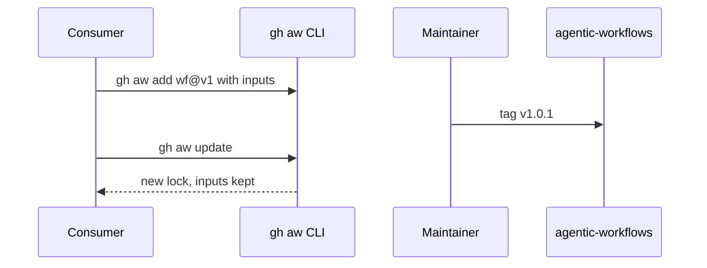
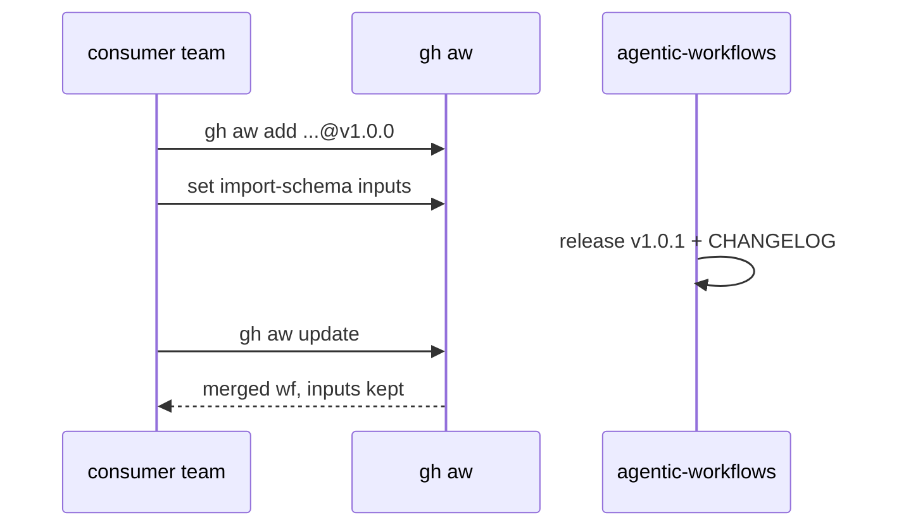

# G00a: Consumer strategy
- Status: done
- PR: #4
- Area: governance
- Wave: W1
- Block: 1
- Lane: Cursor CLI
- Depends on: G00, L01
- proof: test -f docs/pbi/done/G00a-consumer-strategy.md && grep -q 'import-schema' docs/pbi/done/G00a-consumer-strategy.md
- door: one-way
- one-way gate: Sven's exact yes required (named ask in its block). Rollback: revert consumer proof tags on test repos
## Goal
Define how teams install, configure, update, and get support for catalog workflows without editing upstream files. Proof run at end of Block 2: second test repo installs a workflow, catalog cuts v1.0.1, consumer updates with one command and keeps team settings.
## Context
Plan v3.2. Install: `gh aw add svennijhuis/agentic-workflows/<wf>@v1` or exact tag, never branch, one command per workflow. Configure: team settings only via `import-schema` inputs declared in shared imports (agentPacks and catalog), no edits to imported markdown. Update: `gh aw update` on moving `v1`, Dependabot or Renovate on pins, CHANGELOG upgrade notes, X01 test-repo run before every release. Channels: stable and preview tags, deprecation window (G06), support path in G03. Doc lands Block 1; proof pairs with L01 tag flow in Block 2. D01 links here.
## Steps
1. Write consumer guide sections (fold into D01): install, configure, update, channels, deprecation, support.
2. Document conflict-free updates: local `import-schema` values preserved on `gh aw update`.
3. Define Sven test scenario (Block 2): repo A and repo B on same workflow; bump patch; both update.
4. Link C12 agentPacks contract for pin and allowlist rules.
5. Link G05 for org-only features (not used on personal account).
## Definition of Done
- [ ] Install/configure/update/support documented with no branch installs
- [ ] D01 quick start links to this PBI
- [ ] Block 2 proof checklist attached in Evidence after v1.0.1 trial
- [ ] Mermaid flow covers install through update
## Technical design
- Components and files: `docs/how-to/consume.md`, `docs/pbi/done/G00a-consumer-strategy.md`
- Interfaces: `gh aw add svennijhuis/agentic-workflows/<wf>@v1`, settings only via `import-schema` inputs, `gh aw update`
- Sequence:

- Failure modes: Consumer edits our file, so update conflicts. Fix: doc says inputs only; C05 schema rejects unknown keys
- Security: Consumer owns their own secrets; inputs never hold secrets
- Observability: CHANGELOG upgrade notes per tag
- Cost: 0 AIC (doc); the B2 proof run spends trial AIC with Sven's yes
- Rollback: Pin back to the previous tag
- Proof: (B2) a 2nd test repo updates in one command with its settings kept
- Door: two-way for the doc; the B2 proof run is one-way (Sven's yes)
## Evidence

Shipped in PR #4 (Block 1). Gate: `./scripts/verify.sh` log on the exact head SHA, posted as a PR comment (Q0, Actions billing blocked).
(Block 2: X01 second repo, v1.0.1 tag, `gh aw update` log, settings preserved)
## Flow

## Named asks for Sven
X01 (test repo name for proof)
## Cost
n/a
## Sources
- https://github.github.com/gh-aw/setup/working-with-workflows/
- https://github.github.com/gh-aw/reference/releases/
- Plan v3.2 G00a
