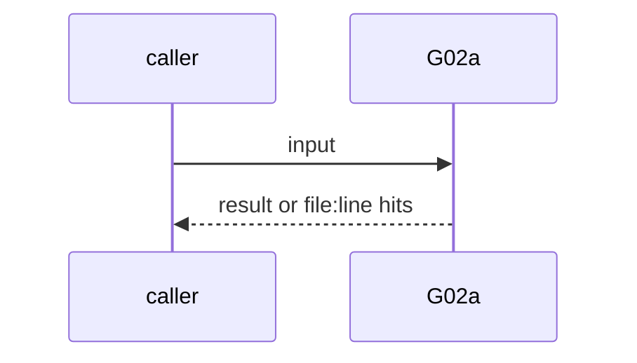
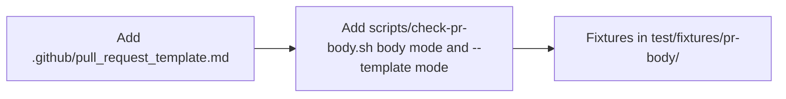

# G02a: PR template: owner, architecture summary, questions for owner
- Status: done
- PR: #4
- Area: governance
- Wave: W1
- Block: 1
- Lane: Builder
- Depends on: G02
- proof: bash scripts/check-pr-body.sh test/fixtures/pr-body/bad-no-owner.md (exit 1); bad-empty-architecture.md (exit 1); good.md (exit 0); bash scripts/check-pr-body.sh --template .github/pull_request_template.md (exit 0)
- door: two-way
- triage: build (template with its check)
- feedback: bash scripts/check-pr-body.sh on the fixtures and the template
- harness: none (script run by scripts/verify.sh)
- review-input: diff + this PBI + DoD (+ linked spec) + PR description, never builder session logs (PA6)
- kind: script
- Source: D23 https://x.com/BHolmesDev/status/2106904644425339163
## Goal
`.github/pull_request_template.md` opens with `owner: @svennijhuis` and has `## Architecture summary` and `## Questions for owner`. The P04 rule (refuse an agent PR without an owner) ships now as a fixture-tested script, so P04 calls it when P04 is built.
## Context
Ben Holmes: "Ask agents to explain the architecture of their changes to you. Ask questions. Have them ask *you* questions." Matt Pocock's map, The Team: "Ownership: 'the agent wrote it' is no excuse". PO gap 3.
## Steps
1. Add `.github/pull_request_template.md`.
2. Add `scripts/check-pr-body.sh` (body mode and `--template` mode).
3. Fixtures in `test/fixtures/pr-body/`.
## Definition of Done
- [x] Template has the owner line and both sections
- [x] check-pr-body.sh exits 1 on a body without owner and on an empty architecture summary
- [x] Good body exits 0
- [x] verify.sh runs the template and fixture checks
## Technical design
- Components and files: `.github/pull_request_template.md`, `scripts/check-pr-body.sh`, `test/fixtures/pr-body/`
- Module boundary: the PR body shape is the interface; P04 (Block 3) calls the same script
- Interfaces: `check-pr-body.sh FILE...` and `--template FILE`; exit 1 on a hit
- Sequence:

- Failure modes: HTML comments do not count as text, so an untouched template body fails body mode
- Security: Reads a file, no tokens
- Observability: verify.sh section PR template
- Cost: 0 AIC
- Rollback: Delete the template and the script call in verify.sh
- Proof: same as proof: above
- Door: two-way (revert is one commit)
## Evidence
Verify log on the exact head SHA of PR #4 (Q0, Actions billing blocked).
## Flow

## Named asks for Sven
none
## Cost
0 AIC
## Sources
- [Ben Holmes, code review is risk mitigation](https://x.com/BHolmesDev/status/2106904644425339163)
- Strategy id list v3.12 (aw-final-ids.md), url-learnings.md D23
