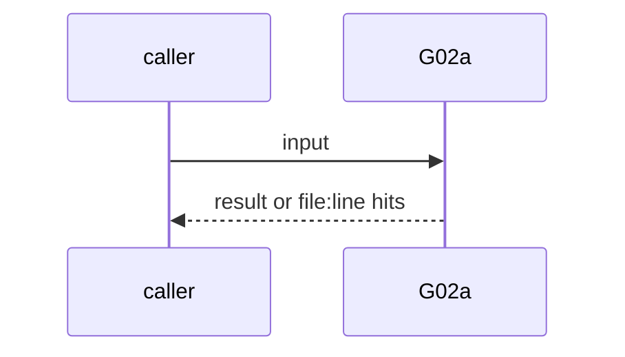
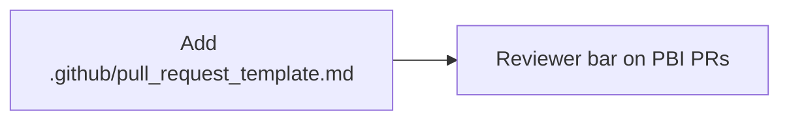

# G02a: PR template: owner, architecture summary, questions for owner
- Status: done
- PR: #4
- Area: governance
- Wave: W1
- Block: 1
- Lane: Builder
- Depends on: G02
- proof: `make verify` (exit 0); `.github/pull_request_template.md` has owner line and both sections
- door: two-way
- triage: build (template shipped in PR 0)
- feedback: Reviewer checks PR bodies against the template on PBI PRs
- harness: none (docs)
- review-input: diff + this PBI + DoD (+ linked spec) + PR description, never builder session logs (PA6)
- kind: script
- Source: D23 https://x.com/BHolmesDev/status/2106904644425339163
## Goal
`.github/pull_request_template.md` opens with `owner: @svennijhuis` and has `## Architecture summary` and `## Questions for owner`. P04 (Block 3) reuses the same shape when P04 is built.
## Context
Ben Holmes: ask agents to explain architecture and ask questions. Matt Pocock's map: ownership means the agent wrote it is no excuse.
## Steps
1. Add `.github/pull_request_template.md`.
2. Reviewer bar: refuse merge when owner or architecture summary is missing on a PBI PR.
## Definition of Done
- [x] Template has the owner line and both sections
- [x] Reviewer checks owner and architecture summary on PBI PRs
## Technical design
- Components and files: `.github/pull_request_template.md`
- Module boundary: PR body shape is the interface; P04 calls the same fields later
- Interfaces: owner line, Architecture summary, Questions for owner sections
- Sequence:

- Failure modes: HTML comments do not count as filled sections
- Security: Reads files only
- Observability: PR review comments
- Cost: 0 AIC
- Rollback: Delete or simplify the template
- Proof: same as proof: above
- Door: two-way (revert is one commit)
## Evidence
Verify log on the exact head SHA of PR #4 (Q0, Actions billing blocked).
## Flow

## Named asks for Sven
none
## Cost
0 AIC
## Sources
- [Ben Holmes, code review is risk mitigation](https://x.com/BHolmesDev/status/2106904644425339163)
- Strategy id list v3.12 (aw-final-ids.md), url-learnings.md D23
