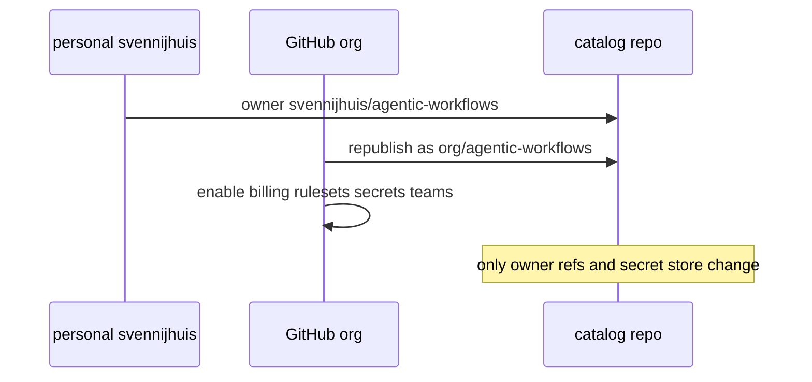

# G05: Org switch checklist (org-only features)
- Status: done
- PR: #12
- Area: governance
- Wave: W5
- Block: 5
- Lane: Cursor CLI
- Depends on: G00, C02
- proof: ./scripts/verify.sh
- door: one-way
- one-way gate: Sven's exact yes required (named ask in its block). Rollback: do not apply org switch steps
## Goal
Checklist only: what changes when moving from personal `svennijhuis` to a GitHub org. Org-only features are documented as ready, not used on the personal account today.
## Context
Nothing else changes at switch: same `workflows/`, `shared/`, `policies/`, `docs/pbi/`, `aw.yml`, import pins, `scripts/verify.sh`, and consumer `gh aw add` paths except the owner string. This PBI is not a general governance appendix.
## Steps
1. Publish `governance/ORG-ONLY.md` with only these sections:
   - **Central Copilot billing**: enables `copilot-requests` org billing path (personal account keeps `copilot-requests: none`, POL21).
   - **Rulesets**: branch protection, required verify checks, POL19 no force push enforcement at org level.
   - **Org secrets**: provider triggers (R06), shared tokens without per-repo PAT sprawl.
   - **Teams**: CODEOWNERS, repo visibility (Q2).
   - **GHES**: enterprise host options and compiler enterprise controls (reference only until needed).
2. Explicit closing line: no catalog layout, workflow behavior, or C12 pin rules change at switch.
## Definition of Done
- [x] Checklist enumerates billing, rulesets, org secrets, teams, GHES only
- [x] Checklist states no other repo structure or workflow behavior changes
- [ ] Q2 visibility decision recorded when Sven answers (open: Q2 not answered yet, placeholder in ORG-ONLY.md)
## Evidence
[governance/ORG-ONLY.md](../../../governance/ORG-ONLY.md)
## Flow

## Named asks for Sven
Q2 (visibility)
## Cost
n/a
## Sources
- https://github.github.com/gh-aw/reference/billing/
- https://github.github.com/gh-aw/reference/enterprise-configuration/
- Plan v3.1 G05 switch checklist only
