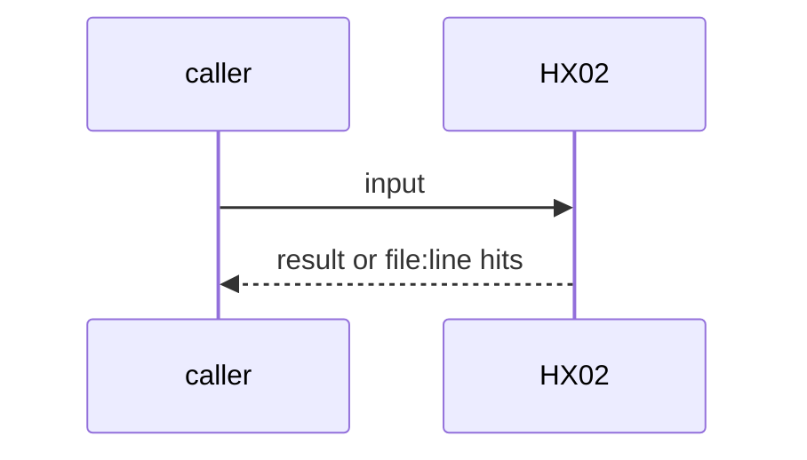
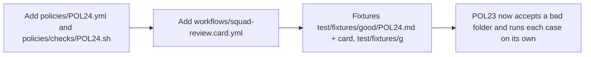

# HX02: Agent card per workflow (MCP transport and secret NAME only)
- Status: done
- PR: #4
- Area: harness
- Wave: W1
- Block: 1
- Lane: Builder
- Depends on: ARC07, C01, C05
- proof: bash policies/checks/POL24.sh test/fixtures/bad/POL24/ (exit 1, each case alone exit 1); bash policies/checks/POL24.sh test/fixtures/good/POL24.md (exit 0); ./scripts/verify.sh runs POL24
- door: two-way
- triage: build (guard with its check in the same PR, Reviewer bar)
- feedback: bash policies/checks/POL24.sh on the bad and good fixtures, then ./scripts/verify.sh
- harness: none (script run by scripts/verify.sh)
- review-input: diff + this PBI + DoD (+ linked spec) + PR description, never builder session logs (PA6)
- kind: script
- Source: D31, D37 https://docs.warp.dev/platform/mcp/ https://x.com/theo/status/2113424203345265053
## Goal
Every workflow has a sibling `<name>.card.yml` that says what runs where: interface, harness, engine, engine secret, tools, and one row per MCP server with its transport and secret NAME. C01 fails when the card is missing, differs from the workflow, or holds a secret value.
## Context
D37: an agent is a harness configuration (tools, instructions, MCP servers). D31: each MCP server entry has exactly one transport and secrets are placeholders resolved at runtime, so the card names the secret and never carries it. The check is POL24 (the id theo-learnings reserved for HX02). The card is a sidecar file, not part of the workflow body, so the prompt and the lock do not change.
## Steps
1. Add `policies/POL24.yml` and `policies/checks/POL24.sh`.
2. Add `workflows/squad-review.card.yml`.
3. Fixtures: `test/fixtures/good/POL24.md` + card, `test/fixtures/good/gate-minimal.card.yml`, bad folder `test/fixtures/bad/POL24/` with 4 cases (missing card, engine and tools mismatch, secret value, mcp rows differ from the lock manifest).
4. POL23 now accepts a bad folder and runs each case on its own.
## Definition of Done
- [x] `workflows/squad-review.card.yml` exists and POL24 passes on the repo
- [x] POL24 exits 1 on each of the 4 bad cases on its own
- [x] POL24 exits 0 on the good fixture and on gate-minimal
- [x] Card secret fields are NAMES; a value or a `${{ }}` expression fails
- [x] mcp names and secret names are compared with the lock manifest when a lock exists
## Technical design
- Components and files: `policies/POL24.yml`, `policies/checks/POL24.sh`, `workflows/squad-review.card.yml`, `test/fixtures/good/POL24.md`, `test/fixtures/good/POL24.card.yml`, `test/fixtures/good/gate-minimal.card.yml`, `test/fixtures/bad/POL24/`, `policies/checks/POL23.sh`
- Module boundary: the card (7 keys) is the small interface; frontmatter resolution and the lock manifest compare are the deep part in POL24.sh
- Interfaces: Card keys: workflow, interface, harness, engine, engine_secret, model, instructions, tools, mcp[name, transport stdio|url|shared, secret]. Output `file:line POL24 message`, exit 1 on a hit
- Sequence:

- Failure modes: Card drifts after a frontmatter edit or a recompile: POL24 names the field. A lock without a manifest header skips the lock compare (POL17 still checks the lock)
- Security: Read-only yq and jq, no network. Secret NAMES only; POL20 patterns and `${{` fail the card
- Observability: One line per hit in verify.sh
- Cost: 0 AIC
- Rollback: Remove POL24.sh (the loop picks checks by file name) and the card files
- Proof: same as proof: above
- Door: two-way (revert is one commit)
## Evidence
Verify log on the exact head SHA of PR #4 (Q0, Actions billing blocked).
## Flow

## Named asks for Sven
none
## Cost
0 AIC
## Sources
- [Warp MCP for cloud agents doc](https://docs.warp.dev/platform/mcp/)
- [Theo, What is a harness?](https://x.com/theo/status/2113424203345265053)
- Strategy id list v3.12 (aw-final-ids.md), url-learnings.md D31, D37
