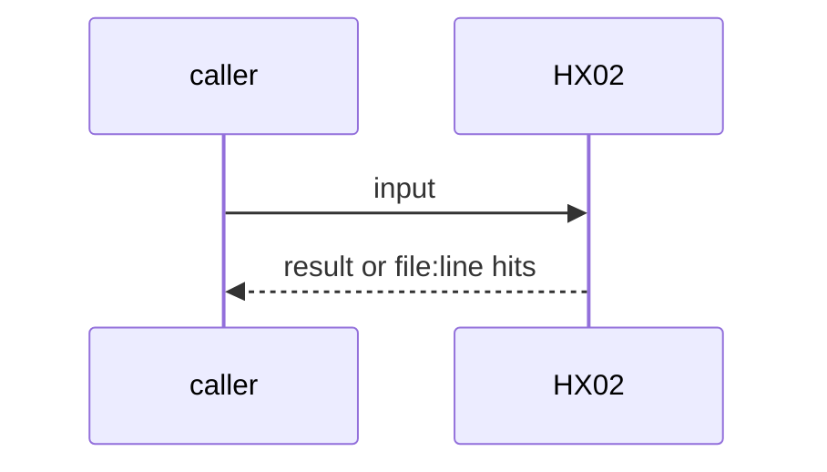

# HX02: Agent card per workflow (MCP transport and secret NAME only)
- Status: done
- PR: #4
- Area: harness
- Wave: W1
- Block: 1
- Lane: Builder
- Depends on: ARC07, C01, C05
- proof: `make verify` (exit 0); `workflows/squad-review.card.yml` exists and matches the workflow
- door: two-way
- triage: build (card sidecar with Reviewer bar)
- feedback: Reviewer compares card to workflow frontmatter and lock on each workflow PR
- harness: none (docs plus card file)
- review-input: diff + this PBI + DoD (+ linked spec) + PR description, never builder session logs (PA6)
- kind: script
- Source: D31, D37 https://docs.warp.dev/platform/mcp/ https://x.com/theo/status/2113424203345265053
## Goal
Every workflow has a sibling `<name>.card.yml` that says what runs where: interface, harness, engine, engine secret, tools, and one row per MCP server with its transport and secret NAME. Reviewers fail when the card is missing, differs from the workflow, or holds a secret value.
## Context
D37: an agent is a harness configuration (tools, instructions, MCP servers). D31: each MCP server entry has exactly one transport and secrets are placeholders resolved at runtime, so the card names the secret and never carries it. The card is a sidecar file, not part of the workflow body.
## Steps
1. Add `workflows/squad-review.card.yml`.
2. Document card keys in harness docs; Reviewer checklist on workflow PRs.
## Definition of Done
- [x] `workflows/squad-review.card.yml` exists
- [x] Card secret fields are NAMES only; a value or a `${{ }}` expression fails review
- [x] mcp names and secret names match the lock manifest when a lock exists
## Technical design
- Components and files: `workflows/squad-review.card.yml`, harness docs
- Module boundary: the card keys are the small interface; frontmatter resolution and lock compare are manual Reviewer steps until a future check
- Interfaces: Card keys: workflow, interface, harness, engine, engine_secret, model, instructions, tools, mcp rows
- Sequence:

- Failure modes: Card drifts after a frontmatter edit: Reviewer catches in the same PR
- Security: Secret NAMES only in the card; never commit values
- Observability: PBI PR review
- Cost: 0 AIC
- Rollback: Remove card files
- Proof: same as proof: above
- Door: two-way (revert is one commit)
## Evidence
Verify log on the exact head SHA of PR #4 (Q0, Actions billing blocked).
## Flow

## Named asks for Sven
none
## Cost
0 AIC
## Sources
- [Warp MCP for cloud agents doc](https://docs.warp.dev/platform/mcp/)
- [Theo, What is a harness?](https://x.com/theo/status/2113424203345265053)
- Strategy id list v3.12 (aw-final-ids.md), url-learnings.md D31, D37
