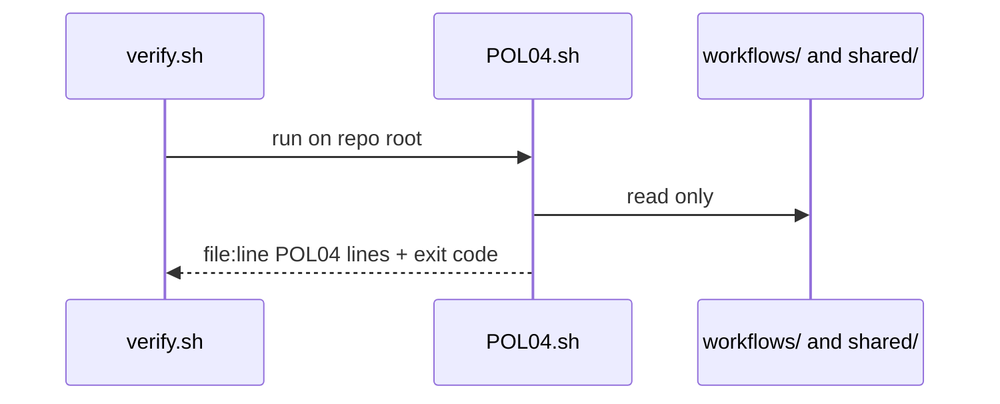
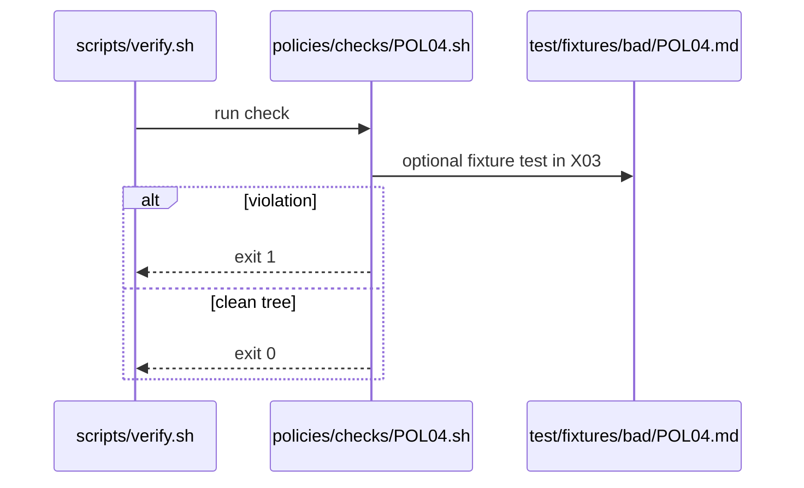

# POL04: No secrets in files
- Status: done
- PR: #4
- Area: policies
- Wave: W1
- Block: 1
- Lane: Cursor CLI
- Depends on: C01
- proof: bash policies/checks/POL04.sh test/fixtures/bad/POL04.md (must exit 1); bash policies/checks/POL04.sh test/fixtures/good/POL04.md (exit 0); ./scripts/verify.sh includes POL04
- door: two-way
## Goal
Encode no secrets in files as policy-as-code: `policies/POL04.yml`, gate script `policies/checks/POL04.sh`, and bad fixture `test/fixtures/bad/POL04.md`, enforced by C01.
## Context
No API keys, PATs, private keys, or connection strings in tracked files. Use GitHub Actions secrets and masked fields for named asks. Personal account catalog; org-ready rulesets in G05 may mirror these checks later.

Policy text: Repository content must not contain high-entropy secret patterns or literal `ghp_`, `github_pat_`, `gho_` tokens.

`policies/checks/POL04.sh` behaviour: Run gitleaks or equivalent plus regex scan on `workflows/`, `shared/`, `docs/`, and `.github/`. Exit 1 on findings.

Bad fixture `test/fixtures/bad/POL04.md`: Markdown containing a fake `ghp_` example token (fixture only).
## Steps
1. Write `policies/POL04.yml` with machine-readable rules.
2. Implement `policies/checks/POL04.sh` (bash, exit codes, clear stderr).
3. Add `test/fixtures/bad/POL04.md` triggering a single failure.
4. Add matching good coverage in `test/fixtures/good/` where needed.
5. Register check in `scripts/verify.sh`.
## Definition of Done
- [ ] Policy YAML, check script, and bad fixture exist for POL04
- [ ] `policies/checks/POL04.sh` fails on bad fixture and passes on good catalog
- [ ] Policy text included in this PBI and in `shared/policies/` or `policies/` doc
- [ ] Gate log on SHA shows POL04 executed
## Technical design
- Components and files: `policies/POL04.yml` (rule + why), `policies/checks/POL04.sh`, `test/fixtures/bad/POL04.md` (shared POL design, see [00-overview.md](../policies/00-overview.md#shared-technical-design-pol01-pol23))
- Interfaces: Check gets the repo root, prints `file:line POL04 message`, exit 1 on hit; verify.sh loops all checks. This check: gitleaks + no `ghp_`/`github_pat_` patterns
- Sequence:

- Failure modes: Tautological check that never fails, so POL23 runs it on its bad fixture `test/fixtures/bad/POL04.md` (fake PAT string) and needs exit 1
- Security: Read-only grep or yq, no tokens, no network
- Observability: One line per hit `file:line POL04 message` in verify.sh output
- Cost: 0 AIC (script)
- Rollback: Remove POL04.sh from the verify.sh loop (the policy doc stays)
- Proof: verify.sh fails on `test/fixtures/bad/POL04.md` and passes on `test/fixtures/good/`
- Door: two-way (script)
## Evidence

Shipped in PR #4 (Block 1). Gate: `./scripts/verify.sh` log on the exact head SHA, posted as a PR comment (Q0, Actions billing blocked).
(commands, logs, verify log on SHA, run links)
## Flow

## Named asks for Sven
none
## Cost
n/a
## Sources
- https://github.github.com/gh-aw/guides/sharing-workflows/
- https://github.github.com/gh-aw/reference/auth/
- https://github.github.com/gh-aw/reference/cost-management/
- https://github.github.com/gh-aw/reference/imports/
- https://github.github.com/gh-aw/reference/engines/copilot/
- https://github.github.com/svennijhuis/agentic-workflows
