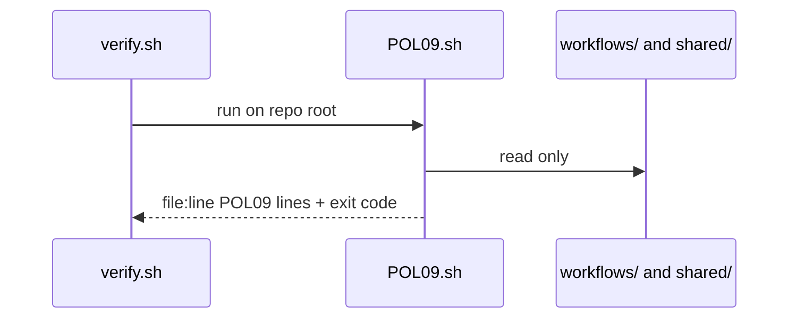
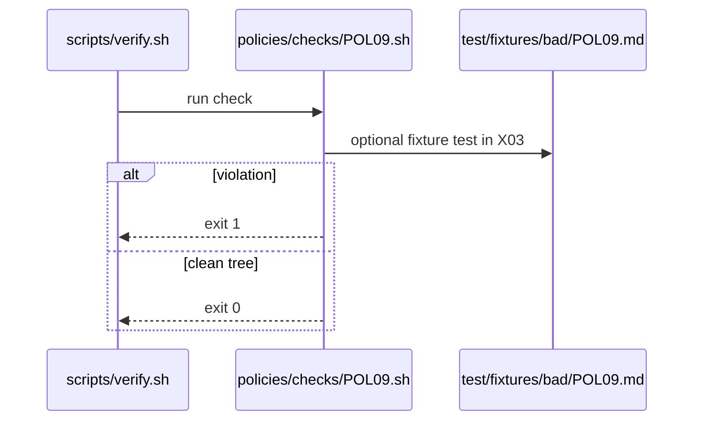

# POL09: Rate limits, concurrency, and cooldown
- Status: done
- PR: #4
- Area: policies
- Wave: W1
- Block: 1
- Lane: Cursor CLI
- Depends on: C01, R01
- proof: bash policies/checks/POL09.sh test/fixtures/bad/POL09.md (must exit 1); bash policies/checks/POL09.sh test/fixtures/good/POL09.md (exit 0); ./scripts/verify.sh includes POL09
- door: two-way
## Goal
Encode rate limits, concurrency, and cooldown as policy-as-code: `policies/POL09.yml`, gate script `policies/checks/POL09.sh`, and bad fixture `test/fixtures/bad/POL09.md`, enforced by C01.
## Context
Workflows must set concurrency groups, cooldown, or rate limits suitable for personal account repos to prevent trigger storms. Personal account catalog; org-ready rulesets in G05 may mirror these checks later.

Policy text: High-frequency triggers require cooldown or concurrency caps documented in the workflow PBI.

`policies/checks/POL09.sh` behaviour: Check concurrency and cooldown fields for schedules and issue triggers per `policies/POL09.yml` rules.

Bad fixture `test/fixtures/bad/POL09.md`: Hourly schedule without concurrency or cooldown (M03 must not enable until Sven yes).
## Steps
1. Write `policies/POL09.yml` with machine-readable rules.
2. Implement `policies/checks/POL09.sh` (bash, exit codes, clear stderr).
3. Add `test/fixtures/bad/POL09.md` triggering a single failure.
4. Add matching good coverage in `test/fixtures/good/` where needed.
5. Register check in `scripts/verify.sh`.
## Definition of Done
- [ ] Policy YAML, check script, and bad fixture exist for POL09
- [ ] `policies/checks/POL09.sh` fails on bad fixture and passes on good catalog
- [ ] Policy text included in this PBI and in `shared/policies/` or `policies/` doc
- [ ] Gate log on SHA shows POL09 executed
## Technical design
- Components and files: `policies/POL09.yml` (rule + why), `policies/checks/POL09.sh`, `test/fixtures/bad/POL09.md` (shared POL design, see [00-overview.md](../policies/00-overview.md#shared-technical-design-pol01-pol23))
- Interfaces: Check gets the repo root, prints `file:line POL09 message`, exit 1 on hit; verify.sh loops all checks. This check: concurrency group + schedule not below 1h
- Sequence:

- Failure modes: Tautological check that never fails, so POL23 runs it on its bad fixture `test/fixtures/bad/POL09.md` (`*/5` cron) and needs exit 1
- Security: Read-only grep or yq, no tokens, no network
- Observability: One line per hit `file:line POL09 message` in verify.sh output
- Cost: 0 AIC (script)
- Rollback: Remove POL09.sh from the verify.sh loop (the policy doc stays)
- Proof: verify.sh fails on `test/fixtures/bad/POL09.md` and passes on `test/fixtures/good/`
- Door: two-way (script)
## Evidence

Shipped in PR #4 (Block 1). Gate: `./scripts/verify.sh` log on the exact head SHA, posted as a PR comment (Q0, Actions billing blocked).
(commands, logs, verify log on SHA, run links)
## Flow

## Named asks for Sven
none
## Cost
n/a
## Sources
- https://github.github.com/gh-aw/guides/sharing-workflows/
- https://github.github.com/gh-aw/reference/auth/
- https://github.github.com/gh-aw/reference/cost-management/
- https://github.github.com/gh-aw/reference/imports/
- https://github.github.com/gh-aw/reference/engines/copilot/
- https://github.github.com/svennijhuis/agentic-workflows
