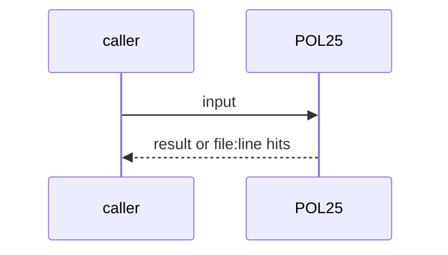
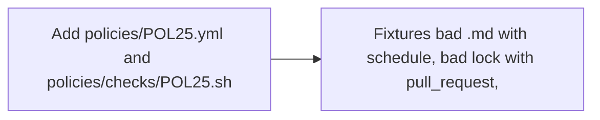

# POL25: Agentic workflows are workflow_dispatch only
- Status: done
- PR: #4
- Area: policies
- Wave: W1
- Block: 1
- Lane: Builder
- Depends on: C01, POL03
- proof: bash policies/checks/POL25.sh test/fixtures/bad/POL25.md (exit 1); bash policies/checks/POL25.sh test/fixtures/bad/POL25-lock.lock.yml (exit 1); bash policies/checks/POL25.sh test/fixtures/good/POL25.md (exit 0); bash policies/checks/POL25.sh test/fixtures/good/POL25-ci.yml (exit 0)
- door: two-way
- triage: build (Reviewer bar PA1, PO scope fix)
- feedback: bash policies/checks/POL25.sh on the 4 fixtures, then ./scripts/verify.sh
- harness: none (script run by scripts/verify.sh)
- review-input: diff + this PBI + DoD (+ linked spec) + PR description, never builder session logs (PA6)
- kind: script
- Source: PA1, D30 https://github.com/svennijhuis/agentic-workflows/pull/4 https://docs.warp.dev/platform/triggers/scheduled-agents/
## Goal
An agentic workflow (gh-aw `.md` and its `.lock.yml`) only has `workflow_dispatch`. A schedule or event trigger fails. Deterministic CI (`.github/workflows/*.yml` that is not a gh-aw lock) is not an agentic workflow, so `pull_request` there passes POL25.
## Context
PA1: a loop that spends tokens or runs on its own is a one-way door: manual first, 3 audited runs with measured cost, then Sven's exact yes. The scheduled agents doc puts cadence and usage cost on the creator. POL03 already gates promotion; POL25 adds the hard line and reads the compiled lock too, so a trigger added after compile is caught. A future yes is recorded in `policies/POL25.yml` `sven_yes` (empty today).
## Steps
1. Add `policies/POL25.yml` and `policies/checks/POL25.sh`.
2. Fixtures: bad `.md` with schedule, bad lock with pull_request, good `.md`, good deterministic CI on pull_request.
## Definition of Done
- [x] POL25 red on agentic schedule (`.md`) and on an agentic lock with pull_request
- [x] POL25 green on dispatch-only agentic workflow and on deterministic CI with pull_request
- [x] verify.sh runs POL25 in repo mode; POL23 runs all 4 cases
## Technical design
- Components and files: `policies/POL25.yml`, `policies/checks/POL25.sh`, `test/fixtures/bad/POL25.md`, `test/fixtures/bad/POL25-lock.lock.yml`, `test/fixtures/good/POL25.md`, `test/fixtures/good/POL25-ci.yml`
- Module boundary: the on: keys are the interface; lock detection (name or gh-aw-metadata header) is inside the check
- Interfaces: `file:line POL25 message`, exit 1 on a hit; `sven_yes: [{workflow, date, quote}]` in POL25.yml
- Sequence:

- Failure modes: A promoted workflow without a `sven_yes` entry stays red: that is the point
- Security: Read-only yq, no network
- Observability: One line per hit in verify.sh
- Cost: 0 AIC
- Rollback: Remove POL25.sh
- Proof: same as proof: above
- Door: two-way (revert is one commit)
## Evidence
Verify log on the exact head SHA of PR #4 (Q0, Actions billing blocked).
## Flow

## Named asks for Sven
none
## Cost
0 AIC
## Sources
- [agentic-workflows PR #4 room (PO additions PA1 to PA9)](https://github.com/svennijhuis/agentic-workflows/pull/4)
- [Warp scheduled agents doc](https://docs.warp.dev/platform/triggers/scheduled-agents/)
- Strategy id list v3.12 (aw-final-ids.md), url-learnings.md PA1, D30
