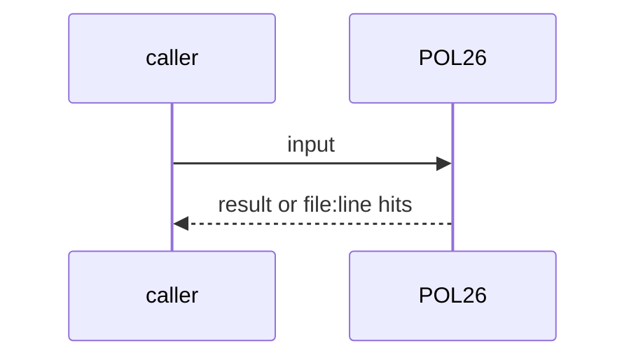
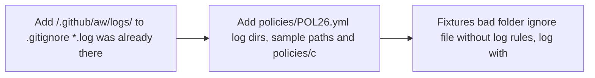

# POL26: Run logs gitignored and scanned by gitleaks
- Status: done
- PR: #4
- Area: policies
- Wave: W1
- Block: 1
- Lane: Builder
- Depends on: C01, POL04
- proof: bash policies/checks/POL26.sh test/fixtures/bad/POL26/ (exit 1); bash policies/checks/POL26.sh test/fixtures/good/POL26/ (exit 0); ./scripts/verify.sh runs POL26 in repo mode
- door: two-way
- triage: build (Reviewer bar PA3)
- feedback: bash policies/checks/POL26.sh on both fixture folders, then ./scripts/verify.sh
- harness: none (script run by scripts/verify.sh)
- review-input: diff + this PBI + DoD (+ linked spec) + PR description, never builder session logs (PA6)
- kind: script
- Source: PA2, PA3, D6 https://github.com/svennijhuis/agentic-workflows/pull/4 https://www.warp.dev/blog/using-llm-as-a-judge-scoring-to-measure-your-software-factory
## Goal
Run logs never land in git: every log path is ignored by `.gitignore`, no run log is tracked, and gitleaks scans every log folder that exists on disk.
## Context
D6: scoring needs traces with prompts, tool calls and MCP results, which can hold tokens. PA3: logs are redacted, kept for the scoring window only, never committed. PA2: gitleaks runs over every stored artifact. `gh aw logs` and `gh aw audit` write to `.github/aw/logs` by default (gh-aw v0.93.4 help).
## Steps
1. Add `/.github/aw/logs/` to `.gitignore` (`*.log` was already there).
2. Add `policies/POL26.yml` (log dirs, sample paths) and `policies/checks/POL26.sh`.
3. Fixtures: bad folder (ignore file without log rules, log with a fake token), good folder (rules, redacted log). Allowlist the bad folder in `.gitleaks.toml` and POL04.
## Definition of Done
- [x] POL26 red on the bad folder (3 sample paths not ignored, gitleaks github-pat hit)
- [x] POL26 green on the good folder and on the repo
- [x] Repo mode fails on any tracked file under a log dir
- [x] verify.sh runs POL26
## Technical design
- Components and files: `.gitignore`, `policies/POL26.yml`, `policies/checks/POL26.sh`, `test/fixtures/bad/POL26/`, `test/fixtures/good/POL26/`, `.gitleaks.toml`, `policies/checks/POL04.sh`
- Module boundary: POL26.yml (log dirs and samples) is the interface; git check-ignore and gitleaks run behind it
- Interfaces: `file:line POL26 message`, exit 1 on a hit; fixture folders use a file named `gitignore` so it stays inert
- Sequence:

- Failure modes: gitleaks missing is a VERIFY failure, never a skip
- Security: gitleaks runs with `--redact`; the fake token sits only in the allowlisted bad fixture
- Observability: One line per hit in verify.sh
- Cost: 0 AIC
- Rollback: Remove POL26.sh; keep the ignore rule
- Proof: same as proof: above
- Door: two-way (revert is one commit)
## Evidence
Verify log on the exact head SHA of PR #4 (Q0, Actions billing blocked).
## Flow

## Named asks for Sven
none
## Cost
0 AIC
## Sources
- [agentic-workflows PR #4 room (PO additions PA1 to PA9)](https://github.com/svennijhuis/agentic-workflows/pull/4)
- [Warp blog, LLM-as-a-judge scoring](https://www.warp.dev/blog/using-llm-as-a-judge-scoring-to-measure-your-software-factory)
- Strategy id list v3.12 (aw-final-ids.md), url-learnings.md PA2, PA3, D6
