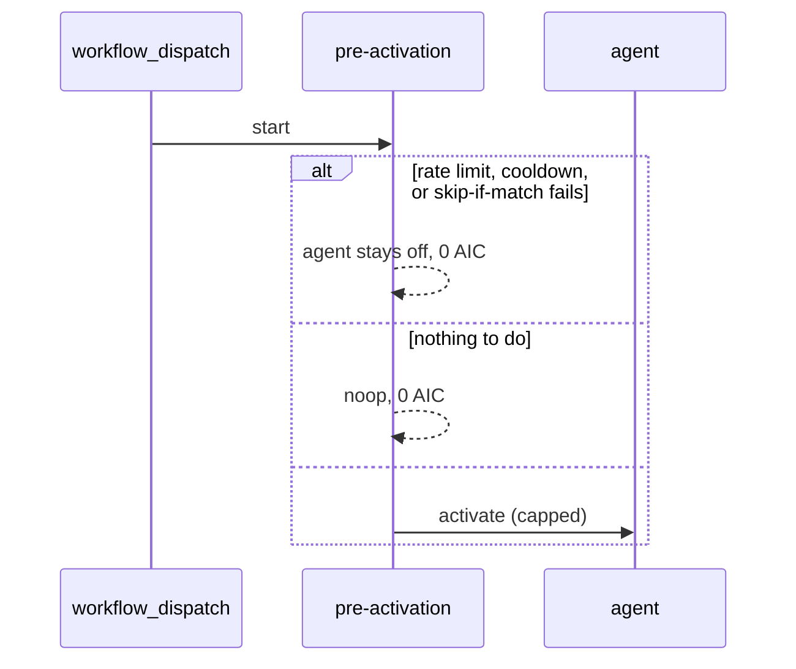
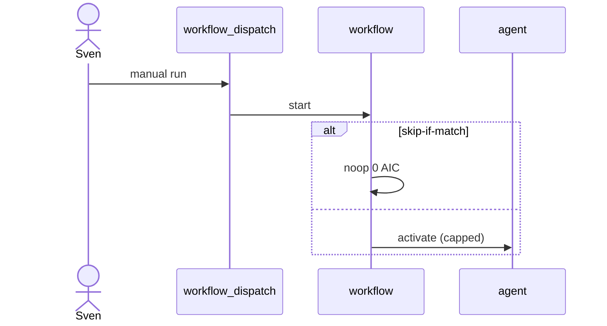

# R01: Dispatch, fuzzy schedule, cooldown
- Status: done
- PR: #31
- Area: triggers
- Wave: PR 0
- Block: 2
- Lane: Cursor CLI
- Depends on: C03
- proof: make verify
- door: two-way
- triage: build (dispatch, cooldown, and rate limits; fuzzy schedule described only)
- feedback: `make verify` exits 0 and `actionlint .github/workflows/verify.yml` exits 0
- harness: gh-aw v0.93.4 compile for the catalog workflow and the R01 fixtures; no live run
- review-input: diff + this PBI + DoD (+ linked spec) + PR description, never builder session logs
- kind: skill
- Source: PA1 https://github.github.com/gh-aw/reference/triggers/ https://github.github.com/gh-aw/specs/fuzzy-schedule-specification/
## Goal
Standardize workflow_dispatch as the first trigger for every workflow, then document fuzzy schedules and cooldown only after explicit Sven approval.
## Context
M03 hourly cron stays off until Sven yes and measured cost. Fuzzy schedule spreads load. Cooldown and concurrency come from shared/defaults.md and workflow frontmatter caps.
## Steps
1. Require workflow_dispatch on all catalog workflows with safe inputs.
2. Document fuzzy schedule syntax for future M03/F03 schedules.
3. Define cooldown defaults per workflow class (review vs daily report).
4. Link cost admission: noop and skip-if-match before agent activation.
## Definition of Done
- [x] Every workflow PBI lists primary trigger: dispatch first.
- [x] Schedule additions require Sven yes recorded in Evidence.
- [x] Rate limits and concurrency documented with examples in shared/defaults.md.
## Technical design
- Components and files: `workflows/shared/defaults.md`, `workflows/squad-review.md` and its lock and card, `docs/reference/triggers.md`, `policies/POL25.yml` settings, `test/fixtures/good/POL25-cooldown.md`, `test/fixtures/bad/POL25-cooldown-schedule.md`, `test/fixtures/r01/review-dispatch.md`, `test/fixtures/r01/daily-report-dispatch.md`, workflow PBI trigger lines, `docs/pbi/README.md`
- Module boundary: `workflows/shared/defaults.md` states the class defaults. The catalog workflow sets `on.cooldown` because a shared fragment cannot carry `on:`. `user-rate-limit` stays on `test/fixtures/r01/` until the compiler warning is gone. The review fixture sets `ignored-roles: []` so 5 runs per 60 minutes binds the owner.
- Interfaces: `on.workflow_dispatch` inputs, `on.cooldown` (Go duration, minimum `5m`), `user-rate-limit` (`max-runs-per-window`, `window`, `events`, `ignored-roles`), `on.skip-if-match`, `on.skip-if-no-match`, `concurrency` (`job-discriminator`)
- Sequence:

- Failure modes: `on.cooldown` under `5m` fails compile; `daily at 9am` fails compile; a `schedule` key without a `sven_yes` row fails POL25
- Security: no secrets; dispatch input `pr` is a required number; rate limit and skip-if-match run in pre-activation, not in the agent prompt
- Observability: lock comments name cooldown and skip-if-match; `GH_AW_COOLDOWN_SECONDS` is the compiled wait
- Cost: 0 AIC (offline compile, no run)
- Rollback: revert the PR
- Proof: same as proof: above
- Door: two-way
## Evidence
Offline only. No `gh aw trial`, no `gh aw run`, no schedule in `workflows/` or in the good fixtures. `policies/POL25.yml` `sven_yes` stays `[]`. Sven has not approved M03 or F03 schedules (named ask, separate yes). A future schedule needs that yes in this kind of Evidence section and a `sven_yes` row before the key exists. `on.cooldown`, `on.skip-if-match`, and `on.skip-if-no-match` are listed in POL25 `settings` so those guards are not read as event triggers. `test/fixtures/good/POL25-cooldown.md` is the dispatch-plus-guards case, including `skip-if-no-match`. `test/fixtures/bad/POL25-cooldown-schedule.md` is `workflow_dispatch` plus `cooldown` plus `schedule` and exits 1 with one hit. `make compile` also compiles a copy of `test/fixtures/r01/`, and POL25 scans that directory, so a `schedule` key there fails the gate.

`workflows/squad-review.md` is `workflow_dispatch` only, with required number input `pr`, `on.cooldown: 15m`, concurrency `squad-review-${{ github.event.inputs.pr }}`, and `job-discriminator: ${{ github.run_id }}`. `user-rate-limit` is an experimental compiler feature (it prints a warning), so the installed workflow does not set it. The review fixture compiles that key (5 per 60 minutes, `ignored-roles: []` so the owner is not exempt) and the daily-report fixture compiles `20h`, 1 per 180 minutes with `ignored-roles: []`, and `skip-if-match`. Neither fixture is installed.

Fuzzy strings were compiled with gh-aw v0.93.4 `--schedule-seed svennijhuis/agentic-workflows` on a throwaway file outside `workflows/`, then deleted. Scattered cron for that seed: `hourly` and `every 1h` -> `24 */1 * * *`; `daily` -> `21 13 * * *`; `daily around 9am` -> `49 8 * * *`. `daily at 9am` failed compile. `on.cooldown: 4m` failed (minimum `5m`). `15m` compiles to 900 seconds. `20h` compiles to 72000 seconds.

`make verify` on gh-aw v0.93.4 exited 0. Tail: catalog compile `1 succeeded, 0 warnings`; r01 fixture compile `2 succeeded, 2 warnings` (experimental rate limiting); `# POL25 repo`; `# POL25 fixtures` `38 bad cases, 9 good cases`; `# POL31 repo`; `# POL31 fixtures` `8 bad cases, 1 good cases`; `0 failures`. `actionlint .github/workflows/verify.yml` exited 0 with no findings. `actionlint workflows/squad-review.lock.yml` reports the same three compiler-emitted findings as main (`job.workflow_ref`, permission `copilot-requests`, concurrency `queue`). No new finding class.

(verify log on the PR head SHA is in the PR body; Q0, Actions billing blocked)
## Flow

## Named asks for Sven
(none (M03 schedule needs separate yes))
## Cost
n/a
## Sources
- https://github.github.com/gh-aw/reference/triggers/
- https://github.github.com/gh-aw/reference/schedule-syntax/
- https://github.github.com/gh-aw/specs/fuzzy-schedule-specification/
- https://github.github.com/gh-aw/patterns/dispatch-ops/
