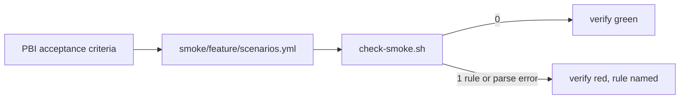
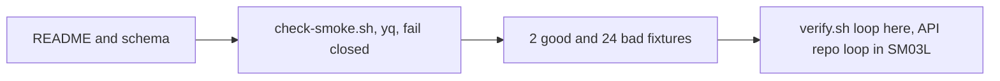

# SM01: Smoke scenario format and folder per feature
- Status: done
- PR: #11
- Area: smoke
- Wave: W3
- Block: 3
- Lane: Builder
- Depends on: none
- proof: `bash scripts/check-smoke.sh test/fixtures/smoke/good.yml` and `good-dotted.yml` exit 0 and each of the 24 `test/fixtures/smoke/bad-*.yml` exits exactly 1, in the `scripts/verify.sh` loop; `./scripts/verify.sh` ends with `0 failures`
- door: two-way
- triage: build
- feedback: `scripts/check-smoke.sh` exits 0 on the good fixture and 1 on each bad fixture (proof)
- harness: none (script)
- review-input: diff + this PBI + DoD (+ linked spec) + PR description, never builder session logs (PA6)
- kind: script (deterministic)
- Source: PA8 (no D row; Sven, Development Agentic Workflows room, 2026-10-25 17:48 and 17:50 (post-deploy smoke on tst/acc, Azure AD JWT)) https://github.com/svennijhuis/agentic-workflows/pull/5
- Gate: [SM08](../smoke/SM08-cursor-findings.md) finding 7 (Cursor review 5648771343 on PR #5) and Cursor review 5654162636 finding 4 (on PR #8) are folded in here. Per the Strategy split check (2026-10-26) SM08 closes when the last of its target PBIs merges, so this build carries its SM08 rows.
## Goal
One plain format for API smoke scenarios, one folder per feature, so writer (SM02) and runner (SM03) share one contract.
## Context
Where things live. The API repo `svennijhuis/<api repo>` (placeholder, Sven names it in SM07) holds the real scenario folders `smoke/<feature>/scenarios.yml` and runs `scripts/check-smoke.sh` in its own verify. This catalog (agentic-workflows) holds the authoring copy (`smoke/README.md`, `smoke/_schema.yml`, `scripts/check-smoke.sh`) and the fixtures. POL23 only runs `policies/checks/POLnn.sh`, so check-smoke.sh gets its own good and bad loop, like the TPL01 loop in `scripts/verify.sh`.
## Steps
1. Write `smoke/README.md` and `smoke/_schema.yml`.
2. Write `scripts/check-smoke.sh` (yq); any yq or parse error exits 1.
3. Fixtures: good, good-dotted, prd env, env not in the allowlist, write without test_data_only, missing expect, broken YAML, absolute URL path, protocol-relative path, unknown method, lowercase method, auth unknown, auth missing, token in a header, token in `id`, one per secret prefix family, query key, unknown header, duplicate key, duplicate id.
4. Wire the loop into `scripts/verify.sh` here. The same loop in the API repo verify moved to the live item SM03L (the API repo is not named yet, SM07).
## Definition of Done
- [x] `smoke/<feature>/scenarios.yml` schema documented in `smoke/README.md`
- [x] Fields: id, env, method, path, auth (none|smoke-jwt), expect.status, expect.json (jsonpath equals/exists), test_data_only: true for any write
- [x] `env` is exactly `tst` or `acc` (allowlist, not a prd denylist): empty, `prd`, `prod`, `production` or any other value exits 1
- [x] `path` is relative: starts with exactly one `/`, no scheme, no host (the host comes only from SMOKE_BASE_URL, SM03)
- [x] A `path` that starts with `//` exits 1 (a URL join reads `//host` as a new host)
- [x] Every `method` other than exactly `GET` or `HEAD` counts as a write (`PURGE` and `post` included)
- [x] A write without `test_data_only: true` exits 1
- [x] A file that does not parse (yq error) exits 1 (fail closed)
- [x] A missing `auth`, or `auth` other than `none` or `smoke-jwt`, exits 1 (SM08 finding 7)
- [x] A token-shaped scalar on any key exits 1: three dot-separated segments of 10 or more `[A-Za-z0-9_-]` chars, or a value starting with `Bearer ` (SM08 finding 7). Both token fixtures set `auth: none` and differ from a valid scenario only by the scalar that holds the `FAKE` plus zeros shape (a header, and `id`) (Cursor 5654162636 finding 4)
- [x] Header names are an allowlist (any case): `Accept`, `Content-Type`, `If-None-Match`, `X-Request-Id`; any other name exits 1, so `Authorization`, `Proxy-Authorization`, `Cookie`, `Set-Cookie` and `X-Key` all fail; auth only via `auth:` (Reviewer FAIL 6424438867 item 1, Strategy allowlist)
- [x] Any value (path, query, headers, ids) starting with `Basic ` or `Token ` (any case), or with a secret prefix at a word start (`gh[opsu]_`, `github_pat_`, `sk_live_`, `sk_test_`, `xox[abpr]-`, `AKIA` plus 16 `[0-9A-Z]`), exits 1 (Reviewer FAIL 6424438867 item 2, Tester FAIL)
- [x] A query key `token=`, `access_token=`, `api_key=`, `key=` or `secret=` (any case, after `?` or `&`) in `path` exits 1 (Tester FAIL)
- [x] A duplicate key in any map exits 1 (yq keeps the last one); a duplicate `id` in one file exits 1; `--help` prints usage and exits 0 (Tester FAIL)
- [x] Bad fixtures, each exits 1: `test/fixtures/smoke/bad-prd-env.yml`, `bad-env-not-allowed.yml`, `bad-write-no-test-data.yml`, `bad-missing-expect.yml`, `bad-broken.yml`, `bad-absolute-url.yml`, `bad-protocol-relative.yml` (`path: //evil.example/a`), `bad-method-unknown.yml` (`method: PURGE`, no `test_data_only`), `bad-method-lowercase.yml` (`method: post`, no `test_data_only`), `bad-auth-unknown.yml` (`auth: basic`), `bad-auth-missing.yml` (no `auth` key), `bad-auth-token.yml` (`auth: none`, header value `FAKE0000000000.FAKE0000000000.FAKE0000000000`), `bad-auth-token-id.yml` (`auth: none`, the same shape on `id`), `bad-header-unknown.yml` (`X-Foo`), `bad-auth-basic.yml` (`Basic FAKE...`), `bad-auth-token-prefix.yml` (`Token FAKE...`), `bad-auth-ghp.yml` (`ghp_FAKE...`), `bad-auth-github-pat.yml`, `bad-auth-sk.yml` (`sk_live_FAKE...`), `bad-auth-xox.yml` (`xoxb-FAKE...`), `bad-auth-akia.yml`, `bad-query-key.yml` (`?limit=1&api_key=FAKE...`), `bad-dup-env.yml` (`env: prd` then `env: tst`), `bad-dup-id.yml`; each gives exactly one hit; good `test/fixtures/smoke/good.yml` and `good-dotted.yml` (`path: /v1.2.3`) exit 0; no real or JWT-prefixed token in any file
- [x] `scripts/verify.sh` loop: each good exits 0, each bad exits exactly 1, one `file:line RULE message` line per hit (the API repo loop moved to SM03L)
## Technical design
- Components and files: catalog: `smoke/README.md`, `smoke/_schema.yml`, `scripts/check-smoke.sh`, `test/fixtures/smoke/{good,bad-*}.yml`, `scripts/verify.sh`; API repo files move to SM03L
- Module boundary: `smoke/<feature>/scenarios.yml` plus `scripts/check-smoke.sh` (exit 0/1); the schema rules (env allowlist, relative path, auth, expect, test_data_only) sit behind it
- Interfaces: input scenarios.yml; exit 0 ok, 1 failed or did not parse (PA5); output `file:line SMOKE message`
- Sequence:

- Failure modes: bad scenario fails verify with the field named; broken YAML fails closed with exit 1
- Security: no URLs with secrets, no tokens in files; host never in a scenario, base URL only from the environment var SMOKE_BASE_URL
- Observability: verify log line per file
- Cost: 0
- Rollback: revert the PR
- Proof: same as proof: above
- Door: two-way (docs, script and fixtures; revert is one commit)
## Evidence
verify log on SHA, bad fixture outputs; gate log comment on PR #11
## Flow

## Named asks for Sven
- Name the API repo (`svennijhuis/<api repo>`) that holds the scenario folders (SM07).
## Cost
0 (script)
## Sources
- Sven, Development Agentic Workflows room, 2026-10-25 17:48 and 17:50
- [PR #5 Cursor review at 17510cc, finding 6](https://github.com/svennijhuis/agentic-workflows/pull/5)
- [PR #5 Cursor review at bf26b0e, finding 5](https://github.com/svennijhuis/agentic-workflows/pull/5#pullrequestreview-5648588578)
