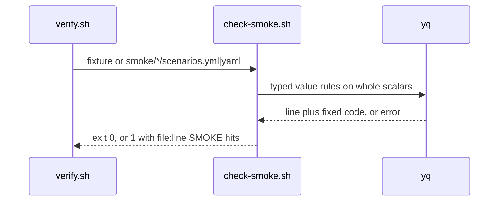
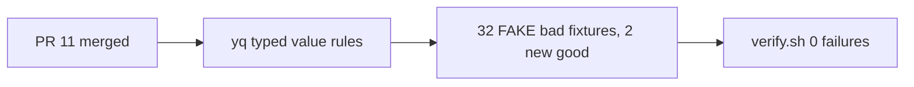

# SM01a: check-smoke.sh hardening follow-ups (fail closed on values, carry from #11)
- Status: done
- PR: #0
- Area: smoke
- Wave: W3
- Block: 3
- Lane: Builder
- Depends on: SM01 ([PR #11](https://github.com/svennijhuis/agentic-workflows/pull/11), merged to main at 9680af0; `scripts/check-smoke.sh` is on main)
- proof: each of the 32 new `test/fixtures/smoke/bad-*` cases below exits exactly 1 under `bash scripts/check-smoke.sh` (row 11 as a two-file call), `good.yml`, `good-dotted.yml` and the new `good-json-oneline.yml` and `good-query-encoded.yml` exit 0, in the `scripts/verify.sh` loop; `./scripts/verify.sh` ends with `0 failures`
- door: two-way
- triage: build (the open findings Sven's 2-round cap moved off PR #11 at 68b63f2: Cursor reviews 5657322997 f1 to f4 and 5657407855 f1 to f7, Reviewer comment 6424620155 and Tester comment 6424705361; each one exits 0 today and gets one FAKE bad fixture)
- feedback: `bash scripts/check-smoke.sh` on each new bad fixture exits 1 with one hit; the good fixtures exit 0; `./scripts/verify.sh` gives `0 failures`
- harness: none (script)
- review-input: diff + this PBI + DoD (+ linked spec) + PR description, never builder session logs (PA6)
- kind: script (deterministic)
- Source: PA8 (no D row; Sven, Development Agentic Workflows room, 2026-10-26 19:34 "Please do not 4 round we will fix issues later and add on list") https://github.com/svennijhuis/agentic-workflows/pull/11#pullrequestreview-5657322997 and https://github.com/svennijhuis/agentic-workflows/pull/11#issuecomment-6424620155 https://github.com/svennijhuis/agentic-workflows/pull/11#issuecomment-6424705361
## Goal
Close the gaps left open on #11 with typed, allowlisted values, not more patterns, so `scripts/check-smoke.sh` fails closed on every value it reads.
## Context
SM01 ships `scripts/check-smoke.sh` in [PR #11](https://github.com/svennijhuis/agentic-workflows/pull/11). Under Sven's 2-round cap (2026-10-26 19:34) Reviewer and Tester passed #11 at 68b63f2 with the findings below still open. Each one was reproduced with `scripts/check-smoke.sh` from 68b63f2 on a copy of `test/fixtures/smoke/good.yml` with one value changed, and each exits 0 today (no hit). #11 merged at 9680af0, so this PBI can start.

Fix map (Strategy draft plus the Tester PASS 6424705361 and the Cursor run on 68b63f2, review 5657407855; line numbers are `scripts/check-smoke.sh` at 68b63f2):

| # | Source | Gap (exits 0 at 68b63f2) | Fix |
|---|---|---|---|
| 1 | Cursor 5657322997 f1 medium, 5657407855 f2 high | `status: 0x1000` (and `0o1130`): yq tags it `!!int`, `tostring` keeps `0x1000`, `[ "$status" -gt 599 ]` at :73 prints `integer expression expected` and the `elif` never calls `hit` (fails open) | the status literal must match `^[0-9]+$` first (read as the raw scalar text, so `0x12C` and `0o144` are hits even though yq tags them `!!int` with a value inside the range), then the range test on the numeric value (100 to 599); exit 1 when yq or the compare cannot decide (Cursor 5657575895 f1 high on PR #15: `0x1000` is 4096 and `0o1130` is 600, both outside the range, so a range test alone catches them but still fails open on `0x12C`, which is 300; Cursor 5657764107 f4 medium on PR #15: `0o144` is 100 and a `0b` literal yq tags `!!int` inside 100..599, so a check that only rejects the `0x` prefix still fails open; both get their own fixture; Cursor 5658018053 f1 medium on PR #15: `status: +200` and `2_00` are `!!int` inside the range and exit 0 today, so a prefix-only denylist of `0x`, `0o` and `0b` must fail them, and each gets its own fixture) |
| 2 | Cursor 5657322997 f2 medium, 5657407855 f1 high | a token, `Bearer ` or `ghp_` value split by a newline (`\n` escape or a block scalar) in `expect.json[].equals` or a header (`X-Request-Id: "ok\nghp_FAKE0000000000"`); a leading space makes `@tsv` quote the value, so `Accept: "  bearer FAKE00000000"` passes; a token (the `@tsv` read at :40 is one physical line at a time, so the rest of the scalar is never tested), and on one line with a short middle segment (`FAKE000000.e30.FAKE000000000`, `e30` is under 10 chars) | run the token `test()` inside yq on the whole scalar, print only `line` plus a fixed code, exit 1 when that yq call fails; JWT shape is three dot segments with a short middle allowed, or an `eyJ` start; move the `env`, `path`, `auth` reads into yq too so a newline cannot drop a field |
| 3 | Cursor 5657322997 f3 low, 5657407855 f5 low | `exists: "true"` (`!!str`): `.exists != true` at :26 treats the string as equal | `exists` must be tag `!!bool` and value `true`, same as `test_data_only` |
| 4 | Cursor 5657322997 f4 low, 5657407855 f7 low, Tester 6424705361 | `docs/pbi/README.md` the Block 3 `**PBIs:**` line (line 437 once this PR lands, line 435 on main at f184995) still says "SM01-SM07 smoke (docs only so far)" and line 56 says SM01 waits on SM08, while #11 marks SM01 done; `docs/pbi/smoke/README.md:2` (Tester: `smoke/README.md:2`) still has the old order with SM08 first | #11 (9680af0) already fixed line 56 and the smoke README gate line, so only two lines are still old: the Block 3 `**PBIs:**` sentence "SM01-SM07 smoke (docs only so far)" and the order line at `docs/pbi/smoke/README.md:2` (SM08 first). Update both to the 2026-10-26 split (SM01 build carries its SM08 rows, SM08 closes after its last target PBI); line 56 keeps main's split sentence plus SM01a (Cursor 5657764107 f1 medium on PR #15) |
| 5 | Reviewer 6424620155 item 5, Tester 6424705361 | `#access_token` fragment: `path: /x#access_token=FAKE0000000000`; the same fragment hidden as `%23` (`path: /x%23access_token=FAKE0000000000`) has no raw `#` and the query split never sees it (Cursor 5657575895 f3 medium) | `path` must not contain `#` raw or after one percent-decode of the whole path; a path that still holds `%` after that one decode is a hit. Both fragment fixtures still hold the plaintext `access_token`, so a raw keyword search passes them without a decode; a third fixture `/x%2523%2561ccess_token=FAKE0000000000` has no raw `#`, no plaintext key, and still holds `%` after one decode (Cursor 5657764107 f3 medium on PR #15) |
| 6 | Reviewer 6424620155 item 5, Tester 6424705361 | `?client_secret=` and `?password=` query keys (the key list at :61 has only token, access_token, api_key, key, secret) | query key allowlist in `smoke/_schema.yml`, shipped with one key, `limit` (the #11 `test/fixtures/smoke/good.yml` and the `smoke/README.md` example use `path: /api/orders?limit=1`, which must keep exiting 0), and the same list stated in `smoke/README.md`; any other query key is a hit (Cursor 5657575895 f2 medium: an empty list would fail `good.yml`). |
| 7 | Reviewer 6424620155 item 5, Tester 6424705361 | `glpat-` prefix: `path: /x/glpat-FAKE0000000000` (PREFIX at :11 has no GitLab family) | add `glpat-` to the prefix list |
| 8 | Reviewer 6424620155 item 5 | a JWT in the path: `path: /x/FAKE000000.e30.FAKE000000000` | same yq token rule as row 2, run on `path` |
| 9 | Reviewer 6424620155 item 6 (round 1 low) | `.yaml` glob: `scripts/verify.sh` at 68b63f2 already loops `smoke/*/scenarios.yaml` (:105), but the fixture loops (:103, :104) read only `good*.yml` and `bad-*.yml`, so a `bad-*.yaml` fixture is never run | the bad fixture loop (:104) also reads `bad-*.yaml`; the good loop stays `good*.yml`, and a glob that matches nothing is skipped with the same `[ -e ]` guard as :105 (Cursor 5658018053 f4 low) |
| 10 | Product Owner gap list | unique ids per file | done in #11 (duplicate id fixture `bad-dup-id.yml` exits 1, Reviewer probed it) |
| 11 | Product Owner gap list, probe | the same `id` in two different smoke files: `check-smoke.sh a.yml b.yml` exits 0 (`ids` resets per file in `check_file`) | ids unique across all files in one call; a repeat in a second file is a hit on that file |
| 12 | Tester 6424705361 | `?sig=FAKE0000000000` and `;token=FAKE0000000000` (`;` is not a query separator in the :61 regex) | same allowlist as row 6; split query and matrix params on `?`, `&` and `;` |
| 13 | Tester 6424705361 | URL-encoded query keys: `?%74oken=FAKE0000000000` | percent-decode the key exactly once before the allowlist; a key that still holds `%` after that one decode is a hit. Lock it with a good `?%6cimit=1` that exits 0 only because one decode gives `limit`, and a bad `?%256cimit=1`: one decode gives `%6cimit` (still holds `%`, a hit) and a second decode would give the allowed `limit`, so exit 1 proves exactly one decode (Cursor 5657575895 f3 medium: `?%74oken=` exits 1 under deny by default even with no decode, so it does not prove the decode; Cursor 5657764107 f2 medium: `?%2574oken=` is not `limit` after any number of decodes, so it does not prove it either). Also `?limit=1&password=FAKE0000000000` (same shape as #11 `bad-query-key.yml`), so a check of only the first key cannot pass |
| 14 | Tester 6424705361, Cursor 5657407855 f4 medium | prefixes `ghr_`, `xoxe-`, `rk_live_` and `sk-` plus 20 alphanumerics (FAKE plus zeros; the literal is not written here because POL20 would flag it) exit 0; PREFIX at :11 is `gh[opsu]_` while POL20 uses `gh[pousr]_` | use `gh[pousr]_`, add `xoxe-`, `rk_live_` and `rk_test_` and an `sk-` alternative matching POL20; one bad fixture per Stripe restricted key prefix (live and test), each added to the `.gitleaks.toml` allowlist because gitleaks 8.28 rule `stripe-access-token` flags a FAKE plus zeros suffix of 10 or more chars (Cursor 5657575895 f4 medium) |
| 15 | Tester 6424705361 | `Basic`, `Token` and `Bearer` are caught only at the start of a value: `X-Request-Id: "id Bearer FAKE0000000000"` exits 0 (:42 anchors with `^`) | match the scheme word followed by a space and a token-like run anywhere in the scalar |
| 16 | Cursor 5657407855 f3 medium | false hit: two maps on one line that reuse a key, `json: [{path: $.items, exists: true}, {path: $.n, equals: 1}]`, exits 1 with `duplicate key 'path'` (KEYS at :18 keys by map line, `uniq -d` at :35 pools every map) | find duplicate keys inside each map in the yq filter, never across maps |
| 17 | Cursor 5657407855 f6 low | false hit: id `orders list` then id `list` exits 1 (substring test at :64) | exact match per id (associative array or `grep -Fxq`); `id` a non-empty `!!str` with no whitespace |

Rows 16 and 17 are false hits (a valid file fails), not leaks; they get good fixtures. Review 5657322997 is posted on commit 68b63f2 but its body says "Cursor review at eab0e53"; 5657407855 is the run on 68b63f2.
## Steps
1. On main after #11 (9680af0), move the value checks of rows 1 to 3, 5 to 8 and 11 to 17 into yq (whole scalars, tags checked), keeping the `file:line SMOKE message` output and exit 0, 1, 2.
2. Add the query key allowlist (`limit` only) to `smoke/_schema.yml` and `smoke/README.md`, and the two rk fixture paths to `.gitleaks.toml`.
3. Fix the fixture loops in `scripts/verify.sh` for `.yaml` (row 9) and the two README lines (row 4): the Block 3 `**PBIs:**` sentence and `docs/pbi/smoke/README.md:2`.
4. Add the bad fixtures below, FAKE plus zeros values only, each differing from `good.yml` by one value.
5. Run `./scripts/verify.sh` twice, `bash scripts/check-pbi-docs.sh`, `bash scripts/check-pbi-template.sh`, gitleaks.
6. Move this file to `docs/pbi/done/` with `- Status: done` and `- PR: #<n>`, update the README rows.
## Definition of Done
- [x] Row 1: `test/fixtures/smoke/bad-status-hex.yml` (`status: 0x1000`) exits 1 with one hit, no bash compare error on stderr
- [x] Row 1: `bad-status-hex-inrange.yml` (`status: 0x12C`, value 300, inside 100..599) exits 1 with one hit from the `^[0-9]+$` literal rule
- [x] Row 1: `bad-status-oct-inrange.yml` (`status: 0o144`, value 100) and `bad-status-bin-inrange.yml` (`status: 0b1100100`, value 100) each exit 1 with one hit from that same literal rule
- [x] Row 1: `bad-status-plus.yml` (`status: +200`) and `bad-status-underscore.yml` (`status: 2_00`) each exit 1 with one hit from that same literal rule (Cursor 5658018053 f1)
- [x] Row 2: `bad-equals-token-oneline.yml` (`equals: FAKE000000.e30.FAKE000000000`) exits 1
- [x] Row 2: `bad-auth-token-multiline.yml` (the FAKE token in `equals` split by a newline) exits 1
- [x] Row 2: `bad-auth-newline.yml` (`X-Request-Id: "ok\nghp_FAKE0000000000"`) exits 1
- [x] Row 2: `bad-auth-bearer-space.yml` (`Accept: "  bearer FAKE00000000"`) exits 1
- [x] Row 3: `bad-exists-string.yml` (`exists: "true"`) exits 1
- [x] Row 4: the Block 3 `**PBIs:**` line with "SM01-SM07 smoke (docs only so far)" and the order line at `docs/pbi/smoke/README.md:2` match the 2026-10-26 split (line 56 and the smoke README gate line were fixed by #11)
- [x] Row 5: `bad-path-fragment.yml` (`path: /x#access_token=FAKE0000000000`) exits 1
- [x] Row 5: `bad-path-fragment-encoded.yml` (`path: /x%23access_token=FAKE0000000000`) exits 1
- [x] Row 5: `bad-path-double-encoded.yml` (`path: /x%2523%2561ccess_token=FAKE0000000000`, no raw `#`, no plaintext key, still holds `%` after one decode) exits 1
- [x] Row 6: `bad-query-client-secret.yml` (`?client_secret=FAKE0000000000`) exits 1
- [x] Row 6: `bad-query-password.yml` (`?password=FAKE0000000000`) exits 1
- [x] Row 6: `smoke/_schema.yml` and `smoke/README.md` list `limit` as the only allowed query key and say any other key is a hit; `good.yml` (`?limit=1`) still exits 0
- [x] Row 7: `bad-auth-glpat.yml` (`glpat-FAKE00000000000000`) exits 1
- [x] Row 8: `bad-path-jwt.yml` (`path: /x/FAKE000000.e30.FAKE000000000`) exits 1
- [x] Row 9: `bad-yaml-ext.yaml` (a bad scenario saved as `.yaml`) is run by the verify fixture loop and exits 1
- [x] Row 10: `bad-dup-id.yml` from #11 still exits 1 (no change)
- [x] Row 11: `test/fixtures/smoke/bad-dup-id-cross/a.yml` plus `b.yml` (same `id` in both) exits 1 when passed together, and the verify loop runs that pair as one case
- [x] Row 12: `bad-query-sig.yml` (`?sig=FAKE0000000000`) and `bad-query-semicolon.yml` (`;token=FAKE0000000000`) each exit 1
- [x] Row 13: `bad-query-encoded.yml` (`?%74oken=FAKE0000000000`) exits 1
- [x] Row 13: new good `good-query-encoded.yml` (`?%6cimit=1`) exits 0, and exits 1 if the decode step is removed
- [x] Row 13: `bad-query-double-encoded.yml` (`?%256cimit=1`: one decode is `%6cimit`, which still holds `%`; a second decode would be the allowed `limit`) exits 1, so a check that decodes more than once fails it
- [x] Row 13: `bad-query-second-key.yml` (`?limit=1&password=FAKE0000000000`) exits 1
- [x] Row 14: `bad-auth-ghr.yml`, `bad-auth-xoxe.yml`, `bad-auth-rk-live.yml`, `bad-auth-rk-test.yml` and `bad-auth-sk-dash.yml` (FAKE plus zeros after the prefix) each exit 1
- [x] Row 14: `.gitleaks.toml` allowlist gets one path entry each for `test/fixtures/smoke/bad-auth-rk-live.yml` and `bad-auth-rk-test.yml` (no wider glob), and gitleaks stays clean with them in the tree
- [x] Row 15: `bad-auth-scheme-mid.yml` (`X-Request-Id: "id Bearer FAKE0000000000"`) exits 1
- [x] Row 16: new good `good-json-oneline.yml` (two `expect.json` items on one line sharing `path`) exits 0; `bad-dup-env.yml` still exits 1
- [x] Row 17: `good-json-oneline.yml` also holds ids `orders-list` and `list` and exits 0; `bad-id-space.yml` (an id with whitespace) exits 1
- [x] `good.yml` and `good-dotted.yml` (`path: /v1.2.3`) still exit 0
- [x] `./scripts/verify.sh` ends with `0 failures` (run twice); `bash scripts/check-pbi-docs.sh` and `bash scripts/check-pbi-template.sh` print nothing; gitleaks clean; no em or en dash; `policies/checks/POL23.sh` untouched
- [x] No real or JWT-prefixed token in any file (FAKE plus zeros only)
- [ ] A fresh Cursor review on the SM01a PR head has no open medium or above
## Technical design
- Components and files: `scripts/check-smoke.sh`, `smoke/_schema.yml`, `smoke/README.md`, `.gitleaks.toml` (two rk fixture paths only), `scripts/verify.sh` (smoke fixture loops only), `test/fixtures/smoke/bad-*.yml`, `bad-yaml-ext.yaml`, `bad-dup-id-cross/`, `good-json-oneline.yml`, `good-query-encoded.yml`, `docs/pbi/README.md`, `docs/pbi/smoke/README.md`
- Module boundary: `scripts/check-smoke.sh FILE...` (exit 0, 1, 2, `file:line SMOKE message`) stays the only interface; the typed yq value rules sit behind it
- Interfaces: input one or more `scenarios.yml` or `.yaml` files; output one line per hit; exit 0 ok, 1 a hit or a value yq cannot decide, 2 needs-human (yq missing)
- Sequence:

- Failure modes: a yq error or an undecidable compare is a hit (exit 1), never a pass; a missing yq is exit 2
- Security: offline, no tokens, FAKE fixtures only; closes token and secret leaks in scenario files
- Observability: `file:line SMOKE message` lines in the verify log
- Cost: 0 (script)
- Rollback: revert the SM01a PR
- Proof: same as proof: above
- Door: two-way (script and fixtures only, nothing enabled)
## Evidence
Probes on 68b63f2 (`scripts/check-smoke.sh` from #11, one value changed in a copy of `good.yml`): rows 1, 2 (newline split, leading space, short middle), 3, 5 to 8 and 11 to 15 exit 0, and the valid files of rows 16 and 17 exit 1. A one-line token with three 10+ char segments in `equals` or `path` already exits 1.
## Flow

## Todo (carried, not built here)
SM01b (`../smoke/SM01b.md` when on main) only exists on PR #18 and is not on main yet, so the low findings from PR #15 sit here until #18 merges; whoever merges second moves them to SM01b.
- [ ] Cursor 5657764107 f5 low and Cursor 5658018053 f5 low (PBI template, ARC08): `docs/pbi/docs/TPL02-template-backfill.md` L26, the G05 DoD item lists ten Technical design fields and omits `Module boundary`. G05 already has that line above the Definition of Done, and a rewrite that adds exactly the ten listed fields would drop the line `check-pbi-template.sh` requires. Fix: move `Module boundary` into the section below the DoD and list it with the other fields (eleven).
## Named asks for Sven
none
## Cost
0 (script)
## Sources
- Cursor review 5657322997 on PR #11 at 68b63f2: https://github.com/svennijhuis/agentic-workflows/pull/11#pullrequestreview-5657322997
- Cursor review 5657407855 on PR #11 at 68b63f2: https://github.com/svennijhuis/agentic-workflows/pull/11#pullrequestreview-5657407855
- Reviewer PASS comment 6424620155: https://github.com/svennijhuis/agentic-workflows/pull/11#issuecomment-6424620155
- Tester PASS comment 6424705361: https://github.com/svennijhuis/agentic-workflows/pull/11#issuecomment-6424705361
- Cursor review 5657575895 on PR #15 at 030ee71 (f1 to f4 and f6 folded into rows 1, 4, 5, 6, 13 and 14): https://github.com/svennijhuis/agentic-workflows/pull/15#pullrequestreview-5657575895
- Sven 2026-10-26 19:34, 2-round cap, leftovers to a todo PBI
- Cursor review 5657764107 on PR #15 at d6881e4 (f1 to f4 medium folded into rows 1, 4, 5 and 13; f5 low in the Todo section): https://github.com/svennijhuis/agentic-workflows/pull/15#pullrequestreview-5657764107
- Cursor review 5658018053 on PR #15 at 368f837 (f1 medium folded into row 1; f4 low into row 9; f5 low in the Todo section): https://github.com/svennijhuis/agentic-workflows/pull/15#pullrequestreview-5658018053
