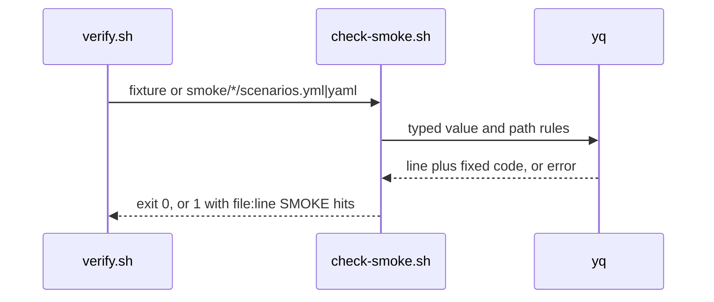
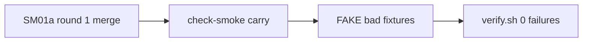

# SM01c: check-smoke carry from PR #20 round 1 lows and Cursor 5723663360
- Status: done
- PR: #24
- Area: smoke
- Wave: W3
- Block: 3
- Lane: Builder
- Depends on: SM01a
- proof: each bad fixture named in Context exits 1 under `bash scripts/check-smoke.sh`; `good-token-refresh.yml` exits 0; `./scripts/verify.sh` ends with `0 failures` twice; both PBI checks print nothing
- door: two-way
- triage: build (round 1 lows on PR #20 plus Cursor high 5723452369 and lows 5723663360, same file `scripts/check-smoke.sh`)
- feedback: `scripts/check-smoke.sh` exits 1 on each bad case and 0 on each good case in the DoD; `./scripts/verify.sh` ends with `0 failures` (proof)
- harness: none (script)
- review-input: diff + this PBI + DoD (+ linked spec) + PR description, never builder session logs (PA6)
- kind: script (deterministic)
- Source: PA8 (Tester 6535761517 and Reviewer 6535832889 on PR #20 at aca48a1; Cursor reviews 5723452369 and 5723663360 on PR #20) https://github.com/svennijhuis/agentic-workflows/pull/20#issuecomment-6535761517 https://github.com/svennijhuis/agentic-workflows/pull/20#issuecomment-6535832889 https://github.com/svennijhuis/agentic-workflows/pull/20#pullrequestreview-5723663360
## Goal
Close the low findings left open after SM01a round 1 on PR #20 and the encoded-path host switch from Cursor, without weakening existing smoke gates.
## Context
SM01a round 1 on PR #20 fixed token keys, decoded-path query keys, int64 status compare, newline-split tokens and empty id stderr. Tester 2 and Reviewer left the items below for a follow-up PBI. Cursor review 5723663360 on PR #20 adds one high row (decoded-path relative rules) and three low rows (scheme false positive, unicode separator bypass, README order line).

Fix map:

| # | Source | Gap (exits 0 today) | Fix |
|---|---|---|---|
| 0 | Cursor 5723452369 high, 5723663360 f1 high | host, backslash and whitespace checks ran on the raw path only; `/%2fevil.example/a`, `/%5cevil.example/a`, `/api/%20orders`, `/api/%0aorders` and `%00` exited 0 | after one successful path decode, rerun the leading-`//`, backslash and whitespace rules; reject `%00` on the raw path; decoder writes with no extra newline and a sentinel keeps a trailing decoded newline (`/api/orders%0a`) from being stripped by the shell (`bad-path-dec-host.yml`, `bad-path-dec-backslash.yml`, `bad-path-dec-space.yml`, `bad-path-dec-newline.yml`, `bad-path-dec-trailing-newline.yml`, `bad-path-nul.yml`) |
| 1 | Cursor f4 low on PR #20 | the second copy of an id in one file is reported as `duplicate id across files` and again as `duplicate id` (`bad-dup-id.yml` gives two hits) | run the in-file duplicate check before updating `GLOBAL_IDS`; emit `across files` only when the id was seen in an earlier file |
| 2 | Tester 6535761517 low | `path: /api/x/%67hp_FAKE...` (encoded `g` in the prefix) exits 0 | run the token rules on the path after one percent-decode as well as on raw scalars (`bad-path-enc-ghp-prefix.yml`) |
| 3 | Tester 6535761517 low; Cursor 5723663360 | `?limit=1&password` with no `=` on the second key exits 0 | treat a query segment with no `=` as a key name and apply the allowlist (`bad-query-key-no-eq.yml`) |
| 4 | Tester 6535761517 low | `status: 0200` exits 0 (leading zero, still in range) | reject HTTP status literals with a leading zero (`bad-status-leading-zero.yml`; rule text in `smoke/README.md`) |
| 5 | Cursor 5723663360 f2 low | `X-Request-Id: "token refresh"` and `equals: "token refresh"` false hit on lowercase `token` scheme match | narrow scheme match: `Bearer`/`Basic` case insensitive, `Token` capital T only; good `good-token-refresh.yml`. Superseded in PR #24 (Tester 2 6548986713, Cursor 5724950625 f6): `token` is case insensitive everywhere and only the exact `token refresh` with nothing after it is allowed (`bad-token-scheme-lower.yml`, `bad-token-refresh-tail.yml`) |
| 6 | Cursor 5723663360 f3 low | `Bearer` split by vertical tab, form feed, NEL, U+2028/U+2029 or NBSP still exits 0 | python scalar pass reruns the token rules with those separators stripped (split prefix) and as a space (scheme then token), NBSP counts as space (`bad-auth-unicode-separator.yml`, `Bearer` U+2028 FAKE; VT and FF were already caught by yq `[[:space:]]`) |
| 7 | Cursor 5723663360 f4 low | `docs/pbi/smoke/README.md:2` order line still leads with SM08; Block 3 sentence omits SM01c | lead the order line with SM01a done then SM01b/SM01c build; name SM01c in the Block 3 `**PBIs:**` sentence (docs only) |

Bad cases (FAKE only): one fixture per row 0 to 4 and rows 5 to 6, each exiting 1 with one hit under `scripts/check-smoke.sh`. Row 7 is docs only.
## Steps
1. Extend `scripts/check-smoke.sh` per the fix map (rows 0 to 6).
2. Add bad and good fixtures per row; the existing verify loop picks them up.
3. Update `smoke/README.md` and PBI README rows (row 7).
4. Run `./scripts/verify.sh` twice; `bash scripts/check-pbi-docs.sh` and `bash scripts/check-pbi-template.sh` print nothing.
## Definition of Done
- [x] Row 0: `bad-path-dec-host.yml`, `bad-path-dec-backslash.yml`, `bad-path-dec-space.yml`, `bad-path-dec-newline.yml`, `bad-path-dec-trailing-newline.yml` and `bad-path-nul.yml` each exit 1 with one hit
- [x] Row 1: `bad-dup-id.yml` exits 1 with one hit (in-file duplicate only)
- [x] Row 2: `bad-path-enc-ghp-prefix.yml` exits 1 with one hit
- [x] Row 3: `bad-query-key-no-eq.yml` exits 1 with one hit
- [x] Row 4: `bad-status-leading-zero.yml` exits 1 with one hit
- [x] Row 5: `good-token-refresh.yml` exits 0
- [x] Row 6: `bad-auth-unicode-separator.yml` exits 1 with one hit
- [x] Row 7: smoke and PBI README order lines updated
- [x] `good.yml` and the other good smoke fixtures still exit 0; SM01b `good-query-enc-limit.yml` still exits 0; SM01a `bad-query-double-encoded.yml` still exits 1
- [x] `./scripts/verify.sh` ends with `0 failures` (run twice); both PBI checks print nothing; no em or en dash; POL23 untouched
## Technical design
- Components and files: `scripts/check-smoke.sh`, `test/fixtures/smoke/bad-*`, `smoke/README.md` (rows 0 and 4 rule text), `docs/pbi/README.md`, `docs/pbi/smoke/README.md`, `scripts/verify.sh` loop unchanged
- Module boundary: `scripts/check-smoke.sh FILE...` exit 0/1/2 and `file:line SMOKE message` output stay the only interface; duplicate-id order and path decode token rules sit behind it
- Interfaces: input one or more `scenarios.yml` or `.yaml` files; output one line per hit
- Sequence:

- Failure modes: yq error or undecidable compare is a hit (exit 1), never a pass
- Security: offline, FAKE fixtures only
- Observability: `file:line SMOKE message` lines in the verify log
- Cost: 0 (script)
- Rollback: revert the SM01c PR
- Proof: same as proof: above
- Door: two-way (script and fixtures only)
## Evidence
Probes on PR #20 head aca48a1 and Cursor 5723663360 at d1d7ff7: rows 0 to 6 covered by fixtures above. Mutation run on main 14998b6: every row 0 to 4 and row 6 bad fixture exits 0 there, `bad-dup-id.yml` gives two hits there, `good-token-refresh.yml` exits 1 there; after this PBI each bad exits 1 with one hit and the good exits 0. Gate log comment on PR #24.
## Flow

## Named asks for Sven
none
## Cost
0 (script)
## Sources
- Tester 2 FAIL comment 6535761517 on PR #20: https://github.com/svennijhuis/agentic-workflows/pull/20#issuecomment-6535761517
- Reviewer FAIL comment 6535832889 on PR #20: https://github.com/svennijhuis/agentic-workflows/pull/20#issuecomment-6535832889
- Cursor review 5723452369 on PR #20: https://github.com/svennijhuis/agentic-workflows/pull/20#pullrequestreview-5723452369
- Cursor review 5723663360 on PR #20: https://github.com/svennijhuis/agentic-workflows/pull/20#pullrequestreview-5723663360
