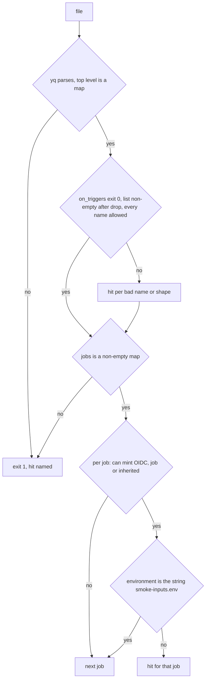
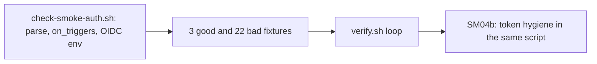

# SM04a: Smoke auth check, part 1 (check-smoke-auth.sh: parse, triggers, OIDC environment rule)
- Status: done
- PR: #17
- Area: smoke
- Wave: W3
- Block: 3
- Lane: Builder
- Depends on: VF01 (done, #10). Part of [SM04](../smoke/SM04.md); SM04b (token hygiene, same script) is next. Not SM07 (offline)
- proof: in the `scripts/verify.sh` smoke auth loop, `bash scripts/check-smoke-auth.sh` exits 0 on each of the 3 `test/fixtures/smoke-auth/good*.yml` and exits exactly 1 with one hit on each of the 22 `test/fixtures/smoke-auth/bad-*.yml`; `./scripts/verify.sh` ends with `0 failures`
- door: two-way
- triage: build (offline check part of SM04, split out by Strategy on 2026-10-26; token hygiene is SM04b, the template step and live probes moved to SM03b and SM03L)
- feedback: the `scripts/verify.sh` smoke auth loop: each good fixture exits 0, each bad fixture exits 1 with exactly one `file:line SMOKEAUTH message` line
- harness: none (script)
- review-input: diff + this PBI + DoD (+ [SM04](../smoke/SM04.md), [SM08](../smoke/SM08-cursor-findings.md) findings 1 and 2, Cursor review 5654162636 findings 2 and 3) + PR description, never builder session logs (PA6)
- kind: script (deterministic)
- Source: PA8 (Sven, Development Agentic Workflows room, 2026-10-25 17:48 and 17:50; split by Strategy, SM04 parts, 2026-10-26) https://github.com/svennijhuis/agentic-workflows/pull/5
- Gate: [SM08](../smoke/SM08-cursor-findings.md) findings 1 and 2 (Cursor reviews on PR #5) and Cursor review 5654162636 findings 2 and 3 (on PR #8) are folded in here. Per the Strategy split check (2026-10-26) SM08 closes when the last of its target PBIs merges, so this build carries its SM08 rows.
## Goal
An offline check that fails a smoke workflow file when it could run on a trigger other than `workflow_dispatch` or `workflow_call`, or when a job that can mint a GitHub OIDC token does not run in its own `smoke-${{ inputs.env }}` environment. Then a wrong federated subject (for example `environment:nonprod`) can not land unseen.
## Context
SM04 mixed an offline check with Sven's Azure setup and a live probe run. Strategy split it: SM04a is the check for parse, triggers and the OIDC environment rule; SM04b adds token hygiene (secrets, mask, debug trace, roles) to the same script; the template auth step and the README auth chain go to SM03b; the first live run probe table goes to SM03L.

SM08 finding 1 (high): triggers are read only through `on_triggers` in `scripts/lib/on-triggers.sh`, never `yq '.on | keys'`, so scalar, list and map forms are read alike and its exit 2 (parse error or bad shape) and exit 3 (no `on:`) are hits. SM08 finding 2 (medium): the environment rule covers every job that has or inherits `id-token: write`, and `permissions: write-all` counts as `id-token: write`. Cursor 5654162636 finding 2: a scalar and a list of allowed names must pass, so there are good fixtures for both. Finding 3: workflow-level `write-all` inherited by a job with no `permissions` key must fail too, while `read-all` grants nothing.

POL23 only runs `policies/checks/POLnn.sh`, so `check-smoke-auth.sh` gets its own loop in `scripts/verify.sh`, like SM01 and SM07a. The loop sits right after the shellcheck producer, away from the lines PRs #11, #14 and #16 add, so they merge in any order.
## Steps
1. `scripts/check-smoke-auth.sh FILE...`: parse, then triggers through `on_triggers`, then `jobs`, then the OIDC environment rule per job.
2. Fixtures in `test/fixtures/smoke-auth/`: 3 good, 22 bad, one hit each.
3. `scripts/verify.sh` loop: each good exits 0, each bad exits 1 with exactly one hit line.
## Definition of Done
- [x] A file that does not parse, or whose top level is not a map, exits 1 and stops there (`bad-broken.yml`)
- [x] Triggers are read only with `on_triggers`; its exit 2 and exit 3 are hits; after dropping `roles`, `skip-bots`, `skip-roles` the list must be non-empty and every name `workflow_dispatch` or `workflow_call` (an allowlist, so an unnamed trigger fails too) (SM08 finding 1)
- [x] Trigger bad fixtures, each exits 1 with one hit: `test/fixtures/smoke-auth/bad-trigger-deployment-status.yml`, `bad-trigger-workflow-run.yml`, `bad-trigger-repository-dispatch.yml`, `bad-trigger-push.yml` (scalar `on: push`), `bad-trigger-pull-request.yml`, `bad-trigger-schedule.yml`, `bad-trigger-release.yml` (map, named nowhere in the check), `bad-trigger-list.yml` (`on: [workflow_dispatch, issue_comment]`), `bad-trigger-settings-only.yml` (`on: {roles: [admin]}`), `bad-trigger-no-on.yml` (exit 3), `bad-trigger-on-shape.yml` (`on: 1`, exit 2)
- [x] A job can mint an OIDC token when its `permissions` is `write-all` or has `id-token: write`, or when it has no `permissions` key and the workflow `permissions` does; `permissions: {}` and `read-all` grant nothing (SM08 finding 2, Cursor 5654162636 finding 3)
- [x] Each such job declares `environment` as exactly the string `smoke-${{ inputs.env }}`; a map, null or any other string exits 1
- [x] Environment bad fixtures, each exits 1 with one hit: `bad-no-environment.yml`, `bad-nonprod-environment.yml`, `bad-env-inputs.yml` (bare `${{ inputs.env }}`), `bad-env-hardcoded.yml` (`smoke-tst`), `bad-prd-subject.yml` (`prd`), `bad-prod-subject.yml` (`production`), `bad-env-object.yml` (a map whose `name` is the right string, so only the string form passes), `bad-inherited-id-token.yml` (workflow-level `id-token: write`), `bad-write-all.yml` (job `write-all`), `bad-write-all-inherited.yml` (workflow-level `write-all`)
- [x] Good fixtures, each exits 0: `test/fixtures/smoke-auth/good.yml` (guard job `permissions: {}` and no `environment`, smoke job on `smoke-${{ inputs.env }}`, report job `read-all` and no `environment`), `good-trigger-scalar.yml` (`on: workflow_dispatch`), `good-trigger-list.yml` (`on: [workflow_dispatch, workflow_call]`) (Cursor 5654162636 finding 2)
- [x] `scripts/verify.sh` loop for `check-smoke-auth.sh` (SM01 style): each good exits 0, each bad exits exactly 1 with one hit; `--help` prints usage and exits 0; yq missing exits 2 (needs-human)
- [ ] Token hygiene rows of SM04 (secrets, mask, debug trace, roles, `good-comment-party-star.yml`): SM04b, not this PR
## Technical design
- Components and files: `scripts/check-smoke-auth.sh`, `test/fixtures/smoke-auth/` (3 good, 22 bad), `scripts/verify.sh` (loop)
- Module boundary: `check-smoke-auth.sh FILE...` with exit 0/1/2 and one `file:line SMOKEAUTH message` per hit; the parse, the `on_triggers` read and the permissions inheritance sit behind it
- Interfaces: input one or more GitHub workflow YAML files; exit 0 ok, 1 a hit (fail closed), 2 needs-human (yq missing); `--help`
- Sequence:

- Failure modes: a file that does not parse, a bad `on:` shape, a missing `on:`, a trigger outside the allowlist, or an OIDC job on the wrong environment fails verify with the line and rule named; yq missing exits 2 (needs-human), never 0
- Security: no secret values, client ids, tenant ids or URLs in the repo; fixtures hold only names and placeholders; no workflow is added under `.github/workflows`, nothing runs live
- Observability: verify log line per hit
- Cost: 0
- Rollback: revert the PR
- Proof: same as proof: above
- Door: two-way (script and fixtures; revert is one commit)
## Evidence
verify log on the PR head SHA, one hit line per bad fixture; gate log comment on PR #17
## Flow

## Named asks for Sven
- None for this PR.
## Cost
0 (script)
## Sources
- [SM04](../smoke/SM04.md) DoD and [SM08](../smoke/SM08-cursor-findings.md) findings 1 and 2
- Cursor review 5654162636 on PR #8, findings 2 and 3 https://github.com/svennijhuis/agentic-workflows/pull/8#pullrequestreview-5654162636
- https://docs.github.com/en/actions/security-for-github-actions/security-hardening-your-deployments/about-security-hardening-with-openid-connect (subject claim carries the job environment)
