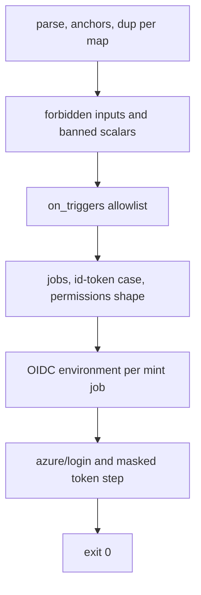

# SM04b: Smoke auth check, part 2 (check-smoke-auth.sh token hygiene and PR #17 lows)
- Status: done
- PR: #22
- Area: smoke
- Wave: W3
- Block: 3
- Lane: Builder
- Depends on: SM04a (done, #17). Part of [SM04](../smoke/SM04.md); live template auth step and README chain stay in SM03b; first run probe table stays in SM03L
- proof: in the `scripts/verify.sh` smoke auth loop, `bash scripts/check-smoke-auth.sh` exits 0 on each of the 5 `test/fixtures/smoke-auth/good*.yml` and exits exactly 1 with one hit on each of the 81 `test/fixtures/smoke-auth/bad-*.yml`; `./scripts/verify.sh` ends with `0 failures`
- door: two-way
- triage: build (token hygiene part of SM04, split out by Strategy on 2026-10-26; SM04a landed parse, triggers and the OIDC environment rule in #17)
- feedback: the `scripts/verify.sh` smoke auth loop: each good fixture exits 0, each bad fixture exits 1 with exactly one `file:line SMOKEAUTH message` line
- harness: none (script)
- review-input: diff + this PBI + DoD (+ [SM04](../smoke/SM04.md), Cursor 5658105243 f1, Reviewer 6425694406 lows 1 and 2 on PR #17, Cursor 5721745072 and 5723767631 on PR #22, Tester 2 6546014746, Reviewer 6546017537) + PR description, never builder session logs (PA6)
- kind: script (deterministic)
- Source: PA8 (Sven, Development Agentic Workflows room, 2026-10-25 17:48 and 17:50; split by Strategy, SM04 parts, 2026-10-26) https://github.com/svennijhuis/agentic-workflows/pull/5
## Goal
Extend `check-smoke-auth.sh` so smoke workflow YAML fails closed on secret-shaped inputs, ROPC, wrong roles, missing or late token masking, debug trace, and non-lowercase `id-token` permission values; fix duplicate-key detection so flow-style `on:` maps on one line do not false-positive.
## Context
SM04a added parse, triggers through `on_triggers`, permissions shape and the OIDC environment rule (29 bad, 3 good fixtures). SM04b adds token hygiene on every job that can mint `id-token: write` and passes the environment rule: `azure/login@v2` from `vars.AZURE_*`, a single masked `az account get-access-token` step, and bans on parsed values (comments that mention `party.*` do not trip the check).

PR #17 low 1 (Cursor 5658105243 f1, Reviewer 6425694406): duplicate keys are detected within each map node, not by `(line, key)` across sibling inline maps; `good-flow-on-line.yml` passes. Low 2: any `id-token` permission value other than exactly `write` is a hit (`bad-id-token-write.yml`).

PR #22 fix round 1 (Tester 2 comment 6540392309, Cursor 5721745072): every `get-access-token` step must mask its captured variable; token reads (printf, curl, same line as capture or mask) before `::add-mask::` are hits; yq read failures on workflow inputs, scalars, or `id-token` values exit 1; forbidden and banned values run on every step `run` and `env` scalar including multiline blocks; shell debug trace and `ACTIONS_STEP_DEBUG` true or 1 on any workflow, job, or step; `azure/login@v2` pin on every login step.

PR #22 fix round 2 (Cursor 5723767631 at `1c5e9f0`, Tester 2 6546014746, Reviewer 6546017537): the token step is scanned per shell command (split on `;`, `&&`, `||`, `|`, `&`), so a read on the capture or mask line is a hit; `${TOKEN:...}` and other substring forms are reads, and a substring read after the mask is still a hit; every `az account get-access-token` must be `VAR=$(...)` with `--scope "$SMOKE_API_SCOPE"` on that command, and every captured variable is masked before any read; every `azure/login` step is checked on its own (pin, `vars.*` ids, no `secrets.*` in `with:`); `shell:` and `defaults.run.shell` with `-x` or `xtrace` are hits; `ACTIONS_STEP_DEBUG` and `ACTIONS_RUNNER_DEBUG` set to `true`, `1` or `$true` in any case, or to any expression, are hits; banned values run on every parsed string, multiline included; `on.workflow_call.secrets` names use the same denylist, case insensitive; any `id-token` value other than the string `write` is a hit; later steps of the smoke job must not print, tee, `printenv` or `env` dump the token, or cat `$GITHUB_ENV`. The verify loop also rejects a hit whose line field is empty.

POL23 only runs `policies/checks/POLnn.sh`, so the smoke auth loop in `scripts/verify.sh` stays the proof path, like SM04a.
## Steps
1. Extend `scripts/check-smoke-auth.sh`: duplicate-key fix, id-token case rule, forbidden inputs, banned scalars and mint-job token steps.
2. Fixtures in `test/fixtures/smoke-auth/`: 5 good, 81 bad, one hit each (14 new bad in SM04b base, 10 round-1 bad and 28 round-2 bad on PR #22, 2 new good; existing good files gain auth steps).
3. `scripts/verify.sh` loop: section title (SM04a+SM04b) and a hit must carry a numeric line field.
## Definition of Done
- [x] Duplicate keys: per-map detection (not `(line, key)` across maps); `good-flow-on-line.yml` exits 0 (Cursor 5658105243 f1, Reviewer 6425694406 low 1)
- [x] `id-token` permission values must be exactly lowercase `write` when the key is present; `bad-id-token-write.yml` exits 1 (Reviewer 6425694406 low 2)
- [x] Forbidden workflow inputs: `client_secret`, `clientSecret`, `client-secret`, `password` (`bad-client_secret.yml`, `bad-clientSecret.yml`, `bad-client-secret.yml`, `bad-password.yml`)
- [x] Banned parsed values: `grant_type=password`, `AZURE_USERNAME`, `party.*` role value, Write or Admin role request in the token step (`bad-ropc.yml`, `bad-azure-username.yml`, `bad-party-star.yml`, `bad-write-role.yml`, `bad-admin-role.yml`)
- [x] Mint job token step: `azure/login@v2` with `client-id` and `tenant-id` from `vars.AZURE_CLIENT_ID` and `vars.AZURE_TENANT_ID`, `allow-no-subscriptions: true`; every `az account get-access-token` step with `SMOKE_API_SCOPE` masks its capture variable; no token read before `::add-mask::` (echo, printf, curl, same line as capture or mask); no shell debug trace on any step; no `ACTIONS_STEP_DEBUG` true or 1 at workflow, job, or step (`bad-echo-token.yml`, `bad-printf-token.yml`, `bad-curl-token.yml`, `bad-no-mask.yml`, `bad-mask-after-use.yml`, `bad-mask-wrong-var.yml`, `bad-second-token-no-mask.yml`, `bad-debug-trace.yml`, `bad-debug-xtrace.yml`, `bad-actions-step-debug-job.yml`, `bad-actions-step-debug-workflow.yml`, `bad-login-v1.yml`)
- [x] yq read failures on workflow inputs (map `on:` only), scalars, step run or env scalars, or `id-token` permission values are hits, never exit 0 (`bad-yq-inputs-fail.yml`)
- [x] Forbidden secret-shaped names and banned values in any parsed scalar, including multiline `run` steps (`bad-client-secret-other-step.yml`)
- [x] Good fixtures exit 0: `good.yml`, `good-trigger-scalar.yml`, `good-trigger-list.yml`, `good-comment-party-star.yml` (comment only forbids `party.*`), `good-flow-on-line.yml`
- [x] PR #22 round 2, Cursor 5723767631 item 1: token read on the capture or mask line, and substring reads, are hits (`bad-same-line-echo.yml`, `bad-same-line-curl.yml`, `bad-token-substr.yml`, `bad-token-substr-after-mask.yml`)
- [x] Cursor 5723767631 item 2: every `get-access-token` is a masked `VAR=$(...)` assignment (`bad-az-stdout.yml`, `bad-second-var-same-step.yml`)
- [x] Cursor 5723767631 item 3: every `azure/login` step is checked with its own `with:` (`bad-second-login-secret.yml`); verify rejects a hit with an empty line field
- [x] Cursor 5723767631 item 4: `shell:` debug trace and case variants of debug values (`bad-shell-bash-x.yml`, `bad-actions-step-debug-true.yml`)
- [x] Cursor 5723767631 item 5: banned values in every parsed string, block scalars included (`bad-job-env-block.yml`, `bad-workflow-env-block.yml`)
- [x] Cursor 5723767631 item 6: `on.workflow_call.secrets` names use the denylist (`bad-call-secret.yml`)
- [x] Cursor 5723767631 item 7: `--scope "$SMOKE_API_SCOPE"` on the assignment, not anywhere in the step (`bad-scope-comment.yml`)
- [x] Cursor 5723767631 item 8: `party.*` inside a string (`bad-party-star-run.yml`); `good-comment-party-star.yml` still exits 0
- [x] Cursor 5723767631 item 9: non-string `id-token` values (`bad-id-token-bool.yml`)
- [x] Reviewer 6546017537: `add-mask` and an echo of the token on the same line (`bad-same-line-mask-echo.yml`)
- [x] Tester 2 6546014746: later smoke job steps that echo, tee, `printenv` or `env` dump the token, or cat `$GITHUB_ENV` (`bad-later-smoke-token-echo.yml`, `bad-later-tee-token.yml`, `bad-later-printenv.yml`, `bad-later-env-dump.yml`, `bad-later-cat-github-env.yml`); `ACTIONS_RUNNER_DEBUG` and `ACTIONS_STEP_DEBUG` from an expression (`bad-actions-runner-debug.yml`, `bad-actions-step-debug-expr.yml`)
- [x] SM04c lows (Cursor 5723767631, Tester 2 6540392309): `Password` input, `client-secret` from `secrets.*` on `azure/login`, `orders.write`, `Orders.ReadWrite`, `orders.admin` (`bad-forbidden-input-case.yml`, `bad-login-client-secret.yml`, `bad-write-role-case.yml`, `bad-readwrite-role-case.yml`, `bad-admin-role-case.yml`)
- [x] `scripts/verify.sh` smoke auth loop: each good exits 0, each bad exits exactly 1 with one hit and a numeric line; `./scripts/verify.sh` ends with `0 failures`
- [ ] Live federated subjects, APIM probe table, and `smoke/templates/smoke-run.yml` auth step: SM07, SM03b, SM03L (not this PR)
## Technical design
- Components and files: `scripts/check-smoke-auth.sh`, `scripts/lib/on-triggers.sh` (import only), `test/fixtures/smoke-auth/` (5 good, 81 bad), `scripts/verify.sh` (loop title)
- Module boundary: SM04a rules unchanged in intent; SM04b adds phases 2 to 7 after parse and before exit; one `file:line SMOKEAUTH message` per hit
- Interfaces: `check-smoke-auth.sh FILE...` exit 0/1/2; `--help`
- Sequence:

- Failure modes: first hit names file and line; yq missing exits 2 (needs-human)
- Security: FAKE test data only in fixtures; no secret values in repo files
- Observability: verify log one line per bad fixture
- Cost: 0
- Rollback: revert the PR
- Proof: same as proof: above
- Door: two-way
## Evidence
verify log on the PR head SHA, one hit line per bad fixture
## Flow

## Copy this
Standalone smoke auth gate for another repo (FAKE fixtures only, no secret values):

| Path | Role |
| --- | --- |
| `scripts/check-smoke-auth.sh` | Entrypoint: `bash scripts/check-smoke-auth.sh FILE...` (exit 0 ok, 1 hit, 2 needs-human when yq is missing) |
| `scripts/lib/on-triggers.sh` | Imported by the check (`source` from `scripts/lib/`) |
| `test/fixtures/smoke-auth/good*.yml` | Must all exit 0 |
| `test/fixtures/smoke-auth/bad-*.yml` | Must each exit 1 with exactly one `file:line SMOKEAUTH message` line |

Copy those paths preserving layout under `scripts/` and `test/fixtures/smoke-auth/`. Wire the same loop as `scripts/verify.sh` (SM04a+SM04b smoke auth section) or call the script in CI on workflow YAML paths. Requires `yq` on PATH. Does not copy workflows, policies, or live Azure or GitHub settings.

## Named asks for Sven
- None for this PR (SM07 setup and first live run stay in SM07 and SM03L).
## Cost
0 (script)
## Sources
- [SM04](../smoke/SM04.md) DoD rows for `check-smoke-auth.sh` token hygiene
- Cursor review 5658105243 on PR #17, finding 1 (flow-style `on:` duplicate false positive)
- Reviewer 6425694406 on PR #17, lows 1 and 2 (duplicate keys, `id-token` case)
- Cursor review 5721745072 on PR #22 (mask order, yq fail closed, multiline scalars, debug trace, login pin)
- Cursor review 5723767631 on PR #22 at `1c5e9f0` (items 1 to 10 and the SM04c lows)
- Tester 2 comment [6546014746](https://github.com/svennijhuis/agentic-workflows/pull/22#issuecomment-6546014746) and Reviewer comment [6546017537](https://github.com/svennijhuis/agentic-workflows/pull/22#issuecomment-6546017537) on PR #22 (lows)
