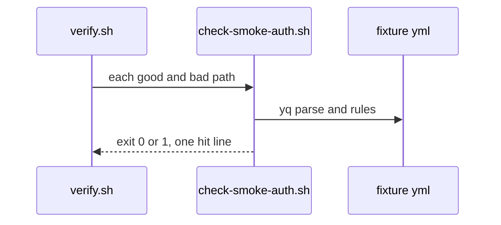
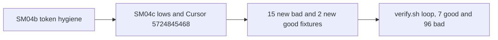

# SM04c: check-smoke-auth.sh hardening follow-ups (PR #22 lows and Cursor 5724845468, fail closed)
- Status: done
- PR: #27
- Area: smoke
- Wave: W3
- Block: 3
- Lane: Builder
- Depends on: SM04b (done, #22). Part of [SM04](../smoke/SM04.md); same script as SM04a and SM04b
- proof: in the `scripts/verify.sh` smoke auth loop, `bash scripts/check-smoke-auth.sh` exits 0 on each of the 7 `test/fixtures/smoke-auth/good*.yml` and exits exactly 1 with one hit on each of the 96 `test/fixtures/smoke-auth/bad-*.yml`; `./scripts/verify.sh` ends with `0 failures`
- door: two-way
- triage: build (Tester 2 lows on PR #22 at 8ea04b8, comment 6540392309, moved off the SM04b fix round under Sven's 2-round cap; Cursor review 5724845468 on PR #22 at e60f72a, 3 high, 2 medium, 2 low, not fixed before the #22 merge)
- feedback: `bash scripts/check-smoke-auth.sh` on each new bad fixture exits 1 with one hit; each new good fixture exits 0; `./scripts/verify.sh` gives `0 failures`
- harness: none (script)
- review-input: diff + this PBI + DoD (+ [SM04](../smoke/SM04.md), Tester 2 comments 6540392309 and 6546014746, Reviewer 6546017537, Cursor 5723767631 and 5724845468 on PR #22) + PR description, never builder session logs (PA6)
- kind: script (deterministic)
- Source: PA8 (Sven, Development Agentic Workflows room, 2026-10-31; Tester 2 FAIL comment 6540392309 and Cursor review 5724845468 on PR #22) https://github.com/svennijhuis/agentic-workflows/pull/22#pullrequestreview-5724845468
## Goal
Close the gaps left on PR #22 so `scripts/check-smoke-auth.sh` fails closed on token captures that leak through a pipe or redirect, any use of the token before or after the mask other than the `GITHUB_ENV` export, secrets on `azure/login` in any form, a replaced `SMOKE_API_SCOPE`, and the shell shapes the per-command splitter does not model (heredoc, `eval`, functions, quoted separators), without false positives on `set -e`.
## Context
SM04b (#22) fixed the blocking token-hygiene probes from Tester 2 comment 6540392309 and Cursor 5721745072 and 5723767631. Cursor review 5724845468 on PR #22 at `e60f72a` came in after the last fix round and found 7 more gaps (3 high, 2 medium, 2 low); #22 merged at `7066c4a` without them. This PBI fixes all 7 and the one open SM04c row (Cursor 5723767631 item 1 follow-up: the splitter is not quote aware and does not model heredocs, `eval`, or functions).

The fix makes the token step an allowlist: capture, then only `::add-mask::` of that variable, then only the `GITHUB_ENV` export reads it. Any other fragment that reads the token is a hit, so a quote that fools the splitter can only add hits, never hide a read.

POL23 only runs `policies/checks/POLnn.sh`, so the smoke auth loop in `scripts/verify.sh` stays the proof path.
## Steps
1. Extend `scripts/check-smoke-auth.sh` for the rows below without weakening existing rules.
2. Add one FAKE bad fixture per gap under `test/fixtures/smoke-auth/`, each a copy of `good.yml` with one edit, plus 2 good fixtures for the false-positive guard.
3. Run `./scripts/verify.sh`, `bash scripts/check-pbi-docs.sh`, and `bash scripts/check-pbi-template.sh`.
## Definition of Done
- [x] Done in SM04b PR #22 round 2, Tester 2 6540392309 low / Cursor 5723767631: forbidden workflow inputs and `workflow_call` secrets are matched case insensitively (`Password`, `CLIENT_SECRET`, and similar) and exit 1 with one hit; fixtures `bad-forbidden-input-case.yml`, `bad-call-secret.yml`
- [x] Done in SM04b PR #22 round 2, Tester 2 6540392309 low / Cursor 5723767631: any `secrets.*` value under `azure/login` `with:` (including `client-secret`) on every login step is a hit; fixtures `bad-login-client-secret.yml`, `bad-second-login-secret.yml`
- [x] Done in SM04b PR #22 round 1, Tester 2 6540392309 low / Cursor 5721745072: banned values and forbidden secret-shaped names in any multiline `run` or `env` scalar are hits, not only in the `get-access-token` step; fixture `bad-client-secret-other-step.yml`
- [x] Done in SM04b PR #22 round 2, Tester 2 6540392309 low / Cursor 5723767631: Write, ReadWrite and Admin role bans are case insensitive (`orders.write`, `Orders.ReadWrite`, `orders.admin`); fixtures `bad-write-role-case.yml`, `bad-readwrite-role-case.yml`, `bad-admin-role-case.yml`
- [x] Done in SM04b PR #22 round 2, Reviewer 6546017537: `echo "::add-mask::$TOKEN" && echo "$TOKEN"` on one line is a hit; fixture `bad-same-line-mask-echo.yml`
- [x] Done in SM04b PR #22 round 2, Reviewer 6546017537 / Tester 2 6546014746: later smoke job steps that echo, tee, `printenv` or `env` dump the token, or cat `$GITHUB_ENV` are hits; fixtures `bad-later-smoke-token-echo.yml`, `bad-later-tee-token.yml`, `bad-later-printenv.yml`, `bad-later-env-dump.yml`, `bad-later-cat-github-env.yml`
- [x] Done in SM04b PR #22 round 2, Tester 2 6546014746: `ACTIONS_RUNNER_DEBUG` true and `ACTIONS_STEP_DEBUG` from any expression are hits; fixtures `bad-actions-runner-debug.yml`, `bad-actions-step-debug-expr.yml`
- [x] Cursor 5723767631 item 1 follow-up: the splitter stays not quote aware, but in the token step every fragment that reads the token and is not the `GITHUB_ENV` export is a hit, and heredocs (`<<`), `eval` and shell functions are hits; fixtures `bad-token-quoted-split.yml`, `bad-token-heredoc.yml`, `bad-token-eval.yml`, `bad-token-function.yml`
- [x] Cursor 5724845468 item 1 (high): a capture is accepted only as one simple `VAR=$(az account get-access-token ...)` with no `|`, `>`, `<`, `&`, `;`, parentheses or backticks inside; fixtures `bad-capture-pipe-tee.yml`, `bad-capture-redirect.yml`
- [x] Cursor 5724845468 item 2 (high): after a capture only blank lines, comments and `::add-mask::` of that variable may follow until it is masked; `${!name}` indirection and env dumps (`env`, `printenv`, bare `set`, `export -p`, `declare -p`) are hits in the token step; fixtures `bad-premask-printenv.yml`, `bad-premask-indirect.yml`, `bad-token-indirect-after-mask.yml`, `bad-token-step-env-dump.yml`
- [x] Cursor 5724845468 item 3 (high): every `azure/login` step is a hit when any `with:` or step `env` value holds a secrets context (`secrets.`, `secrets[`, `toJSON(secrets)`); fixtures `bad-login-secret-bracket.yml`, `bad-login-step-env-secret.yml`
- [x] Cursor 5724845468 item 4 (medium): a mint job step that assigns, exports, reads into or unsets `SMOKE_API_SCOPE` is a hit, and workflow, job or step `env` may set `SMOKE_API_SCOPE` only to `${{ vars.SMOKE_API_SCOPE }}`; fixtures `bad-scope-assign.yml`, `bad-scope-env-literal.yml`; good `good-scope-env-vars.yml`
- [x] Cursor 5724845468 item 5 (medium): after the mask any read of the captured variable other than the `GITHUB_ENV` export is a hit (heredoc body included); fixtures `bad-token-read-after-mask.yml`, `bad-token-heredoc.yml`
- [x] Cursor 5724845468 item 6 (low): the env-dump rule matches `set` only with no arguments; good `good-later-set-e.yml` (later step runs `set -e` and `set -euo pipefail`) exits 0
- [x] Cursor 5724845468 item 7 (low): [SM04](../smoke/SM04.md) flow diagram and DoD counts match the verify loop (7 good, 96 bad)
- [x] `./scripts/verify.sh` ends with `0 failures`; no secret values in repo files (FAKE names only)
## Technical design
- Components and files: `scripts/check-smoke-auth.sh`, `test/fixtures/smoke-auth/` (15 new bad, 2 new good), `scripts/verify.sh` (loop title only), `docs/pbi/smoke/SM04.md` (counts)
- Module boundary: `check-smoke-auth.sh FILE...` with exit 0/1/2 and one `file:line SMOKEAUTH message` per hit; the token step scan (`scan_token_run`), login check (`check_logins`), env check (`env_debug_hit`) and later-step scan (`later_step_leak`) sit behind the same entrypoint as SM04a and SM04b
- Interfaces: `check-smoke-auth.sh FILE...` exit 0 ok, 1 a hit (fail closed), 2 needs-human (yq missing); `--help`
- Sequence:

- Failure modes: a gap that still exits 0 fails verify through its bad fixture; a false positive fails verify through a good fixture; yq missing exits 2 (needs-human); a capture with `2>/dev/null` inside is now a hit (fail closed, by design)
- Security: FAKE test data only in fixtures (`FAKE_LOGIN_KEY`, `graph.example.invalid`); secret names only in files
- Observability: verify log one line per bad fixture
- Cost: 0
- Rollback: revert the PR
- Proof: same as proof: above
- Door: two-way
## Evidence
- Before the fix (script at `7066c4a`): each of the 15 new bad fixtures exits 0, and `good-later-set-e.yml` exits 1 with "must not dump the environment".
- After the fix: each of the 15 new bad fixtures exits 1 with one hit, both new good fixtures exit 0, and every one of the 86 existing fixtures keeps its exit code (6 hit messages changed wording or row, still one hit each).
- `./scripts/verify.sh` on the PR head: `0 failures` (log in the PR gate comment).

| Fixture | Hit |
| --- | --- |
| `bad-capture-pipe-tee.yml` | token capture must be one simple VAR=$(az account get-access-token ...) with no pipe, redirect or & |
| `bad-capture-redirect.yml` | same |
| `bad-premask-printenv.yml` | only ::add-mask:: of TOKEN may follow the token capture |
| `bad-premask-indirect.yml` | same |
| `bad-token-indirect-after-mask.yml` | indirect expansion ${!...} not allowed in the token step |
| `bad-token-step-env-dump.yml` | token step must not dump the environment |
| `bad-login-secret-bracket.yml` | azure/login must not take a secrets context in with: (client-secret) |
| `bad-login-step-env-secret.yml` | azure/login must not take a secrets context in step env |
| `bad-scope-assign.yml` | step must not set SMOKE_API_SCOPE |
| `bad-scope-env-literal.yml` | job smoke env SMOKE_API_SCOPE must be ${{ vars.SMOKE_API_SCOPE }} |
| `bad-token-heredoc.yml` | heredoc or here-string not allowed in the token step |
| `bad-token-read-after-mask.yml` | token must not be read after ::add-mask:: except the GITHUB_ENV export |
| `bad-token-eval.yml` | eval not allowed in the token step |
| `bad-token-function.yml` | shell function not allowed in the token step |
| `bad-token-quoted-split.yml` | token must not be read after ::add-mask:: except the GITHUB_ENV export |
## Flow

## Named asks for Sven
- None (offline check only).
## Cost
0 (script)
## Sources
- Cursor review [5724845468](https://github.com/svennijhuis/agentic-workflows/pull/22#pullrequestreview-5724845468) on PR #22 at `e60f72a` (items 1 to 7)
- Tester 2 comment 6540392309 on [PR #22](https://github.com/svennijhuis/agentic-workflows/pull/22#issuecomment-6540392309)
- [SM04b](SM04b-token-hygiene.md) (merged scope for token hygiene)
- [SM04](../smoke/SM04.md) parent PBI
