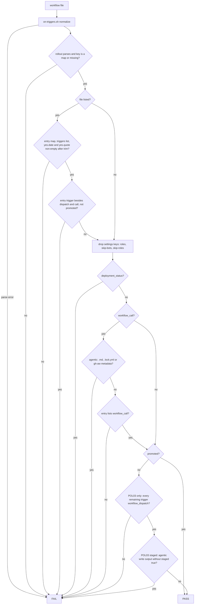
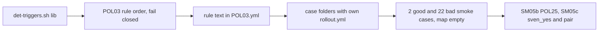

# SM05a: deterministic_triggers lib, POL03 workflow_call allowlist, case folders
- Status: done
- PR: #14
- Area: smoke
- Wave: W3
- Block: 3
- Lane: Builder
- Depends on: VF01 (merged); part of [SM05](../smoke/SM05.md)
- proof: `./scripts/verify.sh` ends with `0 failures`; POL23 inside it runs the 2 good smoke cases `test/fixtures/good/POL03-smoke-*/` (each exits 0), keeps `good/POL03.md` (exits 0), and runs the 22 bad smoke cases `test/fixtures/bad/POL03-smoke-*` (each exits exactly 1)
- door: two-way
- triage: build (first of the three SM05 parts, Strategy split check 2026-10-26)
- feedback: `./scripts/verify.sh`: POL23 runs every `good/POL03-smoke-*` case (exit 0) and every `bad/POL03-smoke-*` case (exit 1); each case folder is checked with its own `rollout.yml` (proof)
- harness: none (script)
- review-input: diff + this PBI + DoD (+ [SM05](../smoke/SM05.md) and [SM08](../smoke/SM08-cursor-findings.md)) + PR description, never builder session logs (PA6)
- kind: script (deterministic)
- Source: PA8 (no D row; Sven, Development Agentic Workflows room, 2026-10-25 17:48 and 17:50 (post-deploy smoke on tst/acc, Azure AD JWT)) https://github.com/svennijhuis/agentic-workflows/pull/5
- Gate: [SM08](../smoke/SM08-cursor-findings.md) finding 3, the POL03 half of findings 5 and 8 (Cursor review 5648771343 on PR #5) and Cursor review 5654162636 finding 6 (on PR #8) are folded in here. Per the Strategy split check (2026-10-26) SM08 closes when the last of its target PBIs merges, so this build carries its SM08 rows.
## Goal
Let a deterministic (non-agentic) workflow be called with `workflow_call` only when `governance/rollout.yml` `deterministic_triggers` lists it with Sven's exact yes, in POL03. `deployment_status` stays forbidden everywhere, agentic workflows never get `workflow_call`. POL25 follows in SM05b (same lib), the `sven_yes` order and the md/lock pair in SM05c.
## Context
Why `workflow_call` and not `deployment_status`: see [SM05](../smoke/SM05.md) Context (the release template runs tst and acc in GitHub environment `nonprod`, so a `deployment_status` event never names `tst` or `acc`).

Before this part, `policies/checks/POL03.sh` had `promoted && return 0` first, so a promoted name could use any trigger, `deployment_status` included, and there was no `workflow_call` allowlist. A directory argument expanded to its `*.md` files only, so a yml case folder passed without a check.

Where the case rollout comes from: the split check put the `POL_ROLLOUT` export in `policies/checks/POL23.sh`. Lane 2 owns `POL23.sh` and `scripts/verify.sh` while PR #13 is open, so this part keeps POL23 untouched. Instead the lib resolves the rollout file per target: `$POL_ROLLOUT` when set, else `<case>/rollout.yml` when the target is a case folder (a directory holding `rollout.yml`), else `governance/rollout.yml`. POL23 already runs each `bad/POL03-*` and `good/POL03-*` directory as one unit, so every case runs with its own `rollout.yml`. A later POL23 export of `POL_ROLLOUT=<case>/rollout.yml` gives the same file and needs no change here.

Rules POL03 applies, in this order, before `promoted && return 0`:
- `on:` that does not parse fails (existing `scripts/lib/on-triggers.sh`).
- A rollout file that is missing or does not parse fails the check for every file.
- A `deterministic_triggers` value that is not a map (a list, a string or null) fails every file. A missing key is an empty map.
- A listed entry (key is the file name, for example `smoke-run.yml`) is always validated: it is a map, `triggers` is a non-empty list of names, `yes.date` and `yes.quote` are non-empty after trimming whitespace. Else that file fails, also when it is dispatch-only.
- An entry trigger other than `workflow_dispatch` and `workflow_call` fails unless the name is on `promoted:` (SM08 finding 5, POL03 half).
- `deployment_status` always fails, listed or promoted.
- `workflow_call` passes only on a non-agentic file whose entry lists it. An agentic `.md`, `*.lock.yml` or gh-aw-metadata yml never gets it.
- The setting keys from `policies/POL25.yml` `settings:` (`roles`, `skip-bots`, `skip-roles`) are dropped before the trigger tests.
- Then `promoted && return 0`, then the existing rules: `workflow_dispatch` must be there, every other trigger needs `promoted:`, and a write output without `safe-outputs.staged: true` needs `promoted:`.
- A case folder must hold exactly one workflow file beside `rollout.yml` (an `X.lock.yml` beside `X.md` counts with it).
## Steps
1. New `scripts/lib/det-triggers.sh`: rollout path, case folder files, map shape, entry check (trim), entry triggers, agentic test. Every error is a message (fail closed).
2. `policies/checks/POL03.sh`: the rule order above, case folders, settings read from `policies/POL25.yml`.
3. `policies/POL03.yml` `rule:` text says the same; the staged sentence stays.
4. `governance/rollout.yml`: `deterministic_triggers: {}`, no entry. The `smoke-run.yml` entry lands in the SM03 PR after Sven's exact yes.
5. Fixtures as listed in the DoD; `./scripts/verify.sh` on the SHA.
## Definition of Done
- [x] `governance/rollout.yml` has `deterministic_triggers: {}` and no entry
- [x] POL03 follows the rule order in Context; the `rule:` text in `policies/POL03.yml` says the same and still says a write output without `safe-outputs.staged: true` needs a `promoted:` entry
- [x] The `deployment_status` fail and the `workflow_call` allowlist run before `promoted && return 0` in `POL03.sh`
- [x] The setting keys from `policies/POL25.yml` `settings:` are dropped before the trigger tests; `test/fixtures/good/POL03.md` and `workflows/squad-review.md` still exit 0
- [x] A rollout file that does not parse, or a `deterministic_triggers` that is a list, a string or null, fails every file (dispatch-only included)
- [x] A listed entry with an empty or whitespace-only `yes.quote` or `yes.date` fails that file even when it is dispatch-only (SM08 finding 8, POL03 half)
- [x] The rollout file is `$POL_ROLLOUT`, else the case folder `rollout.yml`, else `governance/rollout.yml`; a case folder runs only its one workflow file, never `rollout.yml`
- [x] Good cases, each exits 0: `test/fixtures/good/POL03-smoke-runner/` (entry with `workflow_dispatch` and `workflow_call`, valid yes), `good/POL03-smoke-dispatch-unlisted/` (empty map, dispatch-only yml), existing `good/POL03.md`
- [x] Bad cases from SM05 and SM08, each exits 1: `bad/POL03-smoke-missing-key/`, `-rollout-broken/`, `-not-map/`, `-extra-trigger/`, `-no-quote/`, `-deployment-status/`, `-unlisted/`, `-on-broken.yml`, `-quote-empty/`, `-quote-blank/`, `-date-empty/`, `-map-string/`, `-map-null/`, `-promoted-deployment-status/`, `-unstaged-write.md`, `-entry-extra/` (SM08 finding 5: `pull_request` only in the entry `triggers` list), `-date-blank/` (SM08 finding 8)
- [x] Bad cases for the new fail-closed rules of this part, each exits 1: `bad/POL03-smoke-entry-not-map/`, `-triggers-string/`, `-two-workflows/`, `-no-workflow/`, `-agentic-call/` (agentic `.md` listed with `workflow_call`)
- [x] POL23 runs all of them. Making POL03 always pass, letting an unlisted `workflow_call` through, putting `promoted && return 0` first, or dropping the trim each turns POL23 red; main's POL03 passes 19 of the 22 bad smoke cases (Cursor 5654162636 finding 6: proof states its own counts, 2 good smoke and 22 bad)
- [x] Diagram has the POL03 staged node before `OK` on the agentic dispatch-only path, and RT is POL03 only (SM08 findings 3 and 5)
## Technical design
- Components and files: `scripts/lib/det-triggers.sh` (new), `policies/checks/POL03.sh`, `policies/POL03.yml`, `governance/rollout.yml`, `test/fixtures/good/POL03-smoke-*/`, `test/fixtures/bad/POL03-smoke-*`
- Module boundary: `governance/rollout.yml` `deterministic_triggers` plus POL03 exit 0/1; rollout path resolution, map shape, entry check and agentic test sit behind `scripts/lib/det-triggers.sh`, which SM05b reuses for POL25
- Interfaces: `rollout.yml` key `deterministic_triggers`: map of file name to `{triggers, yes: {date, quote}}`; `$POL_ROLLOUT` overrides the path; a case folder carries its own `rollout.yml`; exit 0/1, `file:line POL03 message`
- Sequence:

- Failure modes: a missing or broken rollout file or a non-map value fails every file. An unlisted `workflow_call` fails. An empty quote or date fails. Any `deployment_status` fails, promoted or not. A case folder with zero or two workflow files fails. Each hit names the file, the trigger or the entry and the reason. `bad/POL03-smoke-deployment-status/` has two hits by design (the entry lists `deployment_status` and the file uses it).
- Security: keeps PA1; agentic files never get `workflow_call` or `deployment_status`; the entry needs Sven's exact yes; no secrets; fixture quotes are placeholders
- Observability: verify names file + trigger + reason
- Cost: 0
- Rollback: revert the PR; `deterministic_triggers: {}` has no effect on existing files
- Proof: same as proof: above
- Door: two-way (policy code; adding the entry is Sven's one-way yes, tracked in SM03)
## Evidence
`./scripts/verify.sh` log on the PR SHA, per-case POL03 output, POL23 mutation runs (gate log comment on the PR)
## Flow

## Named asks for Sven
- None in this part; the exact yes (date and quote) for the `smoke-run.yml` entry is asked in SM03.
## Cost
0 (script)
## Sources
- [SM05](../smoke/SM05.md), [SM08](../smoke/SM08-cursor-findings.md) findings 3, 5, 8
- [PR #5 Cursor review 5648771343](https://github.com/svennijhuis/agentic-workflows/pull/5#pullrequestreview-5648771343)
- [PR #8 Cursor review 5654162636, finding 6](https://github.com/svennijhuis/agentic-workflows/pull/8#pullrequestreview-5654162636)
- Strategy split check 2026-10-26 (SM05 split into SM05a, SM05b, SM05c)
