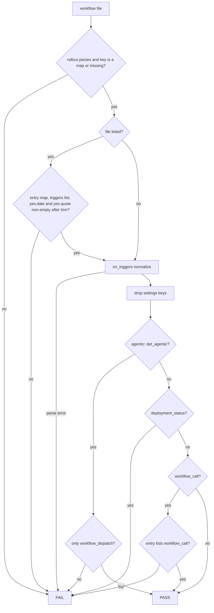
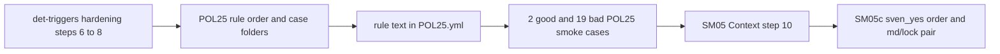

# SM05b: POL25 deterministic_triggers allowlist, det-triggers hardening
- Status: done
- PR: #21
- Area: smoke
- Wave: W3
- Block: 3
- Lane: Builder
- Depends on: [SM05a](SM05a-det-triggers-pol03.md) (merged); part of [SM05](../smoke/SM05.md)
- proof: `./scripts/verify.sh` ends with `0 failures`; POL23 runs the 2 good `test/fixtures/good/POL25-smoke-*/` cases (each exits 0), keeps `good/POL25.md` and `good/POL25-ci.yml` green, and runs every `test/fixtures/bad/POL25-smoke-*` case (each exits exactly 1); step 6 adds `good/POL03-smoke-date-unquoted/`; steps 7 and 8 add six POL03 and six POL25 metadata bad folders plus `bad/POL03-smoke-trigger-blank/`; step 10 updates [SM05](../smoke/SM05.md) Context
- door: two-way
- triage: build (second of three SM05 parts, Strategy split check 2026-10-26)
- feedback: `./scripts/verify.sh`: POL25 passes the good smoke cases and exits 1 on each bad case listed in the DoD; POL03 step 6 to 8 fixtures behave the same under POL03 (proof)
- harness: none (script)
- review-input: diff + this PBI + DoD (+ [SM05](../smoke/SM05.md) and [SM08](../smoke/SM08-cursor-findings.md)) + PR description, never builder session logs (PA6)
- kind: script (deterministic)
- Source: PA8 (no D row; Sven, Development Agentic Workflows room, 2026-10-25 17:48 and 17:50 (post-deploy smoke on tst/acc, Azure AD JWT)) https://github.com/svennijhuis/agentic-workflows/pull/5
- Gate: [SM08](../smoke/SM08-cursor-findings.md) finding 5 and finding 8 POL25 half (Cursor review 5648771343 on PR #5) and Cursor review 5654162636 finding 6 (on PR #8) are folded in here. Steps 6 to 8 and 10 cite Cursor reviews 5657758110, 5657632108, 5658001602 and 5658106584 on PRs #14 and #18.
## Goal
Apply the same `deterministic_triggers` fail-closed allowlist to POL25: agentic files stay `workflow_dispatch` only; deterministic yml fails `deployment_status` always and unlisted `workflow_call`; listed non-agentic runners may use `workflow_call` with Sven's quoted yes. Harden `scripts/lib/det-triggers.sh` (unquoted `yes.date`, gh-aw-metadata detection, blank trigger names) for both checks.
## Context
See [SM05](../smoke/SM05.md) Context for why `workflow_call` replaces `deployment_status` in the release template. [SM05a](SM05a-det-triggers-pol03.md) added `scripts/lib/det-triggers.sh` and POL03 case folders; this part wires POL25 to the same lib and rollout path (`$POL_ROLLOUT`, else `<case>/rollout.yml`, else `governance/rollout.yml`).

POL25 rule order matches SM05 Context: rollout map shape and listed entry validation, then `on_triggers` (parse error fails closed), drop `settings:` keys, classify agentic (`.md`, `*.lock.yml`, gh-aw-metadata in the whole leading comment block with optional indent and one leading UTF-8 BOM stripped), then agentic dispatch-only, else non-agentic `deployment_status` and `workflow_call` allowlist; other triggers are no hit under POL25.

Step 10 (Cursor 5658001602 f5): the SM05 Context paragraph that pointed at `POL03.sh` L22 for `promoted && return 0` now describes SM05a behavior (allowlist before the short circuit).
## Steps
1. `policies/checks/POL25.sh`: source `det-triggers.sh`, case folders via `det_case_files`, same rollout resolution as POL03; repo mode scans non-agentic `.github/workflows/*.{yml,yaml}` for `deployment_status` and unlisted `workflow_call`.
2. `policies/POL25.yml` `rule:` text matches SM05 Context for POL25.
3. POL25 smoke fixtures as in the DoD; `./scripts/verify.sh` on the SHA.
4. Step 6 (Cursor 5657758110 f2, 5657632108 f4): `det_entry_err` uses `tostring | trim` on `yes.date`; `good/POL03-smoke-date-unquoted/` exits 0 with no stderr.
5. Step 7 (Cursor 5657758110 f1, 5657632108 f2, 5658001602 f1, 5658106584 f3): `det_agentic` strips BOM and matches `gh-aw-metadata:` in the leading comment block; POL25 uses `det_agentic` instead of `head -3`; six bad metadata folders (POL03 and POL25 `-metadata-late`, `-indent`, `-bom`).
6. Step 8 (Cursor 5657632108 f5, 5658106584 f7): reject empty trigger names in `det_entry_err` and POL03 entry loop; `bad/POL03-smoke-trigger-blank/`.
7. Step 10: rewrite SM05 Context POL03 paragraph (Cursor 5658001602 f5).
## Definition of Done
- [x] POL25 follows the rule order in Context; `policies/POL25.yml` `rule:` says the same
- [x] The setting keys from `policies/POL25.yml` `settings:` are dropped before the trigger tests; `test/fixtures/good/POL25.md` still exits 0
- [x] `workflow_dispatch` alone passes with no entry. An empty map or a missing key does not fail it (`good/POL25-smoke-dispatch-unlisted/`)
- [x] The `deployment_status` fail and the `workflow_call` allowlist run on every file POL25 checks (no `promoted` short-circuit in POL25)
- [x] A listed entry with an empty or whitespace-only `yes.quote`, or an empty `yes.date`, fails that file even when it is dispatch-only
- [x] On a non-agentic file POL25 fails only `deployment_status` and an unlisted `workflow_call`; `pull_request` stays green (`good/POL25-ci.yml`)
- [x] `deployment_status` fails listed, unlisted and promoted (`bad/POL25-smoke-deployment-status/`, `bad/POL25-smoke-promoted-deployment-status/`)
- [x] A rollout file that does not parse, or a `deterministic_triggers` that is a list, string or null, fails every file
- [x] Agentic `.md`, `*.lock.yml` and gh-aw-metadata yml fail on any trigger besides `workflow_dispatch`, even when the name is in the map
- [x] Good cases, each exits 0: `good/POL25-smoke-runner/`, `good/POL25-smoke-dispatch-unlisted/`, existing `good/POL25-ci.yml`, existing `good/POL25.md`
- [x] Bad POL25 smoke cases, each exits 1: `bad/POL25-smoke-missing-key/`, `-rollout-broken/`, `-not-map/`, `-no-quote/`, `-deployment-status/`, `-agentic-md/`, `-agentic-lock/`, `-metadata/`, `-unlisted/`, `-on-broken.yml`, `-quote-empty/`, `-quote-blank/`, `-date-empty/`, `-map-string/`, `-map-null/`, `-promoted-deployment-status/`, `-metadata-late/`, `-metadata-indent/`, `-metadata-bom/`
- [x] Step 6: `good/POL03-smoke-date-unquoted/` exits 0 with no stderr
- [x] Step 7: all six metadata bad folders exit 1 with an entry that lists `workflow_call`
- [x] Step 8: `bad/POL03-smoke-trigger-blank/` exits 1
- [x] Step 10: SM05 Context POL03 paragraph matches code at merge time
- [x] POL23 runs all of them; stubbing POL25 to always pass turns POL23 red on the good runner cases
- [x] `scripts/lib/det-triggers.sh` changes are shared with POL03; POL23.sh untouched
## Technical design
- Components and files: `policies/checks/POL25.sh`, `policies/POL25.yml`, `scripts/lib/det-triggers.sh`, `policies/checks/POL03.sh` (step 8 entry loop only), `test/fixtures/good/POL25-smoke-*/`, `test/fixtures/bad/POL25-smoke-*`, step 6 to 8 POL03 fixtures, `docs/pbi/smoke/SM05.md` (step 10 Context)
- Module boundary: `governance/rollout.yml` `deterministic_triggers` plus POL25 exit 0/1; rollout path, map shape, entry check, agentic test and allowlist lookup stay in `scripts/lib/det-triggers.sh` (shared with POL03)
- Interfaces: same as SM05a: map of file name to `{triggers, yes: {date, quote}}`; `$POL_ROLLOUT` overrides in file mode; case folder carries `rollout.yml`; exit 0/1, `file:line POL25 message`
- Sequence:

- Failure modes: same fail-closed rollout and entry errors as POL03; agentic never gets `workflow_call` or `deployment_status`; gh-aw-metadata hidden after line 3, behind leading space or BOM is still agentic; empty trigger name in an entry fails; each hit names file and reason
- Security: keeps PA1; fixture quotes are placeholders; no secrets
- Observability: verify names file + trigger + reason
- Cost: 0
- Rollback: revert the PR; empty `deterministic_triggers: {}` unchanged
- Proof: same as proof: above
- Door: two-way (policy code; smoke-run.yml entry still waits for SM03)
## Evidence
`./scripts/verify.sh` log on the PR SHA, POL23 per-case output
## Flow

## Named asks for Sven
- None in this part; the exact yes for `smoke-run.yml` stays in SM03.
## Cost
0 (script)
## Sources
- [SM05](../smoke/SM05.md), [SM05a](SM05a-det-triggers-pol03.md), [SM08](../smoke/SM08-cursor-findings.md) findings 5 and 8 (POL25 half)
- [PR #14 Cursor review 5657758110, findings 1 and 2](https://github.com/svennijhuis/agentic-workflows/pull/14#pullrequestreview-5657758110)
- [PR #14 Cursor review 5657632108, findings 4 and 5](https://github.com/svennijhuis/agentic-workflows/pull/14#pullrequestreview-5657632108)
- [PR #14 Cursor review 5658001602, findings 1 and 5](https://github.com/svennijhuis/agentic-workflows/pull/14#pullrequestreview-5658001602)
- [PR #18 Cursor review 5658106584, findings 3 and 7](https://github.com/svennijhuis/agentic-workflows/pull/18)
- [PR #8 Cursor review 5654162636, finding 6](https://github.com/svennijhuis/agentic-workflows/pull/8#pullrequestreview-5654162636)
