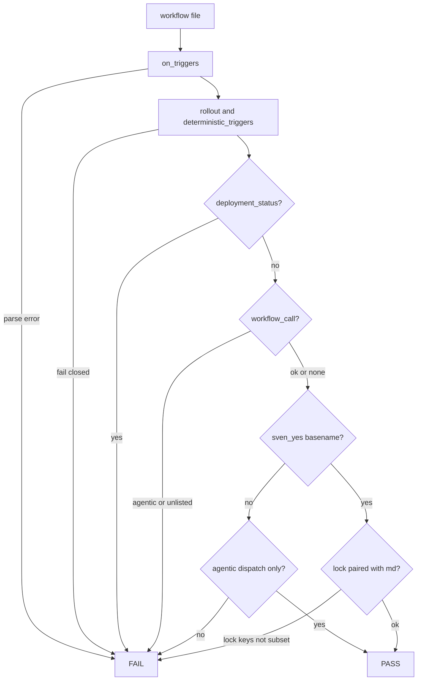
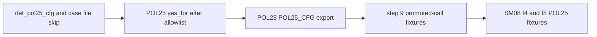

# SM05c: POL25 sven_yes order, POL25_CFG, md/lock pair, SM05 step 9
- Status: done
- PR: #23
- Area: smoke
- Wave: W3
- Block: 3
- Lane: Builder
- Depends on: [SM05b](SM05b-det-triggers-pol25.md) (merged); part of [SM05](../smoke/SM05.md)
- proof: `./scripts/verify.sh` ends with `0 failures`; POL23 runs 3 good `test/fixtures/good/POL03-smoke-*/` and 5 good `good/POL25-smoke-*/` cases (each exits 0), keeps `good/POL03.md`, `good/POL25.md` and `good/POL25-ci.yml` green, and runs every `bad/POL03-smoke-*` and `bad/POL25-smoke-*` case (each exits exactly 1); step 9 adds `bad/POL03-smoke-promoted-call/` and `bad/POL03-smoke-promoted-agentic-call/`; SM08 finding 4 adds six `POL25-smoke-sven-yes-*` cases plus `good/POL25-smoke-call-plus-pr/`; SM08 finding 8 POL25 half adds `bad/POL25-smoke-date-blank/`
- door: two-way
- triage: build (third of three SM05 parts, Strategy split check 2026-10-26)
- feedback: `./scripts/verify.sh`: POL25 applies deployment_status, workflow_call and agentic workflow_call before `sven_yes`; POL23 exports `POL25_CFG` for case folders; promoted `workflow_call` without an entry still fails POL03 (proof)
- harness: none (script)
- review-input: diff + this PBI + DoD (+ [SM05](../smoke/SM05.md) and [SM08](../smoke/SM08-cursor-findings.md)) + PR description, never builder session logs (PA6)
- kind: script (deterministic)
- Source: PA8 (no D row; Sven, Development Agentic Workflows room, 2026-10-25 17:48 and 17:50 (post-deploy smoke on tst/acc, Azure AD JWT)) https://github.com/svennijhuis/agentic-workflows/pull/5
- Gate: [SM08](../smoke/SM08-cursor-findings.md) finding 4 (Cursor review 5648771343 on PR #5) and Cursor review 5654162636 finding 1 (on PR #8) are folded in here. Step 9 cites Cursor review 5657632108 finding 6 on PR #14.
## Goal
Keep PA1 `sven_yes` for agentic schedules without letting it bypass `deployment_status`, unlisted or listed `workflow_call`, or `on:` parse errors. Case folders may ship a `POL25.yml` beside `rollout.yml`; POL23 exports `POL25_CFG`. Pin promoted `workflow_call` without a map entry in POL03 (step 9).
## Context
See [SM05](../smoke/SM05.md) Context. [SM05b](SM05b-det-triggers-pol25.md) wired POL25 to `scripts/lib/det-triggers.sh` but `yes_for` still short-circuited before trigger tests. SM08 finding 4 (narrowed): `deployment_status`, the `workflow_call` allowlist and the agentic `workflow_call` fail run before `yes_for`; `yes_for` lifts only the agentic dispatch-only rule (e.g. `schedule`). `lock_keys` requires a `.lock.yml` under `yes_for` to use only triggers its `.md` also has. Config reads `$POL25_CFG` (default `policies/POL25.yml`); `det_pol25_cfg` and `det_case_files` skip `POL25.yml` as a workflow file. POL23 exports `POL25_CFG=<case>/POL25.yml` when present.

Step 9 (Cursor 5657632108 f6): promoted names still fail `workflow_call` when no `deterministic_triggers` entry lists it, before `promoted && return 0` in POL03.
## Steps
1. `scripts/lib/det-triggers.sh`: `det_pol25_cfg`; `det_case_files` skips `POL25.yml`.
2. `policies/checks/POL25.sh`: run allowlist hits before `yes_for`; `lock_keys` for md/lock pairs; read settings and `sven_yes` from `$POL25_CFG`.
3. `policies/checks/POL23.sh`: export `POL25_CFG` and `POL_ROLLOUT` for case folders in `expect`.
4. `policies/POL25.yml` `rule:` text documents `sven_yes` order and lock pairing.
5. Fixtures as in the DoD; step 9 POL03 promoted-call cases; `./scripts/verify.sh` on the SHA.
## Definition of Done
- [x] `deployment_status`, the `workflow_call` allowlist and the agentic `workflow_call` fail run before `yes_for` in `POL25.sh`; `on_triggers` exit 2 is a hit before any `yes_for` skip
- [x] `sven_yes` lifts only the agentic dispatch-only rule; `good/POL25-smoke-sven-yes-schedule/` and `good/POL25-smoke-sven-yes-schedule-lock/` exit 0
- [x] `sven_yes` does not bypass `deployment_status`, unlisted `workflow_call`, listed agentic `workflow_call`, or lock parse errors: `bad/POL25-smoke-sven-yes-deployment-status/`, `-unlisted-call/`, `-listed-call/`, `-lock-parse/` each exit 1
- [x] POL23 exports `POL25_CFG` to the case `POL25.yml` and does not treat it as a workflow; `det_case_files` skips `POL25.yml`
- [x] `good/POL25-smoke-call-plus-pr/` exits 0 under POL25 (SM08 finding 5 POL25 half)
- [x] `bad/POL25-smoke-date-blank/` exits 1 (SM08 finding 8 POL25 half)
- [x] Step 9: `bad/POL03-smoke-promoted-call/` and `bad/POL03-smoke-promoted-agentic-call/` exit 1
- [x] `policies/POL25.yml` `rule:` matches Context; allowlist logic stays in `scripts/lib/det-triggers.sh` (shared with POL03)
- [x] POL23 runs all new cases; stubbing `yes_for` to always return before allowlist checks turns POL23 red on the four bad `sven-yes-*` cases
## Technical design
- Components and files: `scripts/lib/det-triggers.sh`, `policies/checks/POL25.sh`, `policies/checks/POL23.sh`, `policies/POL25.yml`, step 9 and SM08 fixtures under `test/fixtures/good/POL25-smoke-*` and `bad/POL03-smoke-*`, `bad/POL25-smoke-*`
- Module boundary: rollout and allowlist unchanged in `det-triggers.sh`; `sven_yes` order and lock pairing live in `POL25.sh`
- Interfaces: `$POL25_CFG` overrides policy config in file mode; case folder may hold `POL25.yml` next to `rollout.yml`; exit 0/1
- Sequence:

- Failure modes: `yes_for` never skips allowlist or parse hits; orphan lock under `yes_for` with bad `on:` still fails; promoted POL03 `workflow_call` without a map entry fails
- Security: keeps PA1; fixture quotes are placeholders; no secrets
- Observability: verify names file + trigger + reason
- Cost: 0
- Rollback: revert the PR
- Proof: same as proof: above
- Door: two-way (policy code; smoke-run.yml entry still waits for SM03)
## Evidence
`./scripts/verify.sh` log on the PR SHA, POL23 per-case output
## Flow

## Named asks for Sven
- None in this part; the exact yes for `smoke-run.yml` stays in SM03.
## Cost
0 (script)
## Sources
- [SM05](../smoke/SM05.md), [SM05b](SM05b-det-triggers-pol25.md), [SM08](../smoke/SM08-cursor-findings.md) finding 4
- [PR #14 Cursor review 5657632108, finding 6](https://github.com/svennijhuis/agentic-workflows/pull/14#pullrequestreview-5657632108)
- [PR #8 Cursor review 5654162636, finding 1](https://github.com/svennijhuis/agentic-workflows/pull/8#pullrequestreview-5654162636)

## Copy this

Use this order when a policy lets humans record an exact yes for extra agentic triggers without weakening fail-closed allowlists:

1. Read rollout and map shape first; parse errors fail every file under test.
2. Fail `deployment_status` and unlisted or agentic `workflow_call` before any per-workflow yes list is consulted.
3. Only then apply the yes list: it may lift the agentic dispatch-only rule for named triggers (for example `schedule`), never the items in step 2.
4. For a compiled lock file paired with a markdown workflow, every trigger on the lock must also appear on the markdown when the basename is on the yes list.
5. In fixture mode, point the check at a case-local policy copy via an env var (default repo policy); exclude that copy from the workflow file list.
6. Keep promoted-name bypasses downstream of allowlist hits so promoted `workflow_call` without a map entry still fails.

No secrets, tokens, or repo-specific paths are required to reuse the pattern; wire names to your own policy ids and fixture layout.
