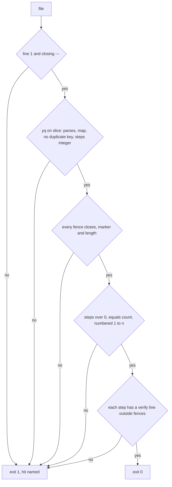

# SM07a: Smoke setup checklist and its check (smoke/SETUP.md, check-smoke-setup.sh)
- Status: done
- PR: #16
- Area: smoke
- Wave: W3
- Block: 3
- Lane: Builder
- Depends on: VF01 (done, #10). Part of [SM07](../smoke/SM07.md); SM07b (Sven runs the steps) is the other part
- proof: `bash scripts/check-smoke-setup.sh smoke/SETUP.md`, `test/fixtures/smoke-setup/good.md`, `good-nested-fence.md` and `good-comment.md` exit 0 and each of the 20 `test/fixtures/smoke-setup/bad-*.md` exits exactly 1 with one hit, in the `scripts/verify.sh` loop (an empty good or bad set fails the loop); `./scripts/verify.sh` ends with `0 failures`
- door: two-way
- triage: build (code part of SM07, split out by Strategy on 2026-10-26; Sven's live setup stays in SM07b)
- feedback: the `scripts/verify.sh` smoke setup loop: `smoke/SETUP.md` and each good fixture exit 0, each bad fixture exits 1 with exactly one `file:line SMOKESETUP message` line
- harness: none (script)
- review-input: diff + this PBI + DoD (+ [SM07](../smoke/SM07.md), [SM08](../smoke/SM08-cursor-findings.md) finding 6) + PR description, never builder session logs (PA6)
- kind: script (human checklist plus a script that checks it)
- Source: PA8 (Sven, Development Agentic Workflows room, 2026-10-25 17:48 and 17:50; split by Strategy, SM07 parts, 2026-10-26) https://github.com/svennijhuis/agentic-workflows/pull/5
- Gate: [SM08](../smoke/SM08-cursor-findings.md) finding 6 (Cursor review 5648771343 on PR #5) and Cursor review 5654162636 finding 5 (on PR #8) are folded in here. Per the Strategy split check (2026-10-26) SM08 closes when the last of its target PBIs merges, so this build carries its SM08 row.
## Goal
Write down every manual setup step for the smoke runner in one checklist Sven can tick off, and check that file offline so a step without a way to verify it, or a file that only looks fine, fails `./scripts/verify.sh`.
## Context
SM07 mixed code (the checklist and its check) with Sven's live Azure, Entra and GitHub setup. Strategy split it: SM07a is the code (two-way, offline), SM07b is Sven running steps 1 to 7 and saying yes in the room (one-way, no PR). SM07b blocks only SM03L.

SM08 finding 6 (medium): "does not parse" must be defined, not left to a markdown parser, because CommonMark runs an unclosed fence to the end of the file and still parses. So the file starts with YAML frontmatter (`steps: <n>`), the check slices it the way `fm` in `policies/checks/lib.sh` does (line 1 `---`, up to the next `---`) and runs `yq` on that slice only. Cursor 5654162636 finding 5 (low): fences are tracked by marker and length, so a backtick fence plus a tilde fence (two unclosed, even count) and a long fence closed by a shorter one both fail.

POL23 only runs `policies/checks/POLnn.sh`, so `check-smoke-setup.sh` gets its own loop in `scripts/verify.sh`, like SM01. The loop sits after the PR template block, away from the SM01 loop lines in PR #11, so the two merge in either order.
## Steps
1. `smoke/SETUP.md`: frontmatter `steps: 8`, the 8 SM07 steps in order, one `verify:` line each.
2. `scripts/check-smoke-setup.sh FILE...` (default `smoke/SETUP.md`): gate phase in a fixed order, stop at the first hit; then the verify-line scan.
3. Fixtures in `test/fixtures/smoke-setup/`: 3 good, 20 bad, one hit each.
4. `scripts/verify.sh` loop: `smoke/SETUP.md` through `produce`, each good exits 0, each bad exits 1 with exactly one hit line; the fixture globs use `nullglob`, an empty good or bad set is a failure, and a bad path that is not a file is a failure (Cursor 5657735146 f1).
## Definition of Done
- [x] `smoke/SETUP.md` lists, in this order, the 8 steps of SM07: Actions billing; one smoke app per env (no secret, no certificate, public client flows off); one federated credential per app (`environment:smoke-tst` and `smoke-acc` subjects only); role assignment through the infra repo clientconfig (read role, `party.<slug>`); API audience check; GitHub environments `smoke-tst` and `smoke-acc` with the six vars; optional Conditional Access for workload identities; not set up (no test user, no ROPC, no TOTP seed, no CA exclusions)
- [x] Each step has a `verify:` line Sven can run (portal path or `gh variable list --env smoke-tst`); the check exits 1 when a numbered step has no `verify:` line, an empty one, or one only inside a code fence
- [x] The check slices the frontmatter (line 1 `---`, up to the next `---`) and runs `yq` on the slice only; before the verify-line scan it exits 1 when the slice is missing or never closed, when `yq` on the slice fails, when the slice is not a map or has a duplicate key, when `steps` is missing or not an integer, when a fence is still open at end of file, when there are 0 numbered steps, when `steps` differs from the count of numbered steps, or when the steps are not numbered 1, 2, 3 in order (SM08 finding 6)
- [x] HTML comments are tracked `<!--` to `-->` outside fences, the same way as fences: a numbered step or `verify:` line inside a comment is not counted, and a comment still open at end of file exits 1 (Cursor 5657735146 f2). Bad fixtures `bad-comment-only.md` (the only step and verify line inside a comment), `bad-step-in-comment.md` (`steps: 2`, step 2 only in a comment), `bad-verify-in-comment.md` (step 2's only verify line in a comment) and `bad-comment-unclosed.md` each exit 1 with one hit; each exits 0 on 83c9b21. Good `good-comment.md` (an inline comment on a step line, a comment holding `3.`, `<!--` inside a fence) exits 0
- [x] `scripts/verify.sh`: with every `bad-*.md` removed the loop prints `SMOKESETUP no bad setup fixtures` and verify ends with `1 failures` (Cursor 5657735146 f1; on 83c9b21 the literal glob gave one `no such file` hit and passed)
- [x] Fences are tracked open and close, not counted: a close is the same marker (backtick or tilde), at least as long as the open, with nothing after it; a backtick line whose info string holds a backtick is not a fence (Cursor 5654162636 finding 5)
- [x] Bad fixtures, each exits 1 with one hit: `test/fixtures/smoke-setup/bad-broken.md` (invalid YAML inside the slice), `bad-no-frontmatter.md`, `bad-frontmatter-unclosed.md`, `bad-frontmatter-not-map.md`, `bad-dup-key.md` (`steps: 8` then `steps: 1`), `bad-steps-missing.md`, `bad-steps-not-int.md` (`steps: "1"`), `bad-unclosed-fence.md` (valid frontmatter, every step has a verify line, one unclosed fence), `bad-two-unclosed.md` (a backtick fence and a tilde line, even fence count), `bad-short-close.md` (four backticks closed by three), `bad-empty.md` (`steps: 0`, 0 numbered steps), `bad-steps-mismatch.md` (`steps: 3`, two numbered steps), `bad-step-order.md` (1 then 3), `bad-missing-verify.md`, `bad-verify-empty.md`, `bad-verify-in-fence.md`, plus the four comment fixtures above (20)
- [x] Good: `test/fixtures/smoke-setup/good.md`, `good-nested-fence.md` (a four-backtick fence holding a three-backtick line, a tilde line and a `2.` line), `good-comment.md` and `smoke/SETUP.md` exit 0 (their slice parses)
- [x] `scripts/verify.sh` loop for `check-smoke-setup.sh` (SM01 style): `smoke/SETUP.md` and each good exit 0, each bad exits exactly 1 with one hit; `--help` prints usage and exits 0; yq missing exits 2 (needs-human)
- [ ] Sven runs steps 1 to 7 and says yes in the room: SM07b, not this PR
## Technical design
- Components and files: `smoke/SETUP.md`, `scripts/check-smoke-setup.sh`, `test/fixtures/smoke-setup/` (2 good, 16 bad), `scripts/verify.sh` (loop)
- Module boundary: `check-smoke-setup.sh FILE...` with exit 0/1/2 and one `file:line SMOKESETUP message` per hit; the frontmatter slice, fence tracking and step rules sit behind it
- Interfaces: input a checklist markdown file with frontmatter `steps: <n>`; exit 0 ok, 1 a hit (fail closed), 2 needs-human (yq missing); `--help`
- Sequence:

- Failure modes: a missing or broken slice, an open fence, a wrong step count or order, or a step without a verify line fails verify with the line and rule named; yq missing exits 2 (needs-human), never 0
- Security: no secret values, client ids, tenant ids or URLs in the repo; `<api repo>` stays a placeholder; bots never sign in to Azure or edit Entra
- Observability: verify log line per hit
- Cost: 0
- Rollback: revert the PR
- Proof: same as proof: above
- Door: two-way (docs, script and fixtures; revert is one commit)
## Evidence
verify log on the PR head SHA, one hit line per bad fixture; gate log comment on PR #16
## Flow

## Todo (carried, not built here)
The SM07 todo rows come in PR #18 (`docs/pbi/smoke/SM07.md`) and are not on main yet, so the low findings from PR #16 sit here; whoever merges second moves them to SM07.
- [ ] Cursor 5657735146 f3 low (security): `smoke/SETUP.md` L23 and L33. Step 6 says the two commands list the six vars and no secrets, but `gh variable list` prints names and values, and step 8 runs `gh secret list` only for `smoke-tst`. Fix: describe step 6 as `gh variable list` for the six names and say to keep the values off chat and off the PR; run `gh secret list` for both `smoke-tst` and `smoke-acc` in step 8.
- [x] Cursor 5657735146 f4 low (readability): `docs/pbi/smoke/README.md` L4 gate sentence said no SM01 to SM07 build PR starts before SM08 merges. Resolved by the merge of main `9680af0` (#11): the line now says the SM08 rows live in the build PBIs (SM07a among them) and SM08 closes once those have merged. No edit on this PR.
## Named asks for Sven
- None for this PR. SM07b: name the API repo, run steps 1 to 7, say yes in the room.
## Cost
0 (script)
## Sources
- [SM07](../smoke/SM07.md) DoD and [SM08](../smoke/SM08-cursor-findings.md) finding 6
- [PR #5 Cursor review at 8936269](https://github.com/svennijhuis/agentic-workflows/pull/5#pullrequestreview-5648771343)
- Cursor review 5654162636 on PR #8, finding 5 (two unclosed fences, mixed markers) https://github.com/svennijhuis/agentic-workflows/pull/8#pullrequestreview-5654162636
- https://spec.commonmark.org/0.31.2/#fenced-code-blocks (an unclosed fence runs to the end of the document)
- Cursor review 5657735146 on PR #16 at 83c9b21 (f1 and f2 medium fixed in round 1; f3 low in the Todo section; f4 low resolved by the main merge) https://github.com/svennijhuis/agentic-workflows/pull/16#pullrequestreview-5657735146
