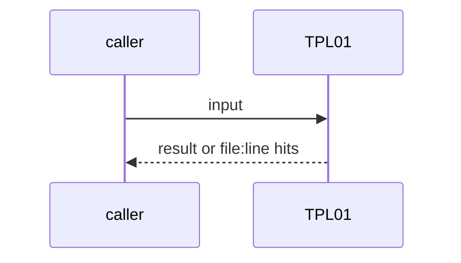
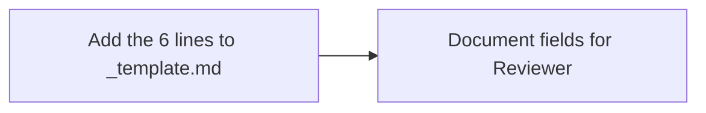

# TPL01: One PBI template for both repos (5 fields plus Source)
- Status: done
- PR: #4
- Area: docs
- Wave: W1
- Block: 1
- Lane: Builder
- Depends on: C01
- proof: `make verify` (exit 0); `docs/pbi/_template.md` has the 5 fields plus Source
- door: two-way
- triage: build (PO scope fix: new or changed PBIs only)
- feedback: Reviewer checks new PBIs against `_template.md` on the PBI PR
- harness: none (docs)
- review-input: diff + this PBI + DoD (+ linked spec) + PR description, never builder session logs (PA6)
- kind: script
- Source: PA8 https://github.com/svennijhuis/agentPacks/pull/80 https://github.com/svennijhuis/agentic-workflows/pull/4
## Goal
`docs/pbi/_template.md` carries the same 5 fields as agentPacks (`triage`, `feedback`, `harness`, `review-input`, `kind: skill|script`) plus `Source: D<n>` and the URL. Reviewers fail a new PBI that misses one or leaves `Module boundary:` or `feedback:` empty (ARC08).
## Context
PA8: both repos share one template. Backfilling the rest is [TPL02](../docs/TPL02-template-backfill.md).
## Steps
1. Add the 6 lines to `_template.md`.
2. Document the fields in README and authoring instructions.
## Definition of Done
- [x] Template has the 5 fields plus Source
- [x] Reviewer bar covers missing Source, missing field, bad kind, Source without URL, empty feedback or module boundary
- [x] Every new or changed PBI in this PR passes
## Technical design
- Components and files: `docs/pbi/_template.md`, `.github/instructions/docs.instructions.md`
- Module boundary: 6 header lines are the interface; Reviewer enforces on PBI PRs
- Interfaces: PBI frontmatter lines per `_template.md`
- Sequence:

- Failure modes: A PBI merged without fields: Reviewer FAIL on the PR
- Security: No tokens, reads files only
- Observability: PBI PR review comments
- Cost: 0 AIC
- Rollback: Revert template lines
- Proof: same as proof: above
- Door: two-way (revert is one commit)
## Evidence
Verify log on the exact head SHA of PR #4 (Q0, Actions billing blocked).
## Flow

## Named asks for Sven
none
## Cost
0 AIC
## Sources
- [agentPacks PR #80 (same 5 template fields)](https://github.com/svennijhuis/agentPacks/pull/80)
- [agentic-workflows PR #4 room (PO additions PA1 to PA9)](https://github.com/svennijhuis/agentic-workflows/pull/4)
- Strategy id list v3.12 (aw-final-ids.md), url-learnings.md PA8
