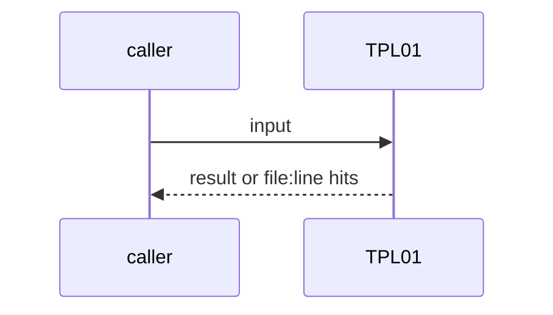
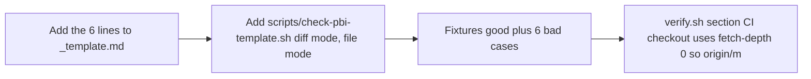

# TPL01: One PBI template for both repos (5 fields plus Source)
- Status: done
- PR: #4
- Area: docs
- Wave: W1
- Block: 1
- Lane: Builder
- Depends on: C01
- proof: bash scripts/check-pbi-template.sh test/fixtures/template/good.md (exit 0); each test/fixtures/template/bad-*.md (exit 1); ./scripts/verify.sh section PBI template
- door: two-way
- triage: build (PO scope fix: new or changed PBIs only)
- feedback: bash scripts/check-pbi-template.sh on the fixtures, then diff mode in verify.sh
- harness: none (script run by scripts/verify.sh)
- review-input: diff + this PBI + DoD (+ linked spec) + PR description, never builder session logs (PA6)
- kind: script
- Source: PA8 https://github.com/svennijhuis/agentPacks/pull/80 https://github.com/svennijhuis/agentic-workflows/pull/4
## Goal
`docs/pbi/_template.md` carries the same 5 fields as agentPacks (`triage`, `feedback`, `harness`, `review-input`, `kind: skill|script`) plus `Source: D<n>` and the URL. `scripts/check-pbi-template.sh` fails a new or changed PBI that misses one.
## Context
PA8: both repos share one template. PO scope fix: the check covers PBIs added (A) or edited in place (M) against the merge base with origin/main, not all existing ones. Moves into `done/` (R) are bookkeeping. Backfilling the rest is [TPL02](../docs/TPL02-template-backfill.md).
## Steps
1. Add the 6 lines to `_template.md`.
2. Add `scripts/check-pbi-template.sh` (diff mode, file mode).
3. Fixtures: good plus 6 bad cases.
4. verify.sh section; CI checkout uses `fetch-depth: 0` so origin/main is there.
## Definition of Done
- [x] Template has the 5 fields plus Source
- [x] Check red on a missing Source, a missing field, a bad kind, a Source without URL, an empty feedback or module boundary
- [x] Diff mode checks only A and M PBIs; no base is a failure, not a skip
- [x] Every new or changed PBI in this PR passes
## Technical design
- Components and files: `docs/pbi/_template.md`, `scripts/check-pbi-template.sh`, `test/fixtures/template/`, `scripts/verify.sh`, `.github/workflows/verify.yml`
- Module boundary: 6 header lines are the interface; diff scoping and parsing sit in one script
- Interfaces: `check-pbi-template.sh` (diff mode, base `$TPL_BASE` or merge-base with origin/main) or `check-pbi-template.sh FILE...`; `file:line TPL01|ARC08 message`; exit 1 on a hit
- Sequence:

- Failure modes: Shallow clone without origin/main: one TPL01 line asks to fetch, the gate is red
- Security: No tokens, reads git and files
- Observability: verify.sh section PBI template
- Cost: 0 AIC
- Rollback: Drop the verify.sh section; the template lines can stay
- Proof: same as proof: above
- Door: two-way (revert is one commit)
## Evidence
Verify log on the exact head SHA of PR #4 (Q0, Actions billing blocked).
## Flow

## Named asks for Sven
none
## Cost
0 AIC
## Sources
- [agentPacks PR #80 (same 5 template fields)](https://github.com/svennijhuis/agentPacks/pull/80)
- [agentic-workflows PR #4 room (PO additions PA1 to PA9)](https://github.com/svennijhuis/agentic-workflows/pull/4)
- Strategy id list v3.12 (aw-final-ids.md), url-learnings.md PA8
