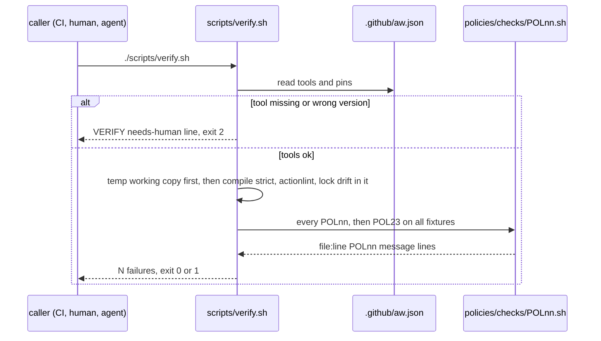
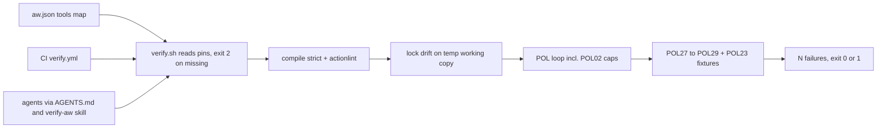

# VF01: One verify entry point: scripts/verify.sh for CI, local gate and every agent
- Status: done
- PR: #10
- Area: verify
- Wave: W2
- Block: 2
- Lane: Builder
- Depends on: C01, POL02, POL17, POL23, X06, C14 (id only, no file yet)
- proof: `./scripts/verify.sh` prints `0 failures` and exits 0 on the green SHA; for each of POL27, POL28 and POL29, `bash policies/checks/POLnn.sh test/fixtures/bad/POLnn/<case>` exits 1 on every immediate child case (file or directory) and `bash policies/checks/POLnn.sh test/fixtures/good/POLnn/` exits 0, and `bash policies/checks/POL23.sh` prints no POL27 to POL29 line, and `bash policies/checks/POLnn.sh test/fixtures/good/gate-minimal.md` exits 0 for POL27, POL28 and POL29; for each POL29 bad case, `./scripts/verify.sh` in a temp copy of the repo with that case laid over it exits 1; with `actionlint` removed from PATH, `./scripts/verify.sh` exits 2 and prints `scripts/verify.sh:1 VERIFY needs-human missing: actionlint`; `bash scripts/check-pbi-docs.sh` run at the root of a temp repo whose root holds both `scripts/check-pbi-docs.sh` and `docs/pbi/<area>/<file>.md` (copied from `test/fixtures/bad/POL29/pbi-docs-finding/`, not under `test/fixtures/`, no `- proof:` line) prints `A1 missing proof: field` and exits 1
- door: two-way
- triage: build (the gate exists in C01; this PBI closes the gaps in the table below, no new trigger)
- feedback: `./scripts/verify.sh; echo "exit=$?"` gives `0 failures` and `exit=0` on the good tree, `exit=1` on each bad fixture copy and `exit=2` with a tool removed from PATH (DoD rows 1 to 4)
- harness: none (script)
- review-input: diff + this PBI + DoD (+ linked spec) + PR description, never builder session logs (PA6)
- kind: script (deterministic)
- Source: PA8 (no D row; Sven via Fleet, Development Agentic Workflows room, 2026-10-26, verification approach from the Matt Pocock and poteto talk) https://github.com/cursor/plugins/blob/main/pstack/docs/guide/06-verify-and-ship.md
## Goal
One script decides green or red. CI, the local gate and every agent (Builder, Tester, Reviewer, Copilot, Cursor) run the same `scripts/verify.sh` with no arguments. It covers `gh aw compile --strict`, actionlint, lock file sync and the per-workflow cost cap. A missing or wrong tool stops the run with exit 2 (needs-human). It never skips a check.
## Context
`scripts/verify.sh` already exists ([C01](../done/C01-verify-script.md), done in PR #4). Most of the bar is there. This PBI writes down what is missing and closes it. It does not copy the gist items. It links them:
- Gist handover points A, B and C are the minimum bar named in [C01 Context](../done/C01-verify-script.md) (compile strict, lock drift, linters, pins). See C01 Sources for where they live.
- [gist-review.md](../gist-review.md) rows 1, 3, 4, 5, 6 and 32, plus additions A1 (proof and door), A3 (one line per failure, last line `N failures`) and A4 ([POL23](../done/POL23-no-tautological-checks.md), no tautological check).
- [X06](../done/X06-verification-skill.md) is the thin agent skill over this script. The upkeep pass for that skill is X06b (id in the Strategy id list v3.12, no file yet).
- C14 (sha256 pin on every curl download in `verify.yml`) and C15 (`promoted:` gains a name only with Sven's yes) are ids in the Strategy id list v3.12, no file yet. VF01 links them and does not redo them.

Learnings from the pstack sources (read 2026-10-26):
- One entry point. Every person and every agent drives the check the same way, so "verify it" needs no setup talk.
- A check you have never seen fail proves nothing. Every check gets a bad input that must fail.
- If a check could not run, the answer is "inconclusive", never a pass. Here that is exit 2.
- Keep the rules in scripts and keep the skill thin. The skill only says which command to run.
- Upkeep is its own pass with three outcomes: clean, changed or blocked. That is X06b and VF02, not this PBI.

Gap table: what VF01 needs vs `scripts/verify.sh` on `origin/main` at 2ccf76d. PR #5 does not change `scripts/verify.sh`.

| # | Item | Today | Where today (file:line) | Gap to close |
|---|---|---|---|---|
| 1 | `gh aw compile --strict` | has | `scripts/verify.sh:18` to `:27` (compile `--dir workflows --strict --actionlint`, in the real tree) | Compile rewrites the real tree before the drift block at `:29`. Strict compile, actionlint on locks and the drift diff move into one temp copy of the working tree, taken before any compile (row 6). `scripts/verify.sh` never runs `gh aw compile` in the real worktree. No bad fixture proves a compile error turns red. Add one under POL29. |
| 2 | gh-aw version pinned | has | `scripts/verify.sh:12` to `:15` (pin from `.github/aw.json:2`) | Wrong version exits 1. It must exit 2 (needs-human). |
| 3 | actionlint on compiled locks | has | `scripts/verify.sh:23` to `:26` | No bad fixture with an actionlint error. Add one under POL29. |
| 4 | actionlint on `.github/workflows/*.yml` | has | `scripts/verify.sh:32` to `:36` | Same as row 3. |
| 5 | actionlint version pinned | partial | presence only at `scripts/verify.sh:13`; version only in `.github/workflows/verify.yml:30` | Local run takes any actionlint. Pin in `.github/aw.json` and compare. POL27. |
| 6 | Lock file sync (lock matches `.md`) | has | `scripts/verify.sh:29` to `:30` (git diff after compile); `policies/checks/POL17.sh:9` to `:21` (frontmatter hash, compiler and engine pin) | Body drift is a `git diff` on `workflows/` after compile, and compile rewrites the real tree. The copy is taken before any compile (row 1), so a stale lock body can never be rewritten first and then pass. Run drift on a temp copy of the working tree (staged and unstaged edits included). Compile only in the copy and diff the copy against its own pre-compile files. The real tree is never written. Every untracked path is copied too (`workflows/**`, `.md` and `.lock.yml`), so a new file with no lock is drift and a new pair is not. A copy failure, or a compile that exits non-zero with no `file:line` finding, is exit 2, not a skip. A compile error with a finding line is exit 1. Fixture under POL29. |
| 7 | Per-workflow cost cap | has | `policies/checks/POL02.sh:6` to `:14` via the loop at `scripts/verify.sh:50` to `:54`; ceilings in `policies/POL02.yml:9` to `:13` | Only a "caps in import only" bad fixture (`test/fixtures/bad/POL02.md`). Add an over-ceiling fixture. Stays in POL02. |
| 8 | Missing tool fails closed | partial | `scripts/verify.sh:13` and `:16` (missing tool exits 1); `scripts/verify.sh:6` (not a repo exits 2) | Missing tool must exit 2 (needs-human, PA5: 0 ok, 1 failed, 2 needs-human). |
| 9 | Tool versions pinned in one place | missing | `.github/workflows/verify.yml:28` to `:32` (gh-aw, actionlint, gitleaks, yq versions in the run step); `.github/aw.json` has only gh-aw and copilot | One `tools:` map in `.github/aw.json`. verify.sh and verify.yml read it. sha256 per download is C14. POL27. |
| 10 | CI calls the same script | has | `.github/workflows/verify.yml:34` to `:37` | No check keeps it that way. POL28. |
| 11 | Agents call the same script | has | `AGENTS.md:13` and `:24`; `.github/copilot-instructions.md:14`; `.github/skills/verify-aw/SKILL.md:3` and `:16`; `CONTRIBUTING.md:13` | No check keeps it that way. POL28. |
| 12 | Output contract (gist A3) | has | `scripts/verify.sh:3` to `:4`, `:8`, `:74` to `:75` | Exit 2 lines need a fixed shape: `file:line VERIFY needs-human <reason>`. |
| 13 | Every check has a bad fixture (gist A4) | has | `scripts/verify.sh:56` to `:57` (POL23) | New POL27 to POL29 join POL23 by their `bad_fixture` and `good_fixture` fields. |
| 14 | No new trigger | has | `.github/workflows/verify.yml:5` to `:6` (`workflow_dispatch` only, POL03) | Keep. VF01 adds no trigger. |
| 15 | PBI docs check fails closed | partial | `scripts/check-pbi-docs.sh:9` to `:34` prints findings but never sets an exit code; `scripts/verify.sh:60` counts its lines, so only the full gate turns red | Run alone, the script exits 0 on findings (proven 2026-10-26 on PR #6 at 520202f: `proof:` deleted from `docs/pbi/verify/VF02.md` printed `A1 missing proof: field` and `exit=0`). It must exit 1 on any finding. Bad fixture under POL29. |
| 16 | A crashed producer is not a pass | missing | `scripts/verify.sh:9` (`count < <(cmd)` drops the child status and empty lines), every `count < <(...)` at `:21`, `:22`, `:24`, `:30` (lock drift: tracked diff plus untracked files), `:35`, `:39`, `:53`, `:57`, `:60`, `:66`, `:70`; `:75` ends on `[ "$N" -eq 0 ]`, so a needs-human line only adds to N and exits 1 | Each producer (compile, actionlint, lock drift, shellcheck, each POLnn, POL23, `scripts/check-pbi-docs.sh`, `scripts/check-pbi-template.sh`, `scripts/check-pr-body.sh`) writes to a temp file and its exit code is read from the command itself, never `$?` after a process substitution. Order per producer: (a) status 2, or any line with `VERIFY needs-human`, prints that line and exits 2 at once, even when the file has other lines; (b) non-zero with an empty file prints `file:line VERIFY needs-human <producer> exited <rc> with no finding` and exits 2 at once; (c) otherwise every finding line is counted. Exit 1 only when (c) counted a real finding (compile, actionlint, drift, POL). |
| 17 | Every bad case runs alone | partial | `policies/checks/POL23.sh:42` (only `*.md` inside a bad folder), `:49` (flat `POLnn-*.md` and `POLnn-*.yml`) | A `*.yml`, `*.json` or folder case inside `test/fixtures/bad/POLnn/` is never run alone, so one red case hides a green one. A case is each immediate child of `test/fixtures/bad/POLnn/`, file or directory. A directory case is run as one unit and never split into its inner files. Good fixtures are the directory `test/fixtures/good/POLnn/` when it exists (`POL23.sh:38` already prefers it). |
| 18 | Repo mode scans the right files | missing | `policies/checks/lib.sh:23` to `:31` (`targets()` expands only `*.md` under `workflows/`), `:49` (`is_workflow` needs `---` frontmatter) | A POL17-shaped POL27 or POL28 in repo mode never sees `.github/aw.json` or `.github/workflows/*.yml` and exits 0. Each new rule names its repo-mode roots. |

## Where it lives
One rule, one place. Each prose rule points to its check. Each check points back to this PBI.
- POL27 Verify toolchain pinned in one place
  - Rule definition: `policies/POL27.yml` with `id`, `title`, `rule`, `why`, `check`, `bad_fixture`, `good_fixture`, `pbi`, `pins` (model: `policies/POL17.yml`). `pins: .github/aw.json`. `pbi: docs/pbi/done/VF01.md`.
  - Rule text: every tool `scripts/verify.sh` installs (actionlint, gitleaks, yq, shellcheck) has one version in `.github/aw.json` `tools:`. `verify.yml` installs exactly those versions. Every downloaded binary has a sha256 (C14).
  - Rule text: gh-aw has one pin only, the top-level `gh-aw` key (`.github/aw.json:2`). `scripts/verify.sh:12` and POL27 both read that key. `tools:` has no `gh-aw` entry, and a second gh-aw pin is a hit.
  - Rule text: `git`, `gh` and `jq` are runner-provided and outside POL27. `scripts/verify.sh` still checks they exist and exits 2 when one is missing.
  - Rule text: repo-mode roots are `.github/aw.json` and `.github/workflows/verify.yml`.
  - Rule text: a missing root, an empty scan or a parse error prints `file:line POL27 ...` and exits 1.
  - Rule text: comments do not count. A url or gh-aw pin that only sits in a comment is not installed (Cursor 5655409212 medium 1). Each `curl -o FILE` download needs one non-comment line that is exactly `echo "<pinned sha256>  FILE" | sha256sum -c -` (regex `^\s*echo "<sha256>  FILE" \| sha256sum -c -\s*$`, two spaces, FILE exact). This is an allowlist, not a denylist: any other form (`|| true`, `|| echo`, `|| /bin/true`, `|| exit 0`, `| true`, a leading `!`, `if ! (...)`, another file name such as `xgitleaks.tar.gz`) is not a check (Reviewer 6421748756, round 3). A `set +e` (or `set +o errexit`) on any line before the check line is still a hit, because a failed check would not stop the step (Tester 2 6421487873 item 2).
  - Check script: `policies/checks/POL27.sh`, prints `file:line POL27 message`.
  - Proof: `test/fixtures/bad/POL27/` (`verify-drifted-version/`, `verify-curl-no-sha256/`, `aw-missing-tool/`, `aw-second-gh-aw-pin/`, `verify-sha256-in-comment/`, `verify-sha256-or-true/`, `verify-sha256-other-file/`, `verify-sha256-masked/`, each a folder with `aw.json` and `verify.yml`, plus `broken-aw.json`) and `test/fixtures/good/POL27/` (a pinned `aw.json` plus a `verify.yml` that installs those versions with sha256).
- POL28 One verify entry point
  - Rule definition: `policies/POL28.yml` (same fields, `pins: .github/aw.json`).
  - Rule text: a `.github/workflows/*.yml` step that gates runs `./scripts/verify.sh` and nothing else. No ad hoc `gh aw compile`, `actionlint` or `shellcheck` step, also not after `command`, `env`, `exec`, `sudo`, `xargs`, a `VAR=x` prefix or a path prefix such as `./bin/`, and no step or job `uses:` that names actionlint or shellcheck (like `docker://rhysd/actionlint`). The `https://` download urls in the install step stay green (Cursor 5655409212 medium 2). `AGENTS.md`, `CONTRIBUTING.md`, `.github/copilot-instructions.md` and `.github/skills/verify-aw/SKILL.md` each name `scripts/verify.sh`.
  - Not here: `run:` forms POL28 does not see as a command start (`bash -c "actionlint x"`, `if actionlint; then`, `go run .../actionlint@v1.7.12`, `npx shellcheck x`; Tester 2 6421487873 item 3) are deferred to VF02d, a gate-job `run:` allowlist ([VF02](../verify/VF02.md) DoD), by the Product Owner 2026-10-26.
  - Rule text: repo-mode roots are `.github/workflows/*.yml` (not `*.lock.yml`), `AGENTS.md`, `CONTRIBUTING.md`, `.github/copilot-instructions.md` and `.github/skills/verify-aw/SKILL.md`.
  - Rule text: a missing root, an empty scan or a parse error prints `file:line POL28 ...` and exits 1.
  - Check script: `policies/checks/POL28.sh`, prints `file:line POL28 message`.
  - Rule text: in fixture mode a missing root is not a hit (a case holds one file); a file that is not one of the roots (by name: `*.yml`, or a `*.md` named agents, contributing, copilot-instructions or skill) prints nothing and exits 0. Repo mode keeps the missing-root hit (Cursor 5654194791 medium 6, high 2).
  - Proof: `test/fixtures/bad/POL28/` (`ci-adhoc-compile.yml`, `ci-command-actionlint.yml`, `ci-env-path-shellcheck.yml`, `verify-uses-docker-actionlint.yml`, `agents-no-verify.md`, `contributing-no-verify.md`, `copilot-instructions-no-verify.md`, `skill-no-verify.md`, `broken.yml`) and `test/fixtures/good/POL28/` (a verify workflow whose only gate step is `./scripts/verify.sh`, plus `AGENTS.md`, `CONTRIBUTING.md`, `copilot-instructions.md` and `SKILL.md`, each naming it).
- POL29 Gate self-test: compile, actionlint and lock drift turn red
  - Rule definition: `policies/POL29.yml` (same fields, `pins: .github/aw.json`).
  - Rule text: one contract. Each bad case is itself the violation the gate must catch: a compile error (`compile-error/`), an actionlint error (`actionlint-error/`), a non-empty lock diff after compile (`lock-drift/`) or a PBI with no `- proof:` line (`pbi-docs-finding/`). POL29 runs the gate step on the case in a temp repo, prints the step's finding as `file:line POL29 <finding>` and exits 1. A clean case (the good fixture) prints nothing and exits 0. `scripts/check-pbi-docs.sh` is a gate step too: it exits 1 on any finding and 0 only when it prints nothing.
  - Rule text: the check copies each fixture folder into a temp dir, then runs `git init`, `git add -A` and `git commit` (fixed test identity) before the gate step. A bare `git init` like the C05 loop at `scripts/verify.sh:41` to `:48` is not enough, because `scripts/check-pbi-docs.sh:9` reads `git ls-files` and drift needs a committed HEAD.
  - Rule text: `lock-drift/` commits a stale `.md` and its `.lock.yml` and compiles in that clone. The non-empty `git diff` is the hit, so POL29 exits 1. An empty diff is no hit (exit 0).
  - Rule text: POL29 exits 2 only when git or the compiler cannot run in the temp repo. No bad case relies on that path, and POL23 never counts exit 2 as a bad case failing.
  - Rule text: that the full gate turns red on each case is proven apart from POL29: `./scripts/verify.sh` in a temp copy of the repo with the case laid over it exits 1 (DoD row, not a check POL23 runs).
  - Check script: `policies/checks/POL29.sh`, prints `file:line POL29 message`.
  - Proof: `test/fixtures/bad/POL29/` (`compile-error/`, `actionlint-error/`, `lock-drift/`, `pbi-docs-finding/`) and `test/fixtures/good/POL29/` (a mini repo that compiles, lints clean, has no drift and a PBI with every field). `pbi-docs-finding/` holds one PBI at `docs/pbi/<area>/<file>.md` with no `- proof:` line. POL29 copies it to that path at the root of a temp repo (3 or more slashes, not under `test/fixtures/`, so `scripts/check-pbi-docs.sh:11` and `:14` do not skip it), so the temp repo root holds both `scripts/check-pbi-docs.sh` and `docs/pbi/<area>/<file>.md`, commits both and needs exit 1 plus an `A1 missing proof: field` line.
- Cost cap stays in POL02 (no new id). The over-ceiling proof is `test/fixtures/bad/POL02-over.md`. `policies/POL02.yml` keeps the ceilings.
- Exit codes (0 ok, 1 failed, 2 needs-human) live in the header of `scripts/verify.sh` (lines 2 to 4 today) and in [C01](../done/C01-verify-script.md). `docs/how-to/verify-workflow.md` points to them.
- Runner: only `scripts/verify.sh` (the C01 gate). New checks join its POL loop. No new script runs them.
- Producers: every producer in `scripts/verify.sh` (compile, actionlint, shellcheck, the POL loop, POL23, `scripts/check-pbi-docs.sh`, `scripts/check-pbi-template.sh`, `scripts/check-pr-body.sh`) plus lock drift writes to a temp file and its own exit code is kept. Status 2 or a `VERIFY needs-human` line exits 2 at once, even with other lines. Non-zero with no output line prints `file:line VERIFY needs-human <producer> exited <rc> with no finding` and exits 2 at once. A real finding is counted and the run exits 1 (VF01 gap row 16).
- POL23: a case is each immediate child of `test/fixtures/bad/POLnn/`, file or directory. A directory case runs as one unit. A `X.lock.yml` or `X.card.yml` beside `X.md` belongs to the `X.md` case. The good fixture is `test/fixtures/good/POLnn/` when that folder exists. Every `test/fixtures/good/POLnn-*` (file or directory) must exit 0 (Cursor 5654194791 medium 5). A bad case must exit exactly 1; any other status, 2 included, is a POL23 hit (Cursor 5654194791 medium 8).
- A check given a file that is not one of its roots prints nothing and exits 0, so `test/fixtures/good/gate-minimal.md` passes POL27, POL28 and POL29. A parse error stays exit 1 only for a file the check claims (Cursor 5654194791 high 2).
- This PBI file lived in `docs/pbi/verify/` and moved to `docs/pbi/done/` with `- Status: done` and `- PR: #<n>`.
## Steps
1. Add a `tools:` map to `.github/aw.json` with actionlint, gitleaks, yq and shellcheck versions and sha256 per download. gh-aw stays the one top-level `gh-aw` key. `git`, `gh` and `jq` are runner-provided.
2. `scripts/verify.sh` reads the tool list from `.github/aw.json`. A missing tool or a wrong version prints `file:line VERIFY needs-human ...` and exits 2. It never runs the rest.
3. `.github/workflows/verify.yml` installs from the same map and checks the sha256. It still runs only `./scripts/verify.sh`. The trigger stays `workflow_dispatch`.
4. One temp copy of the working tree is taken before any compile. Strict compile, actionlint on locks and the drift diff all run in that copy, and the diff is the copy against its own pre-compile files. Remove the real-tree `gh aw compile` at `scripts/verify.sh:19`. The real tree is never written. Every untracked, not ignored path goes into the copy (all of `workflows/`, `.md` and `.lock.yml`, `workflows/shared/` included; Cursor 5654194791 medium 7). A copy failure, or a compile that exits non-zero with no finding line, is exit 2. A compile finding is exit 1.
5. Add POL27, POL28 and POL29 (yml, check, bad and good fixtures, repo-mode roots) and `test/fixtures/bad/POL02-over.md`. Every producer writes to a temp file with its exit code kept; status 2 or a needs-human line is exit 2 at once, non-zero with no line is exit 2 at once. POL23 runs each immediate child of a bad folder (file or directory) as one case. POL29 commits each fixture in its temp repo.
6. `scripts/check-pbi-docs.sh` counts its findings and exits 1 when there is at least one, like `scripts/check-pbi-template.sh` does today. Add `test/fixtures/bad/POL29/pbi-docs-finding/` for it.
7. Update `docs/how-to/verify-workflow.md` and `.github/skills/verify-aw/SKILL.md` with exit 2 and what a human does then.
8. Run `./scripts/verify.sh` twice on the SHA and attach both logs (Q0).
## Definition of Done
- [x] `./scripts/verify.sh` exits 0 with last line `0 failures` on the green SHA.
- [x] Each bad fixture under `test/fixtures/bad/POL27/`, `POL28/`, `POL29/` and `test/fixtures/bad/POL02-over.md` makes its check exit 1.
- [x] Each good fixture folder `test/fixtures/good/POL27/`, `POL28/`, `POL29/` exits 0 and holds the files its check reads (Cursor 5648752180 medium 5).
- [x] `scripts/check-pbi-docs.sh` exits 1 on any finding and exits 0 only with empty output; in a temp repo whose root holds both `scripts/check-pbi-docs.sh` and `docs/pbi/<area>/<file>.md` from `pbi-docs-finding/` (not under `test/fixtures/`), it prints `A1 missing proof: field` and exits 1 (Cursor 5651632842 medium 6).
- [x] A POLnn that exits non-zero with no output line makes `./scripts/verify.sh` exit 2.
- [x] A stub producer (compile, actionlint, lock drift, shellcheck, `check-pbi-docs.sh`, `check-pbi-template.sh`, `check-pr-body.sh`) that exits 7 with no output makes `./scripts/verify.sh` exit 2 with `VERIFY needs-human <producer> exited 7 with no finding` (Cursor 5648752180 high 1, 5651632842 medium 5).
- [x] A stub producer that prints a finding line plus `file:line VERIFY needs-human x`, or exits 2 with a line, makes `./scripts/verify.sh` exit 2, never 1 (Cursor 5651632842 medium 5).
- [x] For each case in `test/fixtures/bad/POL29/`, `bash policies/checks/POL29.sh <case>` exits 1 with a `POL29` line, and `./scripts/verify.sh` in a temp copy of the repo with that case laid over it exits 1 (two separate commands; Cursor 5651632842 high 1).
- [x] POL23 runs each immediate child of a bad folder alone and a directory case as one unit; `POL27/broken-aw.json` and `POL28/broken.yml` each exit 1, and a POL29 folder case is never split (Cursor 5648752180 medium 5).
- [x] POL29 commits each fixture before the gate step; `pbi-docs-finding/` is tracked at `docs/pbi/<area>/` and exits 1, and `lock-drift/` gives a non-empty diff (Cursor 5648752180 high 3).
- [x] `.github/aw.json` has one gh-aw pin (top-level `gh-aw`), read by `scripts/verify.sh` and POL27; `aw-second-gh-aw-pin/` makes POL27 exit 1 (Cursor 5648752180 low 8).
- [x] POL27 and POL28 in repo mode with a root removed or empty exit 1 with a line.
- [x] A dirty `workflows/*.md` with a stale lock body is a drift hit, and `git status` is unchanged after `./scripts/verify.sh`.
- [x] `scripts/verify.sh` has no `gh aw compile` on the real worktree; compile, lock actionlint and drift run in one temp copy taken before any compile (Cursor 5648752180 high 2).
- [x] With any tool from `.github/aw.json` `tools:` removed from PATH, `./scripts/verify.sh` exits 2.
- [x] With a wrong tool version, `./scripts/verify.sh` exits 2.
- [x] The exit 2 line reads `file:line VERIFY needs-human <reason>`.
- [x] No check is skipped silently. A check that cannot run (tool missing, producer crash with no line) is exit 2. A parse error of the input under check is a finding, exit 1.
- [x] `policies/POL27.yml`, `POL28.yml` and `POL29.yml` carry every field of `policies/POL17.yml`.
- [x] `.github/workflows/verify.yml` keeps `workflow_dispatch` as its only trigger.
- [x] `.github/workflows/verify.yml` runs only `./scripts/verify.sh` after the install step.
- [x] `AGENTS.md`, `CONTRIBUTING.md`, `.github/copilot-instructions.md` and the verify-aw skill name `scripts/verify.sh` (POL28 green; Cursor 5653971922 low 10).
- [x] `bash policies/checks/POLnn.sh test/fixtures/good/gate-minimal.md` exits 0 for POL27, POL28 and POL29 (Cursor 5654194791 high 2).
- [x] POL23 runs each `test/fixtures/good/POLnn-*/` directory as one good case (Cursor 5654194791 medium 5).
- [x] `test/fixtures/good/POL28/` holds all four agent surfaces, and each has a bad case that omits `scripts/verify.sh` (Cursor 5654194791 medium 6).
- [x] An untracked `workflows/` pair (`.md` plus `.lock.yml`) and an untracked `workflows/shared/` file enter the temp copy (Cursor 5654194791 medium 7).
- [x] A bad case that exits 2 is a POL23 hit; a bad case must exit exactly 1 (Cursor 5654194791 medium 8).
- [x] A `verify.yml` whose sha256 and `sha256sum -c` lines sit only in comments makes POL27 exit 1 (`bad/POL27/verify-sha256-in-comment/`); the check line must name the `curl -o` file (Cursor 5655409212 medium 1).
- [x] POL27 needs the `curl -o` file as a whole token on the check line and a check that can fail the step: `bad/POL27/verify-sha256-other-file/` (check names `xgitleaks.tar.gz`, curl writes `gitleaks.tar.gz`) and `bad/POL27/verify-sha256-or-true/` (`sha256sum -c - || true`) each exit exactly 1; `|| :`, `||true` and a `set +e` before the check also exit 1 (Tester 2 6421487873 items 1 and 2).
- [x] POL27 accepts only a check line that is exactly `echo "<pinned sha256>  FILE" | sha256sum -c -` (allowlist, round 3, Reviewer 6421748756). `bad/POL27/verify-sha256-masked/` (`|| echo skip`, a leading `!`, and `set +e` before an exact check) exits exactly 1; `|| /bin/true`, `|| exit 0`, `| true`, `if ! (...)`, `|| true`, `set +e` before a masked check and another file name also exit 1; `good/POL27/` and the repo `.github/workflows/verify.yml` exit 0.
- [x] POL28 exits 1 on `run: command actionlint ...`, on `env VAR=x ./bin/shellcheck ...` and on `uses: docker://rhysd/actionlint:...` beside `./scripts/verify.sh`, each a bad case under `bad/POL28/`; `good/POL28/verify.yml` and the repo `verify.yml` download urls stay green (Cursor 5655409212 medium 2).
- [x] `bad/POL29/pbi-docs-finding/docs/pbi/demo/DM01.md` Goal says the case omits `- proof:` and must print `A1 missing proof: field` (Cursor 5655409212 low 3).
- [x] No long dashes, no secrets, no IDs added (POL16, POL04, gitleaks).
- [x] This file moves to `docs/pbi/done/` with `- Status: done` and `- PR: #<n>`.
## Technical design
- Components and files: `scripts/verify.sh`, `.github/aw.json`, `.github/workflows/verify.yml`, `policies/POL27.yml`, `policies/POL28.yml`, `policies/POL29.yml`, `policies/checks/POL27.sh`, `policies/checks/POL28.sh`, `policies/checks/POL29.sh`, `scripts/check-pbi-docs.sh`, `test/fixtures/bad/POL27/`, `test/fixtures/bad/POL28/`, `test/fixtures/bad/POL29/`, `test/fixtures/bad/POL02-over.md`, `test/fixtures/good/POL27/`, `test/fixtures/good/POL28/`, `test/fixtures/good/POL29/`, `docs/how-to/verify-workflow.md`, `.github/skills/verify-aw/SKILL.md`, `policies/checks/POL23.sh`
- Module boundary: `./scripts/verify.sh` with no arguments and exit 0, 1 or 2 is the small interface; the tool pins, compile, lint, drift and POL loop sit behind it
- Interfaces: input none (repo root found by git). Output one line per failure `file:line RULE message`, section headers start with `# `, last line `N failures`. Exit 0 ok, 1 failed, 2 needs-human (PA5). Pins: `.github/aw.json` keys `gh-aw` (the only gh-aw pin), `engines`, `tools` (actionlint, gitleaks, yq, shellcheck).
- Sequence:

- Failure modes: tool missing or wrong version gives exit 2 and a human installs the pin; a compile, lint, drift or POL hit gives exit 1 with `file:line`; a check that cannot parse its input reports that as a `file:line` finding and exits 1; a check that prints a finding exits 1, never 0 (`scripts/check-pbi-docs.sh` included); a bad fixture that passes is a POL23 hit; drift runs on a temp copy of the working tree, so a dirty edit is caught and the real tree is never rewritten; a temp copy failure, or a compile that exits non-zero with no finding line, is exit 2; a producer that exits 2, prints a `VERIFY needs-human` line, or exits non-zero with no output line is exit 2 at once, never a pass and never exit 1; a POL29 temp repo where git or compile cannot run is exit 2
- Security: read only, no network in checks (`policies/checks/lib.sh:2`), downloads pinned by version and sha256 (C14), `verify.yml` keeps `permissions: contents: read` and `persist-credentials: false`, no secret values in files
- Observability: the verify log on the exact SHA (Q0), one line per failure, last line `N failures`, exit code in the PR evidence comment
- Cost: 0 AIC. Actions minutes only on a manual `workflow_dispatch` run.
- Rollback: revert the PR; `scripts/verify.sh` and `scripts/check-pbi-docs.sh` go back to their C01 versions and the POL27 to POL29 files go away
- Proof: same as proof: above
- Door: two-way (local script and docs, no trigger, no spend, revert is one commit)
## Evidence
- Two `./scripts/verify.sh` logs on the PR SHA, `0 failures`, exit 0.
- `POL23` output that lists POL27, POL28, POL29 bad exit 1 and good exit 0.
- `bash scripts/check-pbi-docs.sh; echo "exit=$?"` at the root of the temp repo that holds both `scripts/check-pbi-docs.sh` and `docs/pbi/<area>/<file>.md` from `pbi-docs-finding/`: one `A1 missing proof: field` line and `exit=1`.
- One log with `actionlint` removed from PATH that shows exit 2.
## Flow

## Named asks for Sven
- None for VF01. It adds no trigger and spends nothing.
- Q0 stays open: Actions billing is blocked, so the local verify log on the exact SHA is the gate.
## Cost
0 AIC. No new trigger. A manual CI run costs Actions minutes only when someone dispatches it.
## Sources
- svennijhuis/agentic-workflows@2ccf76d: `scripts/verify.sh`, `.github/workflows/verify.yml`, `.github/aw.json`, `policies/POL02.yml`, `policies/POL17.yml`, `policies/checks/POL02.sh`, `policies/checks/POL17.sh`, `policies/checks/lib.sh`, `AGENTS.md`, `.github/copilot-instructions.md`, `.github/skills/verify-aw/SKILL.md`, `CONTRIBUTING.md`
- [C01](../done/C01-verify-script.md), [X06](../done/X06-verification-skill.md), [POL02](../done/POL02-cost-caps-required.md), [POL17](../done/POL17-lock-file-committed-fresh.md), [POL23](../done/POL23-no-tautological-checks.md), [TPL01](../done/TPL01-one-pbi-template.md), [gist-review.md](../gist-review.md)
- Strategy id list v3.12: X06b, C14, C15 (ids only, no file yet)
- https://github.com/cursor/plugins/blob/main/pstack/docs/guide/06-verify-and-ship.md (read 2026-10-26)
- https://github.com/cursor/plugins/blob/main/pstack/skills/create-verification-skill/SKILL.md (read 2026-10-26)
- https://github.com/cursor/plugins/blob/main/pstack/skills/maintain-verification-skill/SKILL.md (read 2026-10-26)
