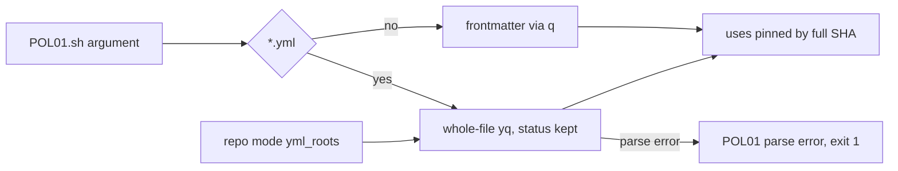

# VF02a: POL01 extension (yml whole-file walk, parse error, yml roots)
- Status: done
- PR: #9
- Area: verify
- Wave: W2
- Block: 2
- Lane: Builder
- Depends on: none (part of [VF02](../verify/VF02.md); VF01 does not touch POL01)
- proof: `bash policies/checks/POL01.sh test/fixtures/bad/POL01-verify-template-tag.yml` and `bash policies/checks/POL01.sh test/fixtures/bad/POL01-verify-template-broken.yml` each exit 1, `bash policies/checks/POL01.sh workflows/squad-review.md` and `bash policies/checks/POL01.sh test/fixtures/good/POL01.md` each exit 0, `./scripts/verify.sh` ends with `0 failures`
- door: two-way
- triage: build (POL01 rows of VF02, split out by Strategy so lane 2 can run beside VF01)
- feedback: POL23 inside `./scripts/verify.sh` runs both new `bad/POL01-*.yml` cases (each must exit 1) and `good/POL01.md` (must exit 0); `0 failures`
- harness: none (script)
- review-input: diff + this PBI + DoD (+ [VF02](../verify/VF02.md)) + PR description, never builder session logs (PA6)
- kind: script
- Source: PA8 (Sven via Fleet, Development Agentic Workflows room, 2026-10-26; split by Strategy, VF02 parts) https://github.com/cursor/plugins/blob/main/pstack/skills/create-verification-skill/SKILL.md
## Goal
POL01 also checks action pins in plain GitHub Actions yml, the kind VF02 ships under `workflows/shared/verify/`. A yml that does not parse fails POL01 instead of passing silently. Markdown workflows keep the frontmatter path, so their markdown body is never parsed as yml.
## Context
Before this part, POL01 file mode read only frontmatter through `q()` (`policies/checks/lib.sh`). A `.yml` file has no frontmatter, so `bad/POL01-verify-template-tag.yml` passed. Repo mode walked `.github/workflows/*.yml` with a hardcoded glob and dropped the `yq` status, so a parse error printed nothing and exited 0.

Cursor review 5654194791 finding 1 (high) on the VF02 spec: a whole-file `yq` walk on `workflows/squad-review.md` fails on the markdown body, so `./scripts/verify.sh` would go red. Fix: keep `q()` for `*.md`, use the whole-file walk with its status only for `*.yml`.
## Steps
1. `policies/checks/POL01.sh`: a `*.yml` argument goes to `yml_walk` (whole-file `yq`, status kept, parse error prints `file:line POL01 parse error`). Every other file keeps the `q()` frontmatter path.
2. `policies/checks/POL01.sh` repo mode: walk every glob in `policies/POL01.yml` `yml_roots` with `yml_walk`, skip `*.lock.yml`. An empty glob is not a hit (VF02f adds the files).
3. `policies/POL01.yml`: `yml_roots` (`.github/workflows/*.yml`, `workflows/shared/verify/*.yml`) and the rule text.
4. Fixtures: `test/fixtures/bad/POL01-verify-template-tag.yml`, `test/fixtures/bad/POL01-verify-template-broken.yml`. POL23 already runs `bad/POLnn-*.yml` cases, so no POL23 change.
5. Run `./scripts/verify.sh` twice on the SHA.
## Definition of Done
- [x] `test/fixtures/bad/POL01-verify-template-tag.yml` makes POL01 exit 1 (whole-file walk).
- [x] `test/fixtures/bad/POL01-verify-template-broken.yml` makes POL01 exit 1 with `POL01 parse error`, in file mode and through repo mode (Cursor 5651632842 high 3).
- [x] `workflows/squad-review.md` and `test/fixtures/good/POL01.md` still make POL01 exit 0; `.md` keeps `q()` (Cursor 5654194791 f1).
- [x] Repo mode reads its yml roots from `policies/POL01.yml` `yml_roots`, not a hardcoded glob; an empty `workflows/shared/verify/` glob exits 0.
- [x] `policies/checks/POL23.sh` and `scripts/verify.sh` are not changed (VF01 owns them).
- [x] `./scripts/verify.sh` exits 0 with `0 failures`, twice on the PR SHA.
- [x] No long dashes, no secrets, no IDs added.
## Technical design
- Components and files: `policies/checks/POL01.sh`, `policies/POL01.yml`, `test/fixtures/bad/POL01-verify-template-tag.yml`, `test/fixtures/bad/POL01-verify-template-broken.yml`
- Module boundary: `bash policies/checks/POL01.sh [FILE...]` prints `file:line POL01 message` and exits 0 or 1; behind it the file kind split (`*.yml` whole-file walk, other files frontmatter via `q()`) and the `yml_roots` glob loop
- Interfaces: `policies/POL01.yml` key `yml_roots` (list of repo relative globs); exit 0 clean, 1 hit (including parse error), 2 missing path or `yq` (lib.sh)
- Sequence:

- Failure modes: a `.yml` that does not parse is a hit at the line `yq` names (1 when none); an action pinned by tag or branch is a hit; a missing `yml_roots` glob match is not a hit; a `.md` body is never parsed as yml
- Security: read-only, no network; fail closed on unparsable yml
- Observability: `file:line POL01 message` lines in the `./scripts/verify.sh` policies section
- Cost: 0 AIC
- Rollback: revert the PR
- Proof: same as proof: above
- Door: two-way (one check script, one config key, two fixtures)
## Evidence
- Two `./scripts/verify.sh` logs on the PR SHA, `0 failures` (gate log comment on the PR).
- POL01 output on each fixture and on a temp repo copy with a broken and a tag-pinned `workflows/shared/verify/verify.yml` (PR description).
## Flow

## Named asks for Sven
None.
## Cost
0 AIC.
## Sources
- [VF02](../verify/VF02.md) (Where it lives, Action pins), [POL01](POL01-pinned-versions-only.md)
- Strategy split check on main `1987bfa`, section VF02a
- Cursor review 5654194791 finding 1
