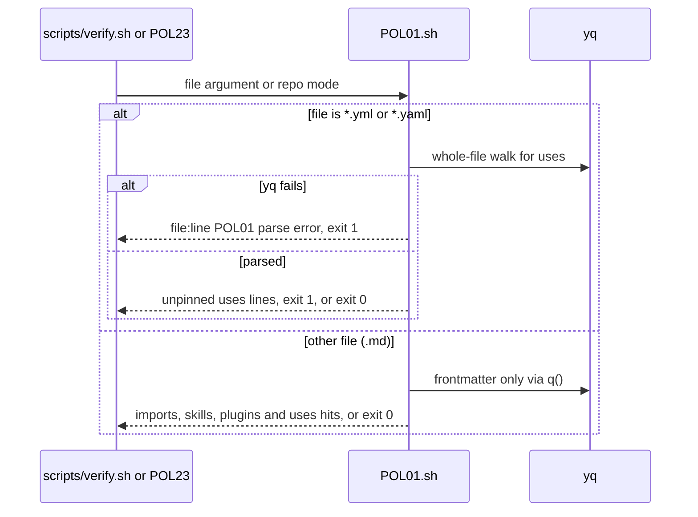
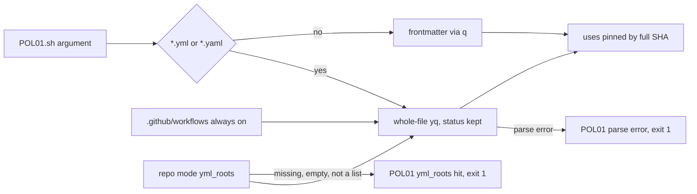

# VF02a: POL01 extension (yml whole-file walk, parse error, yml roots)
- Status: done
- PR: #9
- Area: verify
- Wave: W2
- Block: 2
- Lane: Builder
- Depends on: none (part of [VF02](../verify/VF02.md); VF01 does not touch POL01)
- proof: `bash scripts/test-POL01-roots.sh` ends with `0 failures`; `bash policies/checks/POL01.sh test/fixtures/bad/POL01-verify-template-tag.yml`, `bash policies/checks/POL01.sh test/fixtures/bad/POL01-verify-template-tag.yaml`, `bash policies/checks/POL01.sh test/fixtures/bad/POL01-docker-tag.yml` and `bash policies/checks/POL01.sh test/fixtures/bad/POL01-verify-template-broken.yml` each exit 1, `bash policies/checks/POL01.sh workflows/squad-review.md` and `bash policies/checks/POL01.sh test/fixtures/good/POL01.md` each exit 0, `./scripts/verify.sh` ends with `0 failures`
- door: two-way
- triage: build (POL01 rows of VF02, split out by Strategy so lane 2 can run beside VF01)
- feedback: POL23 inside `./scripts/verify.sh` runs both new `bad/POL01-*.yml` cases (each must exit 1) and `good/POL01.md` (must exit 0); `bash scripts/test-POL01-roots.sh` runs the repo-mode and `.yaml` cases in temp copies; both end with `0 failures`
- harness: none (script)
- review-input: diff + this PBI + DoD (+ [VF02](../verify/VF02.md)) + PR description, never builder session logs (PA6)
- kind: script
- Source: PA8 (Sven via Fleet, Development Agentic Workflows room, 2026-10-26; split by Strategy, VF02 parts) https://github.com/cursor/plugins/blob/main/pstack/skills/create-verification-skill/SKILL.md
## Goal
POL01 also checks action pins in plain GitHub Actions yml (`.yml` and `.yaml`), the kind VF02 ships under `workflows/shared/verify/`. A yml that does not parse fails POL01 instead of passing silently. Markdown workflows keep the frontmatter path, so their markdown body is never parsed as yml.
## Context
Before this part, POL01 file mode read only frontmatter through `q()` (`policies/checks/lib.sh`). A `.yml` file has no frontmatter, so `bad/POL01-verify-template-tag.yml` passed. Repo mode walked `.github/workflows/*.yml` with a hardcoded glob and dropped the `yq` status, so a parse error printed nothing and exited 0.

Cursor review 5654194791 finding 1 (high) on the VF02 spec: a whole-file `yq` walk on `workflows/squad-review.md` fails on the markdown body, so `./scripts/verify.sh` would go red. Fix: keep `q()` for `*.md`, use the whole-file walk with its status only for `*.yml`.
## Steps
1. `policies/checks/POL01.sh`: a `*.yml` or `*.yaml` argument goes to `yml_walk` (whole-file `yq`, status kept, parse error prints `file:line POL01 parse error`). Every other file keeps the `q()` frontmatter path.
2. `policies/checks/POL01.sh` repo mode: always walk `.github/workflows/*.yml` and `*.yaml` (hardcoded), then every glob in `policies/POL01.yml` `yml_roots` (every glob matches both `.yml` and `.yaml`, each file walked once), lock files included (Cursor 5655309259 f1, f3). Config can add roots, never drop the always-on one. A missing, empty, non-list or unreadable `yml_roots` key, a blank entry or an entry that does not end in `.yml` or `.yaml`, is a hit at `policies/POL01.yml`, exit 1. A glob with no match is not a hit (VF02f adds the files).
3. `policies/POL01.yml`: `yml_roots` (`.github/workflows/*.yml`, `workflows/shared/verify/*.yml`) and the rule text.
4. Fixtures: bad `test/fixtures/bad/POL01-verify-template-tag.yml`, `test/fixtures/bad/POL01-verify-template-broken.yml`, `test/fixtures/bad/POL01-verify-template-tag.yaml`; bad `test/fixtures/bad/POL01-docker-tag.yml` (`docker://alpine:3.20`, Cursor 5655309259 f2); good `test/fixtures/good/POL01-verify-template-sha.yml` (whole-file yml, every action pinned, a `docker://` digest, a `./` local action; Cursor 5655065383 f3). POL23 already runs `bad/POLnn-*.yml` and `good/POLnn-*.yml` cases, so no POL23 change. POL23 does not glob `.yaml`, so `scripts/test-POL01-roots.sh` runs the `.yaml` fixture.
5. `scripts/test-POL01-roots.sh`: repo-mode cases for `yml_roots` and `.yaml`, each in a temp copy of the tree. `./scripts/verify.sh` shellchecks it; running it is a DoD command, because wiring it into the gate means editing `scripts/verify.sh` or `POL23.sh` (VF01 owns both).
6. Run `./scripts/verify.sh` and `bash scripts/test-POL01-roots.sh` twice on the SHA.
## Definition of Done
- [x] `test/fixtures/bad/POL01-verify-template-tag.yml` makes POL01 exit 1 (whole-file walk).
- [x] `test/fixtures/bad/POL01-verify-template-broken.yml` makes POL01 exit 1 with `POL01 parse error`, in file mode and through repo mode (Cursor 5651632842 high 3).
- [x] `workflows/squad-review.md` and `test/fixtures/good/POL01.md` still make POL01 exit 0; `.md` keeps `q()` (Cursor 5654194791 f1).
- [x] Repo mode always walks `.github/workflows/*.yml` and `*.yaml`, then adds `policies/POL01.yml` `yml_roots`; a root glob with no match (empty `workflows/shared/verify/`) exits 0 (Reviewer FAIL 6420580436 item 2).
- [x] `bash scripts/test-POL01-roots.sh` ends with `0 failures`: removing `yml_roots` exits 1, `yml_roots: []` exits 1, a string, map or null value exits 1, a blank entry exits 1, an unreadable `policies/POL01.yml` exits 1, and with the key deleted (or set without `.github/workflows/*.yml`) `actions/checkout@v4` in `.github/workflows/verify.yml` is still a hit (Reviewer FAIL 6420580436 items 1 to 3).
- [x] With `yml_roots: []` an unpinned `.github/workflows/d.yml` exits 1, an unpinned `.github/workflows/d.yaml` exits 1, and a tag-pinned `workflows/shared/verify/verify.yaml` exits 1 in repo mode (Tester FAIL on 7059cf9).
- [x] `test/fixtures/bad/POL01-verify-template-tag.yaml` passed by name takes the whole-file walk and exits 1 (Tester FAIL on 7059cf9).
- [x] A `docker://` ref passes only as `@sha256:` plus 64 hex: `docker://alpine:3.20` and `docker://alpine` exit 1, `docker://alpine@sha256:<64-hex>` and `./local-action` exit 0, in `scripts/test-POL01-roots.sh` (Cursor 5655065383 f2, Reviewer FAIL 6420778801, Tester FAIL on c3dbcdc).
- [x] `test/fixtures/good/POL01-verify-template-sha.yml` exits 0 and POL23 runs it (Cursor 5655065383 f3).
- [x] A `yml_roots` entry that does not end in `.yml` or `.yaml` is a config hit, never a walk (Reviewer nit on c3dbcdc).
- [x] Lock files are walked: unpinned `actions/checkout@v4` in `.github/workflows/evil.lock.yml` or `.github/workflows/evil.lock.yaml` exits 1 (Cursor 5655309259 f1). `./scripts/verify.sh` stays `0 failures` on the real tree; `bash policies/checks/POL01.sh workflows/squad-review.lock.yml` exits 0.
- [x] `test/fixtures/bad/POL01-docker-tag.yml` exits 1 and POL23 runs it (Cursor 5655309259 f2).
- [x] Roots are symmetric: a `*.yaml` entry also walks `*.yml` and a `*.yml` entry also walks `*.yaml`; listing both walks each file once (one hit) (Cursor 5655309259 f3).
- [x] `policies/checks/POL23.sh` and `scripts/verify.sh` are not changed (VF01 owns them).
- [x] `./scripts/verify.sh` exits 0 with `0 failures`, twice on the PR SHA.
- [x] No long dashes, no secrets, no IDs added.
## Technical design
- Components and files: `policies/checks/POL01.sh`, `policies/POL01.yml`, `scripts/test-POL01-roots.sh`, `test/fixtures/good/POL01-verify-template-sha.yml`, `test/fixtures/bad/POL01-verify-template-tag.yml`, `test/fixtures/bad/POL01-verify-template-tag.yaml`, `test/fixtures/bad/POL01-verify-template-broken.yml`, `test/fixtures/bad/POL01-docker-tag.yml`
- Module boundary: `bash policies/checks/POL01.sh [FILE...]` prints `file:line POL01 message` and exits 0 or 1; behind it the file kind split (`*.yml` and `*.yaml` whole-file walk, other files frontmatter via `q()`), the always-on `.github/workflows/` root and the `yml_roots` glob loop
- Interfaces: `policies/POL01.yml` key `yml_roots` (non-empty list of repo relative glob strings, added to the always-on `.github/workflows/*.yml`); exit 0 clean, 1 hit (including parse error), 2 missing path or `yq` (lib.sh)
- Sequence:

- Failure modes: a `.yml` or `.yaml` that does not parse is a hit at the line `yq` names (1 when none); an action pinned by tag or branch is a hit; a `docker://` image without `@sha256:<64-hex>` is a hit (a `./` local action is fine); a `yml_roots` key that is missing, empty, not a list, has a blank entry, has an entry that does not end in `.yml` or `.yaml`, or cannot be read is a hit at `policies/POL01.yml`; a `yml_roots` glob with no match is not a hit; `.github/workflows/*.yml` and `*.yaml` are walked whatever the config says, lock files included; a duplicate `uses` key in one step is read as its last value (known gap, Cursor 5655309259 f4, noted under VF02b); a `.md` body is never parsed as yml
- Security: read-only, no network; fail closed on unparsable yml and on a broken `yml_roots` key, so a config edit never switches the check off
- Observability: `file:line POL01 message` lines in the `./scripts/verify.sh` policies section
- Cost: 0 AIC
- Rollback: revert the PR
- Proof: same as proof: above
- Door: two-way (one check script, one test script, one config key, five fixture files)
## Evidence
- Two `./scripts/verify.sh` logs on the PR SHA, `0 failures` (gate log comment on the PR).
- POL01 output on each fixture and `bash scripts/test-POL01-roots.sh` output (PR description and gate log).
## Flow

## Named asks for Sven
None.
## Cost
0 AIC.
## Sources
- [VF02](../verify/VF02.md) (Where it lives, Action pins), [POL01](POL01-pinned-versions-only.md)
- Strategy split check on main `1987bfa`, section VF02a
- Cursor review 5654194791 finding 1
- Reviewer FAIL on 7059cf9 (PR comment 6420580436), Tester FAIL on 7059cf9
- Cursor review 5655309259 (f1 to f5), Cursor review 5655065383 (f1 to f4), Reviewer FAIL on c3dbcdc (PR comment 6420778801), Tester FAIL on c3dbcdc
