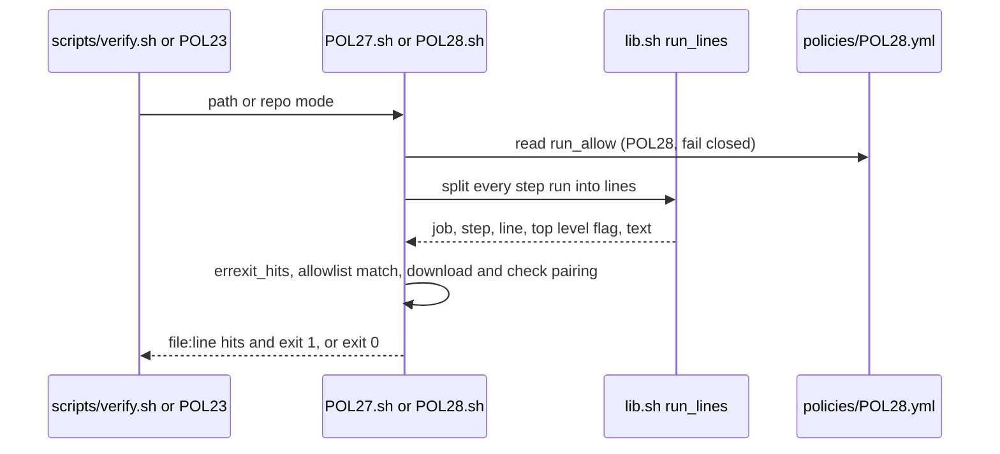
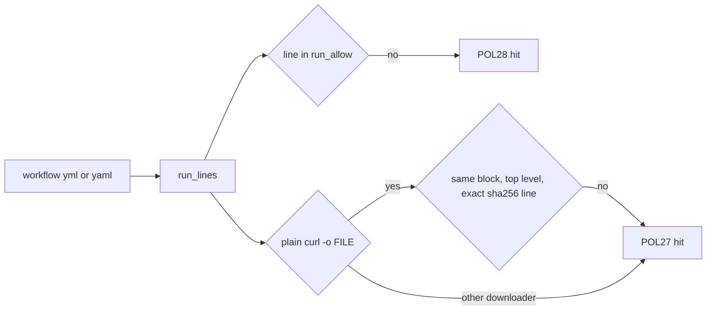

# VF02d1: Gate job run allowlist (POL27 and POL28)
- Status: done
- PR: #13
- Area: verify
- Wave: W2
- Block: 2
- Lane: Builder
- Depends on: VF01 (#10); part of [VF02](../verify/VF02.md), pulled forward from VF02d by the Product Owner 2026-10-26, lane 1 before SM05a
- proof: `bash policies/checks/POL27.sh test/fixtures/bad/POL27/<case>` and `bash policies/checks/POL28.sh test/fixtures/bad/POL28/<case>` exit 1 on every immediate child case, `bash policies/checks/POL27.sh test/fixtures/good/POL27/`, `bash policies/checks/POL28.sh test/fixtures/good/POL28/` and both checks in repo mode exit 0, `bash scripts/test-POL28-allow.sh` ends with `0 failures`, `./scripts/verify.sh` ends with `0 failures`
- door: two-way
- triage: build (closes the 2 high and 2 medium findings of Cursor review 5655973880, waived at the #10 merge per Sven 2026-10-26)
- feedback: POL23 inside `./scripts/verify.sh` runs every new `bad/POL27/` and `bad/POL28/` case (each must exit 1) and both good folders (must exit 0); `bash scripts/test-POL28-allow.sh` runs the fail closed and mutation cases in temp copies; both end with `0 failures`
- harness: none (script)
- review-input: diff + this PBI + DoD (+ [VF02](../verify/VF02.md)) + PR description, never builder session logs (PA6)
- kind: script
- Source: PA8 (Strategy plan `VF02d1`, Development Agentic Workflows room, 2026-10-26; Cursor review 5655973880 on #10, Tester 2 comments 6421487873 item 3 and 6421708289) https://github.com/svennijhuis/agentic-workflows/pull/10
## Goal
Close the 2 high POL27 bypasses that main carried after #10 and end the denylist loop. In every job of a `.github/workflows/*.yml` or `*.yaml` (not `*.lock.yml`), every `run:` line must match a known shape. Anything else is a hit, exit 1.
## Context
On #10 at `4f7ec56` POL28 was a denylist over shell text, so every new command start form (`bash -c`, `npx`, `go run`, `if`, `sudo -u root`) slipped through. POL27 looked for the exact check line anywhere in the file, so `if false; then` around it, a check in another step, or a pinned url that was only echoed while `/usr/bin/curl` fetched another file all exited 0 (Cursor 5655973880 f1, f2). Sven merged #10 with these findings waived and moved them here.

Allowed shapes (`policies/POL28.yml`, whole line, `grep -xE`; blank lines and comments are dropped before the match):
- `run_allow:` (every workflow): `./scripts/verify.sh`, `set -euo pipefail`
- `setup_allow:` (only in a file named `verify.yml`, where POL27 checks every download): `gh extension install github/gh-aw --pin vX.Y.Z`, `mkdir -p "$HOME/bin" && cd "$HOME/bin"`, `curl <flags> -o <file> https://<url>` (plain `curl` only), `echo "<64 hex>  <file>" | sha256sum -c -`, `tar <flags> <file> [--strip-components=N] [members]`, `chmod +x <file>`, `rm -f ./<glob>`, `echo "$HOME/bin" >> "$GITHUB_PATH"`

Builder deviations from the Strategy plan, each closing a bypass found while building: install shapes are scoped to `verify.yml` (a `ci.yml` could otherwise curl a binary, put it on PATH and then run `./scripts/verify.sh`); `mv` and `install` are left out (the real `verify.yml` does not use them, and they could move a repo file onto PATH); POL27 requires the `tar` archive and the `chmod +x` file to be a checked `-o` file from earlier in the same block; an `env:` that sets `PATH`, `BASH_ENV`, `ENV`, `SHELLOPTS` or `BASHOPTS` is a hit (it could swap `sha256sum` or turn errexit off).

Fix map (every finding of Cursor review 5655973880, plus the draft cases):

| Finding | Fix | Bad case (exit 1) |
|---|---|---|
| f1 high: `\curl`, `/usr/bin/curl`, `bin/curl`, `wget -O`, pinned url only echoed | POL27: a download is only a top-level line that starts with plain `curl ` and has `-o FILE`; any other curl spelling and any `wget` or `aria2c` is a hit; a tools url counts as installed only when a plain curl line fetched and checked it | `bad/POL27/verify-curl-backslash`, `verify-curl-usr-bin`, `verify-curl-bin-path`, `verify-curl-command`, `verify-wget`, `verify-aria2c` |
| f2 high: check line under `if false`, or not in the curl's `run:` block | POL27: the check line must be in the same `run:` block as its curl, after it, at the top level (no `if`, `then`, `case`, loop, group, heredoc or `\` continuation opened before it in that block), via `run_lines` in `policies/checks/lib.sh` | `verify-sha256-if-false`, `verify-sha256-other-step`, `verify-sha256-if-block`, `verify-sha256-if-condition`, `verify-sha256-heredoc` |
| f3 medium: `continue-on-error: true`, `shell: bash {0}`, `set +o 'errexit'` | `errexit_hits` in `lib.sh` (POL27 and POL28): `continue-on-error` on a step or job, a `shell:` (step, job or workflow `defaults.run.shell`) other than `bash` or `sh` with no `-e` or `errexit`; `set +e` and `set +o errexit` match with or without quotes | `verify-continue-on-error-step`, `verify-continue-on-error-job`, `verify-shell-bash-no-e`, `verify-defaults-shell-no-e`, `verify-set-plus-e`, `verify-set-o-errexit-single-quoted`, `verify-set-o-errexit-double-quoted` |
| f4 medium: `sudo -u root actionlint`, `env -u PATH actionlint`, `xargs -I {} actionlint` | POL28: `run_allow:` allowlist replaces the `WRAP` and `ADHOC` denylist; missing, empty, non-list, blank or broken regex is a hit (fail closed); every `uses:` is `actions/checkout@<40 hex>` | `bad/POL28/ci-sudo-u-root-actionlint.yml`, `ci-env-u-path-actionlint.yml`, `ci-xargs-i-actionlint.yml`, `ci-uses-other-action.yml` |
| Builder: install shapes outside `verify.yml`, unchecked `tar` or `chmod` file, `env:` PATH or BASH_ENV | POL28 `setup_allow:` scope; POL27 operand pairing; `errexit_hits` env keys | `bad/POL28/ci-place-binary.yml`, `bad/POL27/verify-tar-unchecked-file`, `verify-chmod-unchecked-file`, `verify-env-path`, `verify-env-bash-env` |
| f5 low: version `1.7.1` matches a `1.7.12` url | POL27: the version must be its own token in the url | `bad/POL27/aw-version-substring` |
| f6 low: `*.yaml` workflows not scanned | POL28 repo mode, POL28 file mode and `gate_actionlint` in `scripts/lib/gate-steps.sh` read `*.yaml` too, `*.lock.yml` still skipped | `bad/POL28/ci-yaml-actionlint.yaml` |
| f7 low: one VF02d DoD bullet holds two checks | split into two bullets in [VF02](../verify/VF02.md) | none (doc) |
| Tester 2 6421487873 item 3 | allowlist | `bad/POL28/ci-bash-c-actionlint.yml`, `ci-if-actionlint.yml`, `ci-go-run-actionlint.yml`, `ci-npx-shellcheck.yml`, `ci-unknown-run.yml` (`make lint`) |
| Tester 2 6421708289 carries | exact top-level check line | `bad/POL27/verify-sha256-or-exit-0`, `verify-sha256-or-echo-skip`, `verify-sha256-or-bin-true`, `verify-sha256-pipe-true`, `verify-sha256-if-not-subshell` |
## Steps
1. `policies/checks/lib.sh`: `run_lines FILE` (one row per shell line of every step `run:` with job, step, file line and a top-level flag) and `errexit_hits FILE ID`.
2. `policies/checks/POL28.sh`: read `run_allow:` and `setup_allow:` fail closed, hit on any run line that matches no entry, `uses:` only `actions/checkout@<40 hex>`, `errexit_hits`, `*.yaml` roots. Drop the `WRAP` and `ADHOC` denylist.
3. `policies/checks/POL27.sh`: downloader allowlist, same block and top-level check line, `errexit_hits`, quoted `set +o errexit`, version token.
4. `policies/POL28.yml` `run_allow:` and `setup_allow:`; rule text of POL27 and POL28.
5. `scripts/lib/gate-steps.sh`: `gate_actionlint` on `*.yaml` too.
6. Bad cases under the existing `bad/POL27/` and `bad/POL28/` folders (POL23 runs each child alone).
7. `scripts/test-POL28-allow.sh`: fail closed cases and the mutation case in temp copies.
## Definition of Done
- [x] Every bad case in the fix map exits exactly 1 alone; every existing bad case still exits 1; `good/POL27/`, `good/POL28/` and the real `.github/workflows/verify.yml` (repo mode) exit 0.
- [x] Deleting `run_allow` exits 1 (`bash scripts/test-POL28-allow.sh`, case `allow-deleted`); empty, string, null, blank entry, bad regex and unreadable config exit 1 too, and so does a deleted or empty `setup_allow`.
- [x] Mutation: `run_allow: [".*"]` in a scratch copy makes POL23 report the allowlist-only POL28 bad cases as passing (`mutation-allow-all`).
- [x] `./scripts/verify.sh` 0 failures, run twice. `check-pbi-docs` 0 lines. gitleaks clean. No long dashes.
- [x] Fix map cites Cursor 5655973880 (f1 to f4 plus the 3 lows), Tester 2 6421487873 item 3 and Tester 2 6421708289.
- [ ] Clean Cursor review of the exact head SHA (no medium or higher): checked by Reviewer at the gate.
- [x] `policies/checks/POL23.sh` and `scripts/verify.sh` are not changed (no lane 2 clash).
## Technical design
- Components and files: `policies/checks/lib.sh`, `policies/checks/POL27.sh`, `policies/checks/POL28.sh`, `policies/POL27.yml`, `policies/POL28.yml`, `scripts/lib/gate-steps.sh`, `scripts/test-POL28-allow.sh`, new cases under `test/fixtures/bad/POL27/` and `test/fixtures/bad/POL28/`
- Module boundary: `bash policies/checks/POL27.sh [PATH...]` and `bash policies/checks/POL28.sh [PATH...]` print `file:line POLnn message` and exit 0 or 1; behind them `run_lines` (the one shell line split both use) and `errexit_hits`
- Interfaces: `policies/POL28.yml` keys `run_allow` (every workflow) and `setup_allow` (only a file named `verify.yml`), each a non-empty list of regex strings matched against a whole run line; exit 0 clean, 1 hit (parse error and broken config included), 2 missing path or tool (lib.sh)
- Sequence:

- Failure modes: a run line outside `run_allow` is a hit; a broken `run_allow` is a hit at `policies/POL28.yml`; a download without its top-level check line in the same block, any non plain curl, `wget` or `aria2c`, `continue-on-error`, a shell without `-e` or a `set +e` before the check is a hit; a multi-line `shell:` value is read by its first line only (fails closed)
- Security: read-only, no network, fail closed; the allowlist only grows by a reviewed edit to `policies/POL28.yml`
- Observability: `file:line POL27` and `file:line POL28` lines in the `./scripts/verify.sh` policies section
- Cost: 0 AIC
- Rollback: revert the PR
- Proof: same as proof: above
- Door: two-way (two check scripts, one helper pair, one config key, fixtures)
## Evidence
- Gate log comment on the PR head SHA: two `./scripts/verify.sh` runs with `0 failures`, `scripts/test-POL28-allow.sh`, `scripts/test-POL01-roots.sh`, POL23, gitleaks, and the probe table (every case exit 1, controls exit 0).
## Flow

## Named asks for Sven
None.
## Cost
0 AIC, scripts only.
## Sources
- Cursor review 5655973880 on #10 at `4f7ec56` (f1 to f7).
- Tester 2 comments 6421487873 item 3 and 6421708289 on #10.
- Strategy plan VF02d1 (supersedes the VF01b draft), Development Agentic Workflows room, 2026-10-26.
