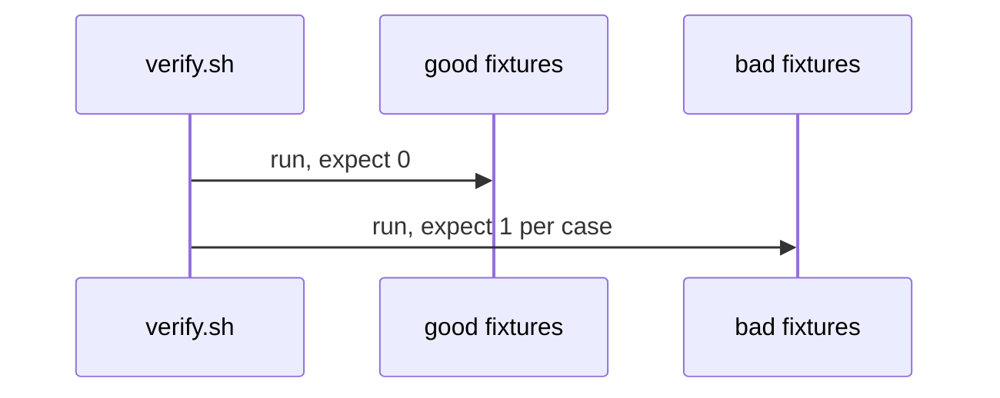
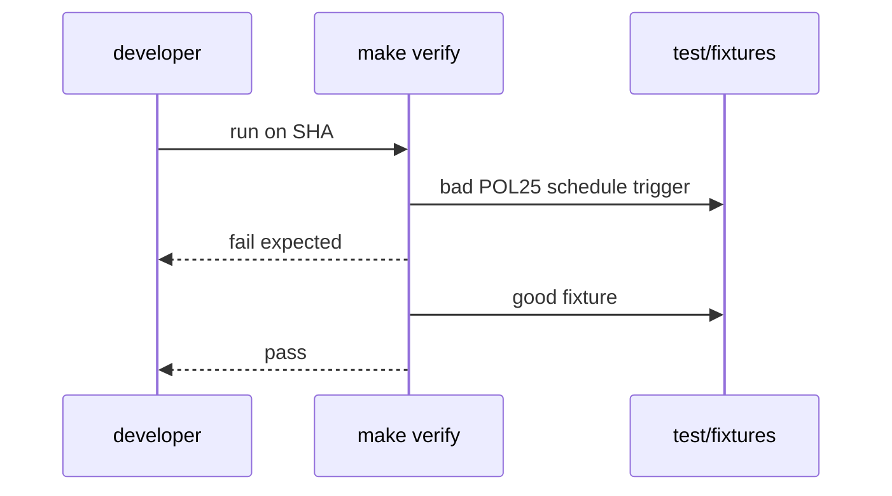

# X03: Verify fixtures
- Status: done
- PR: #4
- Area: testing
- Wave: PR 0
- Block: 1
- Lane: Builder
- Depends on: C01
- proof: `make verify` (exit 0 on clean SHA; POL25 and POL31 bad fixtures fail when run alone)
- door: two-way
## Goal
Document `test/fixtures/` good and bad layout for POL25 and POL31, exercised by `scripts/verify.sh`.
## Context
C01 local verify replaces CI until Q0 fixed. Fixtures prove POL25 and POL31 fail closed on bad cases and pass on good ones.
## Steps
1. Map POL25 and POL31 to paths under `test/fixtures/bad/` and `test/fixtures/good/`.
2. Document good fixture minimal valid workflow snippet.
3. Wire `scripts/verify.sh` to run both checks on repo and fixtures after compile.
## Definition of Done
- [x] POL25 and POL31 have bad and good fixture paths documented.
- [x] `make verify` on clean SHA passes; bad fixtures fail when checked in isolation.
- [x] Evidence records verify log on exact SHA.
## Technical design
- Components and files: `test/fixtures/good/POL25*`, `test/fixtures/bad/POL25*`, `test/fixtures/good/POL31*`, `test/fixtures/bad/POL31/`
- Interfaces: `make verify`
- Sequence:

- Failure modes: A fixture passes by accident; fix the check or fixture in the same PR
- Security: Fake token strings are clearly fake (no real prefix length)
- Observability: Fixture run output in the PR
- Cost: 0 AIC
- Rollback: Revert the PR
- Proof: Fixture run output in the PR
- Door: two-way (files)
## Evidence

Shipped in PR #4 (Block 1). Gate: `make verify` log on the exact head SHA, posted as a PR comment (Q0, Actions billing blocked).
## Flow

## Named asks for Sven
(Q0)
## Cost
n/a
## Sources
- https://github.github.com/gh-aw/reference/compilation-process/
- https://github.github.com/gh-aw/reference/workflow-linters/
