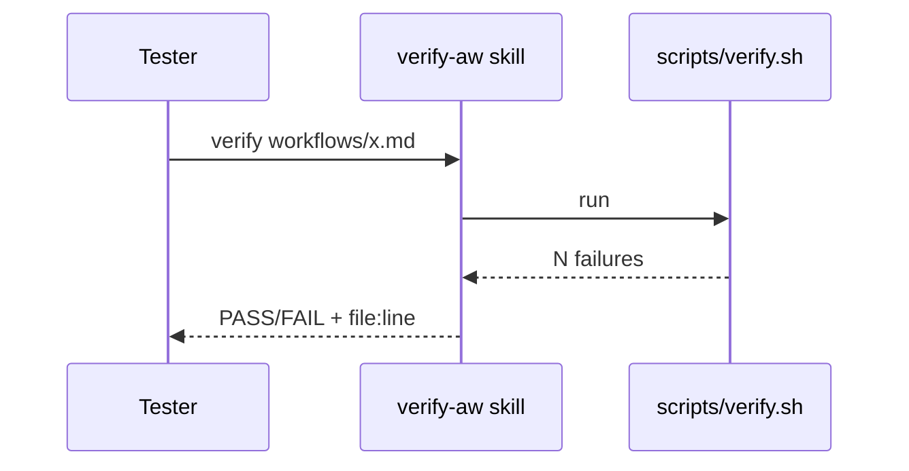
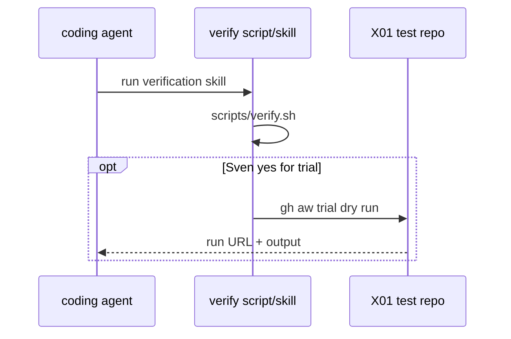

# X06: Verification skill (repo-local)
- Status: done
- PR: #4
- Area: testing
- Wave: W1
- Block: 1
- Lane: Builder
- Depends on: none
- proof: ./scripts/verify.sh; test -f docs/how-to/verify-workflow.md
- door: two-way
## Goal
Repo-local verification skill and thin wrapper over `scripts/verify.sh`: compile strict, optional `gh aw trial` or `workflow_dispatch` dry run on scratch repo, read output. Tester and Builder share one path (gist candidates 5, points 1 and 3).
## Context
First PBI in Block 1 (before [C01](C01-verify-script.md)): specs the thin verification skill; [C01](C01-verify-script.md) implements `scripts/verify.sh`. Both land in Block 1; X06 does not require C01 merged first. Tester uses this skill from Block 2 onward. Deterministic parts live in the script; skill doc tells agents when to run it. Pairs with X02 staged checklist and [gist-review.md](../gist-review.md) A2.
## Steps
1. Add `docs/how-to/verify-workflow.md` or testing skill doc referenced from AGENTS.md.
2. Script steps: `scripts/verify.sh`, optional `gh aw trial` against X01 with report-only workflow.
3. Document credit warning: trial spends AIC only on Sven yes for a given workflow.
4. Link from F00 gist ratings and D06 CLI runbook.
## Definition of Done
- [ ] Skill doc lists exact commands and expected green output
- [ ] Script or makefile target callable from CI optional job (non-spending)
- [ ] Linked from X02 and D06
- [ ] Mermaid flow present
## Technical design
- Components and files: `.github/skills/verify-aw/SKILL.md`, reference to `scripts/verify.sh`
- Interfaces: Input: a workflow path. Output: PASS/FAIL checklist (compile --strict, lock fresh, POL checks, `gh aw trial` dry run command printed, not run)
- Sequence:

- Failure modes: Skill drifts from verify.sh, so the skill only calls verify.sh and holds no rules of its own
- Security: No tokens. The trial run is printed only (a trial spends tokens and needs Sven's yes)
- Observability: One output line per failure, same lines as verify.sh
- Cost: 0 AIC (script)
- Rollback: Delete the `.github/skills/verify-aw/` folder
- Proof: Tester runs the skill on one good and one bad fixture
- Door: two-way (repo-local file, no spend)
## Evidence

Shipped in PR #4 (Block 1). Gate: `./scripts/verify.sh` log on the exact head SHA, posted as a PR comment (Q0, Actions billing blocked).
(sample log from verify.sh + optional trial transcript)
## Flow

## Named asks for Sven
X01 (test repo); trial runs need per-workflow yes when spending credits
## Cost
n/a for verify.sh; trial tier varies (unverified)
## Sources
- gist-handover-agentic-workflows.md candidate 5
- Plan v3.2 X06 Block 1
