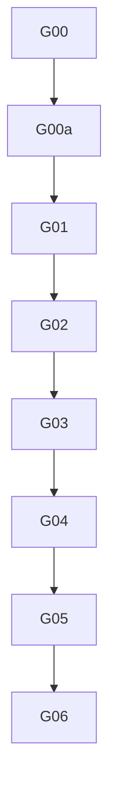

# governance: overview

**Purpose:** Rollout, RACI, consumer strategy, org switch checklist.

## PBIs

- [G00: G00-org-target-structure](G00-org-target-structure.md)
- [G00a: G00a-consumer-strategy](G00a-consumer-strategy.md)
- [G01: G01-rollout-ladder-human-review](G01-rollout-ladder-human-review.md)
- [G02: G02-raci](G02-raci.md)
- [G03: G03-onboarding-support](G03-onboarding-support.md)
- [G04: G04-config-governance](G04-config-governance.md)
- [G05: G05-org-only-appendix](G05-org-only-appendix.md)
- [G06: G06-correctionops-feedback-loop](G06-correctionops-feedback-loop.md)

## Dependency sketch

