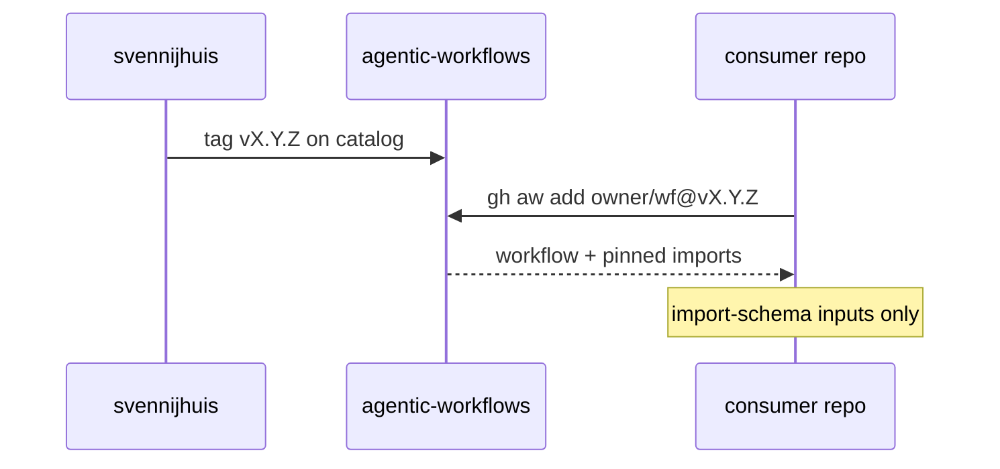

# G00: Org target structure
- Status: todo
- Area: governance
- Wave: W1
- Block: 1
- Lane: Cursor CLI
- Depends on: none
- proof: test -f docs/pbi/governance/G00-org-target-structure.md && grep -q '## Definition of Done' docs/pbi/governance/G00-org-target-structure.md
- door: two-way
## Goal
Document the org-ready target structure before C02 lands: layout, naming, versioning, `import-schema` parameter seams, and auth seams (PAT now, GitHub App later). Owner is one variable; nothing else changes at org switch except G05 checklist items.
## Context
Plan v3.1 item 1. Matches gh-aw Recommended Enterprise Pattern: `aw.yml`, flat `workflows/<name>.md`, root `shared/`, `policies/`, `scripts/verify.sh`, consumer `gh aw add svennijhuis/agentic-workflows/<wf>@<tag>`. Tags are stable releases; branches are dev only. RACI ties to G02; rollout ladder to G01.
## Steps
1. Publish governance target doc (or extend RACI.md) with directory tree matching plan C02.
2. Define naming: workflow file slug equals install name; labels in `aw.yml` for discovery.
3. Versioning: semver tags on catalog; moving `v1` policy in L01 (Q7); never install from branch.
4. Document `import-schema` inputs as the only consumer customization surface (pairs with G00a).
5. Auth seams: `COPILOT_GITHUB_TOKEN` fine-grained PAT today (C04); GitHub App path documented, not required (Q3).
6. Cross-link G05 as org-only delta checklist only.
## Definition of Done
- [ ] Layout and naming documented and aligned with C02 DoD
- [ ] Versioning and tag rules reference L01 and POL01
- [ ] Auth seams documented without secrets in repo
- [ ] Mermaid flow shows consumer install path
## Evidence
(links to governance docs, verify log on SHA when C02 merges)
## Flow

## Named asks for Sven
none
## Cost
n/a
## Sources
- https://github.github.com/gh-aw/guides/sharing-workflows/
- https://github.github.com/gh-aw/reference/aw-yml-package-manifest/
- Plan v3.1 G00
