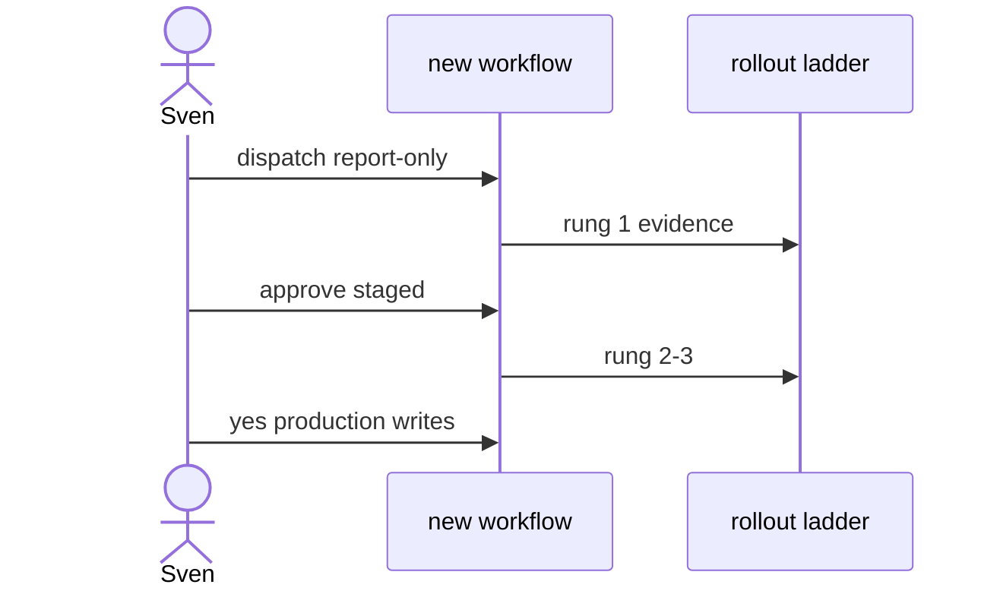

# G01: Rollout ladder + human review
- Status: todo
- Area: governance
- Wave: PR 0
- Block: 2
- Lane: Cursor CLI
- Depends on: X02
- proof: test -f docs/pbi/governance/G01-rollout-ladder-human-review.md && grep -q '## Definition of Done' docs/pbi/governance/G01-rollout-ladder-human-review.md
- door: two-way
## Goal
Define the catalog rollout ladder (report-only, staged, shadow, production writes) and human review gates before promotion.
## Context
Every workflow starts at workflow_dispatch report-only. Nothing scheduled or token-spending goes live without Sven exact yes. Aligns with safe-rollout guide and compliance patterns.
## Steps
1. Document four ladder rungs with entry and exit criteria.
2. Require human review for create-pull-request enablement.
3. Link X02 dry-run checklist and B01 audit for evidence.
4. Publish governance/ROLLOUT.md content outline (Builder).
## Definition of Done
- [ ] ROLLOUT.md ladder matches gh-aw safe-rollout guide.
- [ ] Every workflow PBI references current ladder rung.
- [ ] Promotion requires Sven yes recorded in Evidence.
## Evidence
(commands, logs, verify log on SHA, run links)
## Flow

## Named asks for Sven
(none)
## Cost
n/a
## Sources
- https://github.github.com/gh-aw/guides/safe-rollout/
- https://github.github.com/gh-aw/reference/compliance-patterns/
