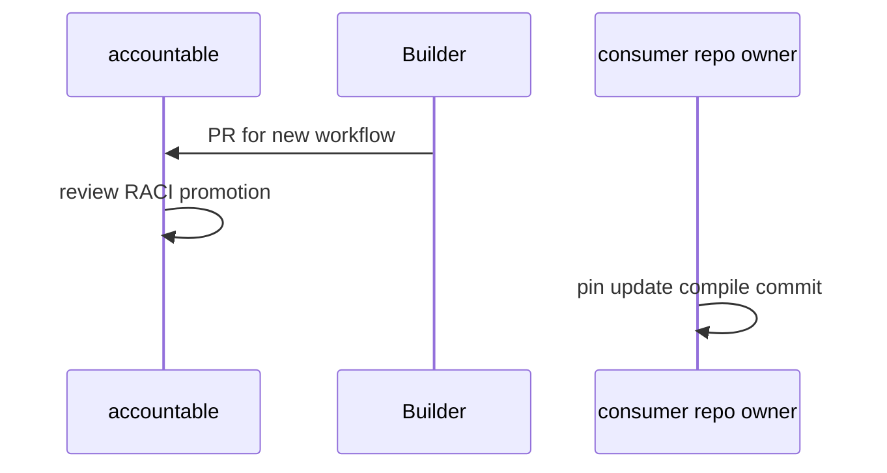

# G02: RACI
- Status: todo
- Area: governance
- Wave: PR 0
- Block: 2
- Lane: Cursor CLI
- Depends on: G01
- proof: test -f docs/pbi/governance/G02-raci.md && grep -q '## Definition of Done' docs/pbi/governance/G02-raci.md
- door: two-way
## Goal
Document RACI for catalog ownership, consumer repos, secrets, and workflow promotion decisions on personal account today.
## Context
Sven is accountable for promotion yes and secrets. Builder implements. Cursor CLI authors docs. Org roles documented as future in G05 only.
## Steps
1. Draft governance/RACI.md matrix: catalog, workflows, secrets, releases.
2. Map CODEOWNERS paths to responsible parties.
3. Clarify consumer team responsibilities for pins and compile commits.
## Definition of Done
- [ ] RACI.md covers at least catalog merge, secret injection, promotion, incident response.
- [ ] No org team names required for personal account phase.
## Evidence
(commands, logs, verify log on SHA, run links)
## Flow

## Named asks for Sven
(none)
## Cost
n/a
## Sources
- https://github.github.com/gh-aw/guides/sharing-workflows/
- https://github.github.com/gh-aw/reference/governance/
