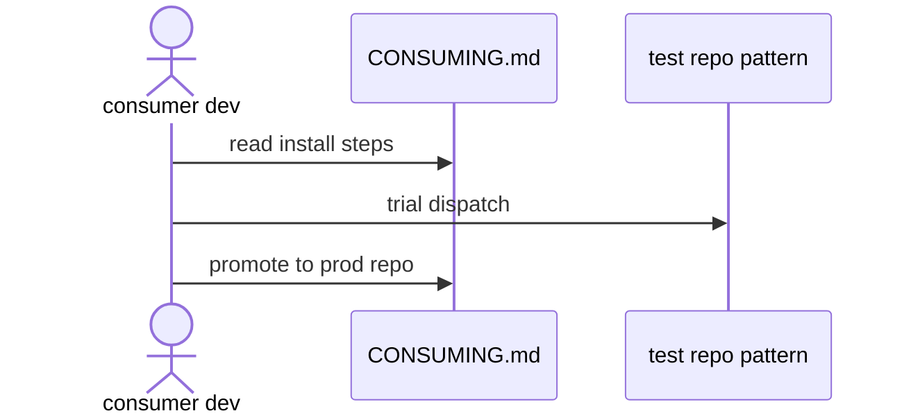

# G03: Onboarding + support
- Status: todo
- Area: governance
- Wave: PR 0
- Block: 2
- Lane: Cursor CLI
- Depends on: G02, D01
- proof: test -f docs/pbi/governance/G03-onboarding-support.md && grep -q '## Definition of Done' docs/pbi/governance/G03-onboarding-support.md
- door: two-way
## Goal
Document onboarding path for adding a workflow to a personal repo and support escalation when runs fail.
## Context
Pairs with docs/CONSUMING.md and governance/SUPPORT.md. Workshop link for deeper training.
## Steps
1. Outline SUPPORT.md tiers: self-serve docs, issue template, security contact.
2. Onboarding steps: gh aw add, secrets, dispatch trial on X01 pattern.
3. Link troubleshooting D07 common errors.
## Definition of Done
- [ ] SUPPORT.md outline complete in governance (Builder).
- [ ] Onboarding checklist references Q3 secrets and Q0 gate.
## Evidence
(commands, logs, verify log on SHA, run links)
## Flow

## Named asks for Sven
(Q3)
## Cost
n/a
## Sources
- https://github.github.com/gh-aw/setup/quick-start/
- https://github.github.com/gh-aw/guides/workshop/
- https://github.github.com/gh-aw/troubleshooting/common-issues/
