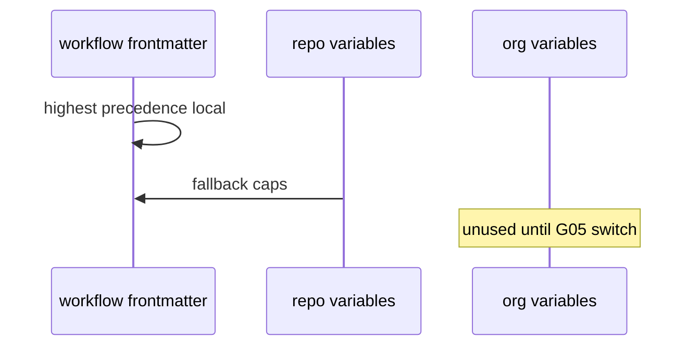

# G04: Config governance
- Status: todo
- Area: governance
- Wave: PR 0
- Block: 5
- Lane: Cursor CLI
- Depends on: C03, POL18
- proof: test -f docs/pbi/governance/G04-config-governance.md && grep -q '## Definition of Done' docs/pbi/governance/G04-config-governance.md
- door: two-way
## Goal
Document repo-level gh aw env runtime policy vars and precedence (workflow, repo, org) for personal account.
## Context
POL18 gh aw env vars can disable PR creation etc. Org enterprise controls are G05 only.
## Steps
1. Document precedence chain from governance/defaults.example.yml.
2. List recommended repo variables for caps and admission on personal repos.
3. Separate org-only controls into G05 appendix.
## Definition of Done
- [ ] Config governance doc lists vars without secret values.
- [ ] Personal repo setup guide references gh aw env get/update.
## Evidence
(commands, logs, verify log on SHA, run links)
## Flow

## Named asks for Sven
(none)
## Cost
n/a
## Sources
- https://github.github.com/gh-aw/reference/governance/
- https://github.github.com/gh-aw/reference/environment-variables/
- https://github.github.com/gh-aw/reference/compiler-enterprise-environment-controls/
