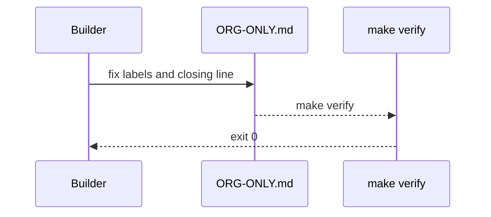
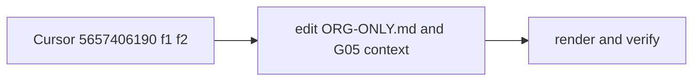

# G05a: ORG-ONLY.md follow-ups (mermaid labels, billing box scope)
- Status: todo
- Area: governance
- Wave: W5
- Block: 5
- Lane: Cursor CLI
- Depends on: G05 ([done/G05-org-only-appendix.md](../done/G05-org-only-appendix.md), PR #12)
- proof: `grep -c '#lt;\|#gt;' governance/ORG-ONLY.md` prints 0, both ORG-ONLY.md mermaid blocks render (mermaid-cli exit 0) and show `WORKFLOW` and `ORG`; `make verify` exits 0 (`gh aw compile --strict` clean, POL25 and POL31 clean)
- door: two-way
- triage: spec (the low findings Sven's 2-round cap moved off PR #12 at bdc7013: Cursor review 5657406190 f1 and f2; docs only)
- feedback: the grep above prints 0; mermaid-cli renders both blocks; `make verify` exits 0
- harness: none (docs)
- review-input: diff + this PBI + DoD (+ linked spec) + PR description, never builder session logs (PA6)
- kind: skill
- Source: PA8 (no D row; Sven, Development Agentic Workflows room, 2026-10-26 19:34 "Please do not 4 round we will fix issues later and add on list") https://github.com/svennijhuis/agentic-workflows/pull/12#pullrequestreview-5657406190 https://github.com/svennijhuis/agentic-workflows/pull/12#issuecomment-6424705952
## Goal
Fix the two doc findings left open on G05 so the org switch checklist reads right and draws right.
## Context
G05 merged in PR #12 (main f184995). The Product Owner GO (comment 6424705952) carried these forward as todo under Sven's cap. Line numbers are `governance/ORG-ONLY.md` on main at f184995.

| # | Source | Where | Gap | Fix |
|---|---|---|---|---|
| 1 | Cursor 5657406190 f1 low | `governance/ORG-ONLY.md:22` (hub edge) and `:40` (org owner box) | `#lt;` and `#gt;` are not mermaid escapes, so the diagrams show `#lt;wf#gt;` and `#lt;org#gt;` literally | write `WORKFLOW` and `ORG` in both quoted labels |
| 2 | Cursor 5657406190 f2 low | `governance/ORG-ONLY.md:90` (closing line), `:55` (diagram node `unchanged: workflows/, ... policies/`), `:60` (billing box), `docs/pbi/done/G05-org-only-appendix.md:21` (G05 context), `:29` (step 2), `:34` (checked DoD item) and `:47` (flow note "only owner refs and secret store change") | the closing line says workflow behavior does not change and the G05 context says `workflows/` and `policies/` stay the same, while the billing box changes `permissions.copilot-requests`, recompiles the `.lock.yml` and edits billing permission docs | keep the billing steps; narrow all six places (closing line, `:55` node, G05 context, step 2, DoD item, flow note) the same way: agent logic, catalog layout and C12 pins stay, and the only workflow and policy edits at switch are the billing box (`copilot-requests`, lock recompile, billing permission doc) |

Moved to [TPL02](../docs/TPL02-template-backfill.md), not in this PBI: Cursor 5657406190 f3 (G05 Technical design below the DoD with the ten template fields) and Reviewer note n1 on #12, comment 6424506602 (renamed `R` files escaped an old template script; that script is gone, use `make verify` only).
## Steps
1. Edit the two mermaid labels at `governance/ORG-ONLY.md:22` and `:40`.
2. Rewrite `governance/ORG-ONLY.md:55` and `:90` and `docs/pbi/done/G05-org-only-appendix.md:21`, `:29`, `:34` and `:47` to name the billing box as the only workflow and policy edit at switch (the `:55` node says `workflows/` and `policies/` are unchanged except the billing box; the `:47` note adds the billing box to owner refs and secret store).
3. Render both mermaid blocks, run `make verify`.
4. Move this file to `docs/pbi/done/` with `- Status: done` and `- PR: #<n>`, update the README row.
## Definition of Done
- [ ] Finding 1: no `#lt;` or `#gt;` in `governance/ORG-ONLY.md`; the labels read `WORKFLOW` and `ORG`; both blocks render
- [ ] Finding 2: the closing line, the `ORG-ONLY.md:55` diagram node, and the G05 context, step 2, DoD item and flow note (`G05-org-only-appendix.md:21`, `:29`, `:34`, `:47`) all say agent logic, catalog layout and C12 pins stay, and name the billing box (`copilot-requests` none to write, lock recompile, billing permission doc) as the only workflow and policy change at switch
- [ ] No org call, no org creation, no switch: checklist text only
- [ ] `make verify` exits 0; no em or en dash
- [ ] A fresh Cursor review on the G05a PR head has no open medium or above
## Technical design
- Components and files: `governance/ORG-ONLY.md`, `docs/pbi/done/G05-org-only-appendix.md`, `docs/pbi/README.md`
- Module boundary: `governance/ORG-ONLY.md` is the one checklist Sven reads at switch; the billing box is the only part that touches workflows and policies
- Interfaces: none (docs); mermaid labels in fenced `mermaid` blocks only
- Sequence:

- Failure modes: a label that still does not render shows in the mermaid-cli run; a broken relative link shows when editing docs
- Security: docs only, no tokens, no org call
- Observability: verify log and the mermaid-cli render on the PR head
- Cost: 0 (docs)
- Rollback: revert the G05a PR
- Proof: same as proof: above
- Door: two-way (docs only, nothing switched)
## Evidence
(todo)
## Flow

## Named asks for Sven
none (Q2 org visibility stays open in G05)
## Cost
0 (docs)
## Sources
- Cursor review 5657406190 on PR #12 at bdc7013: https://github.com/svennijhuis/agentic-workflows/pull/12#pullrequestreview-5657406190
- Cursor review 5657575895 on PR #15 at 030ee71 (f5: the four extra places in finding 2): https://github.com/svennijhuis/agentic-workflows/pull/15#pullrequestreview-5657575895
- Product Owner GO comment 6424705952: https://github.com/svennijhuis/agentic-workflows/pull/12#issuecomment-6424705952
- Sven 2026-10-26 19:34, 2-round cap, leftovers to a todo PBI
