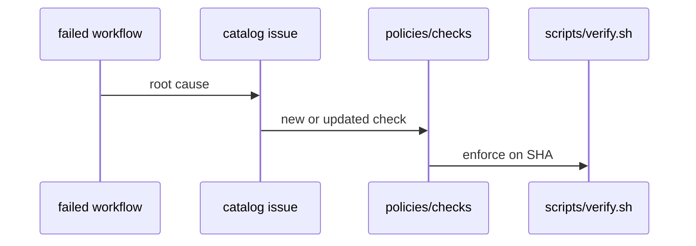

# G06: CorrectionOps feedback loop
- Status: todo
- Area: governance
- Wave: PR 0
- Block: 5
- Lane: Cursor CLI
- Depends on: G01, C01
- proof: test -f docs/pbi/governance/G06-correctionops-feedback-loop.md && grep -q '## Definition of Done' docs/pbi/governance/G06-correctionops-feedback-loop.md
- door: two-way
- triage: build
- feedback: the grep proof above plus LINK rule
- harness: none (docs page)
- review-input: diff + this PBI + DoD (+ linked spec) + PR description, never builder session logs (PA6)
- kind: skill
- Source: PA8 (pre-link PBI edited in PR #4, origin in its Sources) https://github.com/svennijhuis/agentic-workflows/pull/4
- Module boundary: the correction record format is the interface; LP00 runs the loop
## Goal
Document CorrectionOps loop: conformance failures become gate rules or docs fixes so the same mistake cannot recur.
## Context
Inspired by gh-aw blog on conformance to eslint rules. Links verify fixtures ([X03](../done/X03-gate-fixtures.md)) and policy checks. **Findings rule (gist A5):** the same FAIL from Reviewer or Tester twice on the same item, or any revert, becomes a POL check PBI in the next nF findings block (no prose-only lesson).
## Steps
1. Summarize CorrectionOps experimental pattern.
2. Define process: failed run -> issue -> policy or fixture -> scripts/verify.sh.
3. Apply findings rule: duplicate FAIL or revert opens a POL PBI in the next nF block with proof and fixtures.
4. Track corrections in CHANGELOG or governance note.
## Definition of Done
- [ ] CorrectionOps steps documented for maintainers.
- [ ] Findings rule documented (duplicate FAIL or revert -> POL PBI in next nF).
- [ ] At least one example mapping error message to POL check.
## Evidence
(commands, logs, verify log on SHA, run links)
## Flow

## Named asks for Sven
(none)
## Cost
n/a
## Sources
- https://github.github.com/gh-aw/experimental/correction-ops/
- https://github.github.com/gh-aw/blog/2026-08-23-from-conformance-failure-to-eslint-rule/
