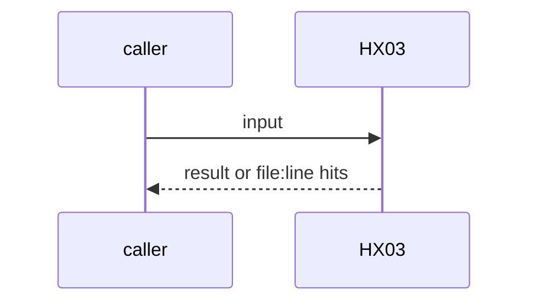
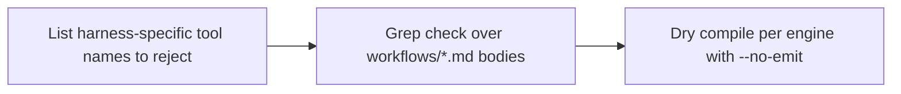

# HX03: Harness-neutral prompts
- Status: todo
- Area: harness
- Wave: W2
- Block: 2
- Lane: Builder
- Depends on: ARC07, HX02, C12
- proof: grep check on workflow prompts for harness-specific tool names, plus one dry compile per engine (no run spend)
- door: two-way
- triage: build
- feedback: the grep check and `gh aw compile --no-emit` per engine
- harness: gh-aw, engine copilot via shared/defaults.md (when built)
- review-input: diff + this PBI + DoD (+ linked spec) + PR description, never builder session logs (PA6)
- kind: script
- Source: D37 https://x.com/theo/status/2113424203345265053
## Goal
The same prompt body works on engine copilot and on another engine through one config switch. Prompts name no harness-specific tool.
## Context
Theo: different agents are often different harness configurations; the same harness can sit behind other apps. Block 2. Not built in PR #4: docs only, nothing enabled (PA9).
## Steps
1. List harness-specific tool names to reject.
2. Grep check over `workflows/*.md` bodies.
3. Dry compile per engine with `--no-emit`.
## Definition of Done
- [ ] Grep check red on a fixture prompt with a harness-specific tool name
- [ ] Dry compile per engine passes, no run
- [ ] Every Bar H line from [README.md](../README.md#bar-h-every-workflow-pbi) when the workflow ships
## Technical design
- Components and files: a check under `policies/checks/` or `scripts/`, fixtures
- Module boundary: the prompt body is the interface; engine choice stays in frontmatter
- Interfaces: frontmatter `engine:`
- Sequence:

- Failure modes: An engine without support for a tool: compile names it
- Security: No secrets in the compile
- Observability: verify.sh line per hit
- Cost: 0 AIC (compile only)
- Rollback: Remove the check
- Proof: same as proof: above
- Door: two-way (revert is one commit)
## Evidence
(todo)
## Flow

## Named asks for Sven
none
## Cost
0 AIC (compile only)
## Sources
- [Theo, What is a harness?](https://x.com/theo/status/2113424203345265053)
- Strategy id list v3.12 (aw-final-ids.md), url-learnings.md D37
