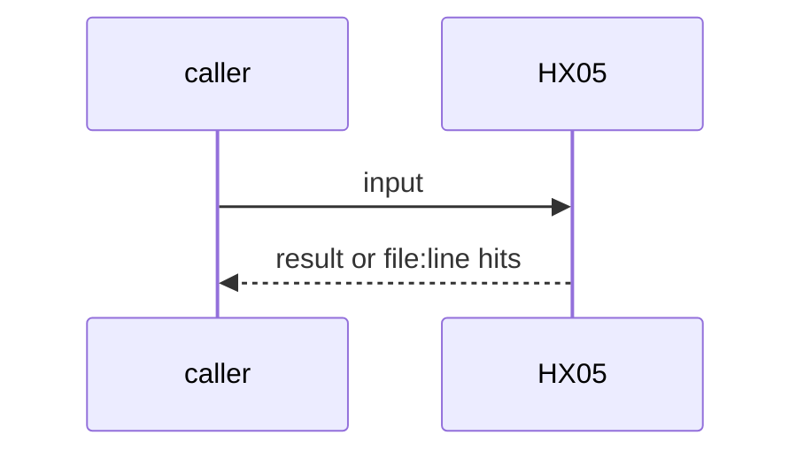
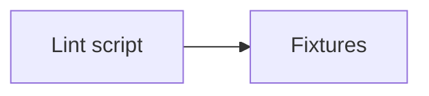

# HX05: Tool description lint
- Status: todo
- Area: harness
- Wave: W3
- Block: 3
- Lane: Builder
- Depends on: HX02
- proof: lint on all declared tools and MCP descriptions: 0 missing fields; red on a fixture description missing a field
- door: two-way
- triage: build
- feedback: the lint on its fixture
- harness: none (script run by scripts/verify.sh)
- review-input: diff + this PBI + DoD (+ linked spec) + PR description, never builder session logs (PA6)
- kind: script
- Source: D37 https://x.com/theo/status/2113424203345265053
## Goal
Tool and MCP descriptions name purpose, inputs and when not to use. A lint fails a description missing one.
## Context
Theo: a harness includes "A list of tools available w/ descriptions of how to use them". agentPacks AP30 is the twin. Not built in PR #4: docs only, nothing enabled (PA9).
## Steps
1. Lint script.
2. Fixtures.
## Definition of Done
- [ ] Red on a fixture missing a field
- [ ] 0 hits on the catalog
## Technical design
- Components and files: a check under `policies/checks/` or `scripts/`
- Module boundary: 3 description fields
- Interfaces: description text
- Sequence:

- Failure modes: Upstream tools without descriptions: allowlist per tool
- Security: No tokens
- Observability: verify.sh
- Cost: 0 AIC
- Rollback: Remove the lint
- Proof: same as proof: above
- Door: two-way (revert is one commit)
## Evidence
(todo)
## Flow

## Named asks for Sven
none
## Cost
0 AIC
## Sources
- [Theo, What is a harness?](https://x.com/theo/status/2113424203345265053)
- Strategy id list v3.12 (aw-final-ids.md), url-learnings.md D37
