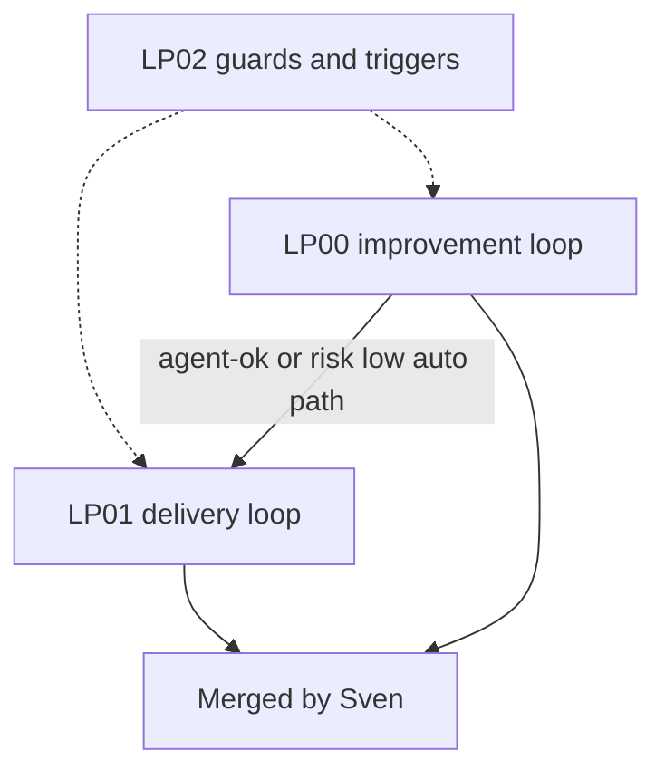

# loops: overview

**Purpose:** LP00 finds work, LP01 delivers it, LP02 maps who starts what and guards both loops. Release ids L01-L07 stay in `release/`; loop docs use LP00-LP02 to avoid a clash.

## PBIs

- [LP00: Improvement loop](LP00-improvement-loop.md) (find work: logs to issues to fix PRs)
- [LP01: Delivery loop](LP01-delivery-loop.md) (board: plan, grill, pick up, review, merge)
- [LP02: Event map](LP02-event-map.md) (automatic and human triggers, guards, one-way doors)

## Dependency sketch

