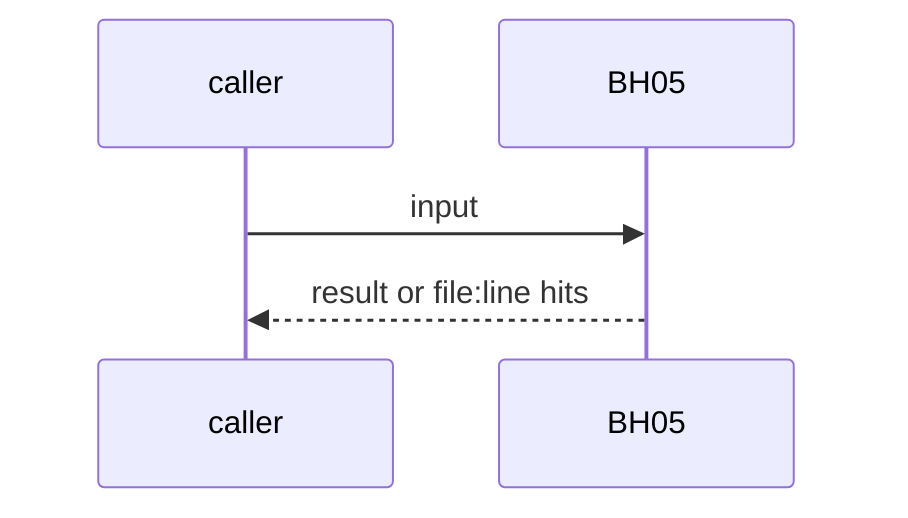
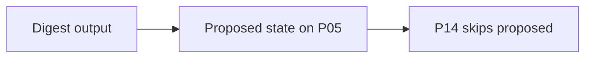

# BH05: Product loop: digest first, then proposed board items
- Status: todo
- Area: loops
- Wave: W6
- Block: 6
- Lane: Builder
- Depends on: P05, LP00
- proof: step 1 digest only; step 2 board items in a `proposed` state; no agent moves a proposed item to Ready
- door: one-way
- one-way gate: two one-way steps, each with Sven's exact yes (digest, then proposed items). Rollback: stop the job, close proposed items
- triage: spec
- feedback: fixture: a proposed item is never picked by P14
- harness: gh-aw, engine copilot via shared/defaults.md (when built)
- review-input: diff + this PBI + DoD (+ linked spec) + PR description, never builder session logs (PA6)
- kind: skill
- Source: D34 https://x.com/BHolmesDev/status/2110793920930107817
## Goal
An agent reads feedback sources on a regular cadence and looks for where users get stuck. Step 1 lands a digest only; step 2 creates `proposed` board items. A human accepts; agents never pick proposed items.
## Context
Ben Holmes: insights first landed in Slack for the sales team, then as tasks on the board; "We still require humans to review and accept these ideas." PO LP03. Not built in PR #4: docs only, nothing enabled (PA9).
## Steps
1. Digest output.
2. Proposed state on P05.
3. P14 skips proposed.
## Definition of Done
- [ ] Digest step
- [ ] Proposed state
- [ ] P14 fixture skips proposed
- [ ] Every Bar H line from [README.md](../README.md#bar-h-every-workflow-pbi) when the workflow ships
## Technical design
- Components and files: P05, P14, LP00
- Module boundary: digest file, proposed state
- Interfaces: board state
- Sequence:

- Failure modes: No feedback: noop
- Security: Feedback text is untrusted
- Observability: digest count
- Cost: per run, measured
- Rollback: Stop the job
- Proof: same as proof: above
- Door: one-way (spend or autonomy, Sven's yes)
## Evidence
(todo)
## Flow

## Named asks for Sven
Sven's exact yes before the one-way step: two one-way steps, each with Sven's exact yes (digest, then proposed items)
## Cost
per run, measured
## Sources
- [Ben Holmes, The road to self-improving software](https://x.com/BHolmesDev/status/2110793920930107817)
- Strategy id list v3.12 (aw-final-ids.md), url-learnings.md D34
