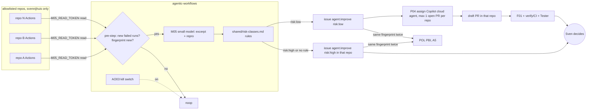
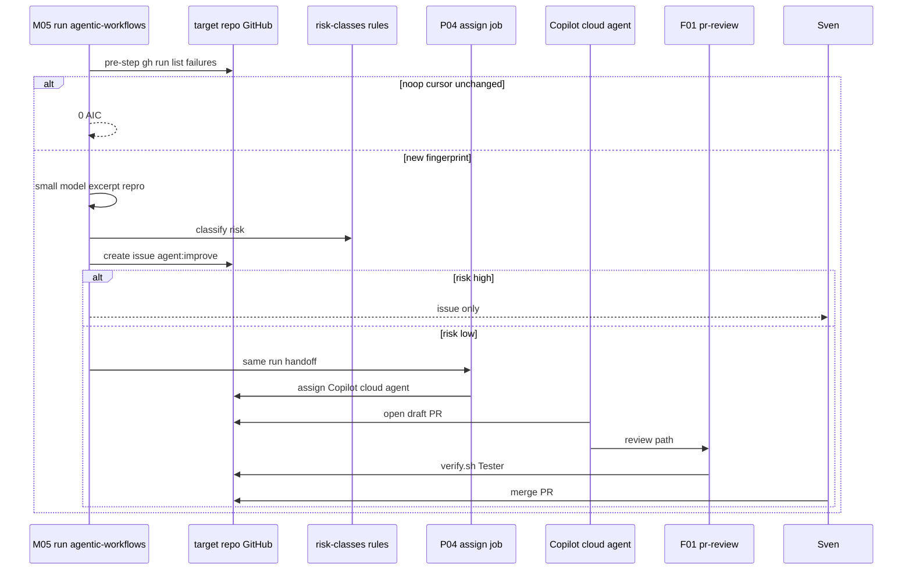
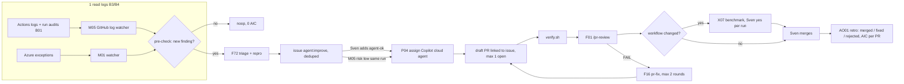

# LP00: Improvement loop
- Status: todo
- Area: loops
- Wave: PR 0
- Block: 0
- Lane: Builder
- Depends on: M05, M01, P04, F01, F16, F72, X07, AO01, AO03, POL12, Y02, O04, O05, C03
- proof: every LP00 mermaid block renders (mmdc, PR 0 gate section 10) and on GitHub; all links resolve
- door: two-way
- triage: build (map doc)
- feedback: mmdc render of every LP00 mermaid plus LINK rule
- harness: none (map doc)
- review-input: diff + this PBI + DoD (+ linked spec) + PR description, never builder session logs (PA6)
- kind: skill
- Source: PA8 (pre-link PBI edited in PR #4, origin in its Sources) https://github.com/svennijhuis/agentic-workflows/pull/4
## Goal
Document the improvement loop from log signals through deduped `agent:improve` issues to optional fix PRs, review, and human merge, including cross-repo M05 v2 behavior.
## Context
LP00 finds work; [LP01](LP01-delivery-loop.md) delivers board work. F76 log insights folded into [M05](../monitoring/M05-github-log-watcher.md). F77 issue-to-PR folded into step 3 via [P04](../multi-repo/P04-research-plan-assign-copilot.md) (assign-only: Copilot cloud agent opens the draft PR). Human promotion uses `agent-ok`. Sven merges every fix PR; an agent never merges.

Block 0 map doc: steps ship in B3, B4, and B5 as named in the table. Each step links to its own one-way PBI when implemented.

## Steps
| Step | PBIs | Block | Door | Cap per day |
|---|---|---|---|---|
| 1. Read logs | M01 Azure watcher, **M05** GitHub logs: Actions logs, workflow failures, gh-aw run audits (B01). Looks for errors, slow steps, flaky tests, cost spikes. Deterministic pre-check, so nothing new means a noop and 0 AIC | B3 (M05), B4 (M01) | one-way (tokens) | 1 run per hour max, Sven sets |
| 2. Make issues | F72 triage with repro. One issue per finding, dedupe by fingerprint (workflow + step + error hash), fixed format: log excerpt, repro command, first seen, count. Label `agent:improve` | B3 | one-way (writes issues) | max 3 issues (local); v2 cross-repo cap 5 issues total |
| 3. Make PR | **P04** assign-only: assigns the issue to the Copilot cloud agent (human `agent-ok` path, or M05 `risk:low` same-run handoff). Copilot opens the draft PR linked to the issue | B5 | one-way (assign + tokens) | max 1 open auto-fix PR per repo (WIP 1) |
| 4. Review | F01 `/pr-review` comments. X07 runs when a `workflows/*.md` file changed. `scripts/verify.sh` must be green. On FAIL, F16 pr-fix pushes a fix (max 2 rounds) | B5 | one-way (tokens) | max 2 fix rounds per PR |
| 5. Human | An agent never merges. Sven merges. AO01 retro counts loop PRs as merged, fixed or rejected, plus the AIC per merged PR | B5 | two-way | none |

## LP00 v2: cross-repo self-fix

**M05 cross-repo log watcher** (B4 with multi-repo/, depends P01, POL12, AO03)

- Runs once, centrally in agentic-workflows. Reads Actions runs and failed job logs from every repo in `policies/POL01.yml` key `m05_repos` (allowlist, personal svennijhuis only; POL12 check fails on any other owner).
- Pre-step (deterministic, 0 AIC): `gh run list --status failure` per repo since last run (cursor in repo-memory Y02). Nothing new means noop. Fingerprint = repo + workflow + step + error hash; a known fingerprint only bumps a counter.
- Agent step: small cheap model (C03 alias `small`), max-turns low. Writes one issue per new fingerprint in the repo where it failed (`target-repo` from the allowlist), labeled `agent:improve` + `risk:low|high`, body = log excerpt, repro command, first seen, count.
- **Risk class is set by rules, not the model.** A table in `shared/risk-classes.md` maps failing step + touched paths to a class. Low: lint, markdown/docs, flaky test (passed on rerun), dependency patch bump, CI config typo. High: anything matching auth, payment, secret, infra/bicep/terraform, Azure, `.github/workflows/`, `workflows/*.md`, or no rule matched. The model may move low to high, never high to low.
- Log text is untrusted input (OWASP LLM01 prompt injection). Treat excerpts as data, not instructions.
- Caps: max 5 issues per day over all repos, max 1 open auto-fix PR per repo, same fingerprint reopened twice becomes a POL PBI (A5). [AO03](../agent-ops/AO03-kill-switch.md) kill switch noops everything.

**Auto-fix path** (B5, depends M05, P04, O04, O05)

- For `risk:low` only, M05 hands off to P04 in the same run (assign the issue to the Copilot cloud agent in that repo). It does not rely on a label event, so the LP02 guard "bot labels never start a workflow" still holds; the one bot-started path is this explicit, rule-gated handoff, listed in [LP02](LP02-event-map.md).
- No `agent-ok` label on the auto-fix path, so bot labels never start a workflow stays true (own LP02 row).
- P04 only assigns the issue to the Copilot cloud agent in the target repo.
- Copilot opens the draft PR under its own identity in the target repo.
- Copilot not enabled in a repo: skip assign and comment on the issue, no fallback PR.
- PR then: draft PR in the target repo, F01 review, `scripts/verify.sh` (or that repo's CI), Tester, then Sven merges. An agent never merges.
- `risk:high` (auth, payments, secrets, infra/Azure, the workflows themselves, unclear): `agent:improve` issue only and Sven decides (he may add `agent-ok` himself).

**Who opens the PR, with which token**

- P04 runs centrally in agentic-workflows (same run as M05, deterministic job after M05's issue job). It only **assigns** the issue to the Copilot cloud agent in the target repo. Our workflow never pushes code or opens a PR in another repo.
- The Copilot cloud agent then opens the draft PR **inside the target repo under its own identity**, with its own scoped access in that repo. So no contents:write or pull-requests:write token of ours exists anywhere.
- Token: central `P04_ASSIGN_TOKEN`, a fine-grained PAT, set by Sven himself as a repo secret in agentic-workflows. Scope: allowlisted repos only, Issues write + Metadata read. Separate from `M05_READ_TOKEN`, so the read job can never assign. One-way door.
- Needs per target repo: Copilot cloud agent enabled (Sven, one-way, per repo). If a repo does not have it, P04 skips that repo and leaves a comment on the issue, no fallback PR.
- B5 proof run 1 checks on the test repo that the assign works with this exact scope. If GitHub needs more than Issues write to assign Copilot, the proof run names the minimum extra scope and Sven decides.
- Rejected: one central PAT with contents and PR write on all repos (too much blast radius), and a per-repo copy of P04 (N secrets and N workflows to update).

**Tokens** (named asks, Sven sets them himself as repo secrets in agentic-workflows)

- `M05_READ_TOKEN`: fine-grained PAT on the allowlisted repos, Actions read, Contents read, Issues write. Nothing else.
- `P04_ASSIGN_TOKEN`: Issues write, Metadata read, allowlisted repos only. Both tokens are one-way doors, set only by Sven.

**Rollout** (each step one-way: 3 audited runs + measured AIC + Sven's yes)

1. M05 report-only (issues staged, not written) on 1 repo.
2. M05 writes issues on all allowlisted repos.
3. Auto-fix path on for `risk:low`.

Placement: cross-repo M05 in B4; auto-fix handoff in B5.

**Open item:** Copilot cloud agent enablement per repo, decided by the first B5 proof run (which names the minimum extra scope if assign needs more).

## Definition of Done
- [ ] Step table uses M05, `agent:improve`, and P04 assign-only for step 3
- [ ] LP00 v2 section includes rollout, tokens, risk rules, and who opens the PR
- [ ] Cross-repo and main loop mermaid blocks present
- [ ] Links to M05, P04, AO03 resolve
- [ ] Header `proof:` grep count matches three diagram blocks (cross-repo, sequence, Flow)
- [ ] GitHub markdown preview renders diagrams
## Technical design
- Components and files: [M05](../monitoring/M05-github-log-watcher.md) workflow in agentic-workflows; `policies/POL01.yml` `m05_repos`; `shared/risk-classes.md`; [P04](../multi-repo/P04-research-plan-assign-copilot.md) assign job in same run; Y02 repo-memory cursor; F01, F16, X07 on PR path; secrets `M05_READ_TOKEN`, `P04_ASSIGN_TOKEN`.
- Module boundary: the step table is the interface; each step links its own PBI
- Interfaces: `gh run list --status failure` pre-step; issue labels `agent:improve`, `risk:low`, `risk:high`, human `agent-ok`; in-run P04 assign API to Copilot cloud agent; LP02 exception for bot-started assign on `risk:low`.
- Sequence:

- Failure modes: allowlist owner not svennijhuis (POL12 fail); Copilot disabled (comment, no PR); daily cap hit (stop creating issues); duplicate fingerprint twice (POL PBI); kill switch on (noop).
- Security: split read and assign tokens; log text untrusted (OWASP LLM01); no cross-repo contents or PR write PAT; threat detection on agent steps per Bar H.
- Observability: B01 run id on every issue; fingerprint and count in issue body; AO01 retro on merged loop PRs.
- Cost: Map doc 0 AIC; M05 pre-step 0 AIC when noop; small model capped via C03; P04 assign deterministic low AIC; PR path F01 and Copilot per measure in Evidence.
- Rollback: Disable M05 workflow; AO03 global off; revoke tokens; shrink the `m05_repos` allowlist in `policies/POL01.yml`.
- Proof: header `proof:` command plus GitHub render
- Door: two-way (Block 0 map; child PBIs and tokens are one-way)
## Evidence
- Output of header `proof:` command (expect 4: one proof line plus three diagrams)
- GitHub preview of this file after PR 0 merge
- After B4/B5: three audited M05 rollout runs with measured AIC per step
## Flow

## Named asks for Sven
- Set `M05_READ_TOKEN` and `P04_ASSIGN_TOKEN` (fine-grained PATs, scopes as above)
- M05 rollout steps 1-3: exact yes after 3 audited runs and measured AIC each
- Enable Copilot cloud agent per allowlisted repo (minimum scope from B5 proof run 1)
- Cap: 1 run per hour max for M05 schedule (when enabled)
## Cost
0 AIC for this map doc; live loop cost = sum of M05, P04 assign, Copilot coding, F01, X07 per measured runs (B02)
## Sources
- Plan v3.7-v3.9b (agentic-workflows-pbi-plan.md)
- pr0-adds/loops.md (LP00, LP00 v2, folds M05/P04)
- agent-ops.md (AO03, OWASP S10)
- [M05](../monitoring/M05-github-log-watcher.md), [P04](../multi-repo/P04-research-plan-assign-copilot.md), [AO03](../agent-ops/AO03-kill-switch.md)
