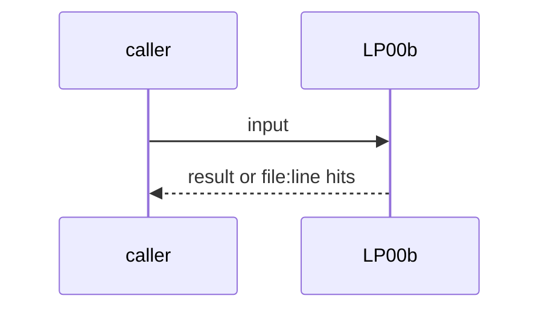
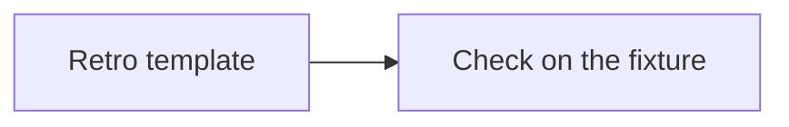

# LP00b: Blameless format for LP00 and /retro
- Status: todo
- Area: loops
- Wave: W3
- Block: 3
- Lane: Builder
- Depends on: LP00, AO04
- proof: retro template check: each finding names an environment fix (check, doc, tool), never an agent or person
- door: two-way
- triage: build
- feedback: template check on a retro fixture
- harness: none (docs page read by humans and agents)
- review-input: diff + this PBI + DoD (+ linked spec) + PR description, never builder session logs (PA6)
- kind: skill
- Source: D38 https://x.com/mattpocockuk/status/2112184048248336654
## Goal
LP00 findings and `/retro` (AO04) use a blameless format: each finding names the environment fix (a check, a doc, a tool), never the agent or the person.
## Context
Matt Pocock's map, Practices: "Maintenance without blame". PO gap 4 folds into LP00 with D4. Not built in PR #4: docs only, nothing enabled (PA9).
## Steps
1. Retro template.
2. Check on the fixture.
## Definition of Done
- [ ] Template in LP00 and AO04
- [ ] Fixture finding that blames fails
## Technical design
- Components and files: LP00, AO04, template
- Module boundary: finding = fix target + evidence
- Interfaces: retro template fields
- Sequence:

- Failure modes: Finding without a fix target fails
- Security: No personal data in findings
- Observability: retro files
- Cost: 0 AIC
- Rollback: Revert the template
- Proof: same as proof: above
- Door: two-way (revert is one commit)
## Evidence
(todo)
## Flow

## Named asks for Sven
none
## Cost
0 AIC
## Sources
- [Matt Pocock, Software Factory map](https://x.com/mattpocockuk/status/2112184048248336654)
- Strategy id list v3.12 (aw-final-ids.md), url-learnings.md D38
