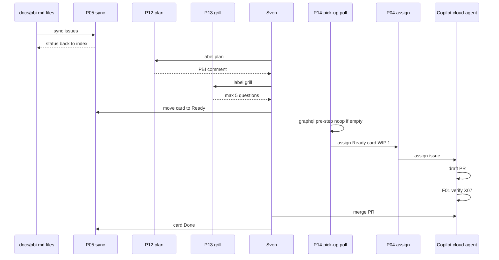
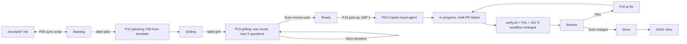

# LP01: Delivery loop
- Status: todo
- Area: loops
- Wave: PR 0
- Block: 0
- Lane: Builder
- Depends on: P05, P12, P13, P14, P04, F01, F16, X07, AO01
- proof: test -f docs/pbi/loops/LP01-delivery-loop.md && grep -q 'P14' docs/pbi/loops/LP01-delivery-loop.md
- door: two-way
## Goal
Document the delivery loop: planned PBIs move from the personal Project board through planning and grilling to Ready, then one at a time into implementation, review, and Done after Sven merges.
## Context
LP00 finds improvement work; LP01 delivers backlog work from [P05](../multi-repo/P05-project-board-monitoring.md). An LP00 issue with `agent-ok` can enter LP01 at Ready (same pick-up path as board cards). F77 issue-to-PR is folded into [P04](../multi-repo/P04-research-plan-assign-copilot.md) assign-only (Copilot opens the draft PR). Sven merges every fix PR; an agent never merges.

This file is a Block 0 map. Workflows ship in the blocks named in the step table (mostly B3, pick-up and coding in B5).

## Steps
| Step | PBI | Block | Door | Cap |
|---|---|---|---|---|
| Board | [P05](../multi-repo/P05-project-board-monitoring.md): GitHub Project (user-owned, personal account) with columns Backlog, Grilling, Ready, In progress, Review, Done. A script syncs `docs/pbi/*.md` to issues (one per PBI, by id in the title), and status flows back into the index Status column | B3 | two-way (script, no tokens) | none |
| Plan | [P12](../multi-repo/P12-planning-workflow.md): label `plan` on an issue, and the workflow writes a PBI from the template (goal, DoD, `proof:`, `door:`, technical design, mermaid) as an issue comment. The human copies or approves it | B3 | one-way (tokens) | 3 runs per day |
| Grill | [P13](../multi-repo/P13-grilling-workflow.md) (gist 27): label `grill`, and the agent posts one round of max 5 questions on goal, DoD and edge cases. It waits for Sven's reply and only then asks the next round. It never moves a card to Ready | B3 | one-way (tokens) | 1 round per issue per run |
| Pick up | [P14](../multi-repo/P14-board-pick-up.md): only cards Sven moved to Ready. Assigned to the Copilot cloud agent via P04, WIP 1, and the draft PR links back to the card | B5 | one-way (PR + tokens) | WIP 1, 1 per day |
| Code + review | Copilot cloud agent codes, then F01, `scripts/verify.sh`, X07 if a workflow changed. Card moves to Review | B5 | one-way (tokens) | 2 fix rounds |
| Human | Sven merges, and the card moves to Done. An agent never merges | B5 | two-way | none |

**P14 pick-up (scheduled poll):** Board pick-up is a 30 minute `schedule` workflow with a deterministic noop pre-step (`gh api graphql` lists Ready items without a linked PR; 0 AIC when Ready is empty). It is a scheduled workflow, so it stays OFF until Sven's exact yes (one-way door, B5). Its Actions minutes (48 runs per day) count toward measured cost in Evidence.

## Definition of Done
- [ ] Step table lists P05, P12, P13, P14 with correct blocks and doors
- [ ] P14 poll, noop pre-step, OFF until Sven yes, and 48 runs per day cost note are documented
- [ ] Flow mermaid matches board columns and review path
- [ ] Links resolve to multi-repo PBI files
- [ ] LP00 `agent-ok` to Ready entry and Sven merge to Done are stated
## Technical design
- Components and files: [P05](../multi-repo/P05-project-board-monitoring.md) sync script and Project columns; [P12](../multi-repo/P12-planning-workflow.md), [P13](../multi-repo/P13-grilling-workflow.md), [P14](../multi-repo/P14-board-pick-up.md) workflows under `workflows/` when built; F01, F16, X07 on the PR path; `docs/pbi/*.md` as source of PBI issues.
- Interfaces: GitHub Project columns; issue labels `plan`, `grill`; human move to Ready; P04 assign to Copilot cloud agent; `pull_request` and review events on the draft PR; `agent-ok` from LP00 for improvement issues entering Ready.
- Sequence:

- Failure modes: Ready poll runs while workflow disabled (noop only); multiple Ready cards blocked by WIP 1; grill agent moves card (forbidden by P13); Copilot assign fails (comment on issue, no PR).
- Security: POL10 actor checks on labels; bot labels never start workflows; tokens only on one-way steps (P12, P13, P14, P04).
- Observability: B01 run logs per workflow; AO01 retro counts delivery loop merges; board column changes visible on Project.
- Cost: Map doc 0 AIC; P05 sync 0 AIC; P12/P13 agent steps capped per table; P14 schedule 48 workflow runs per day (mostly noop pre-step, 0 AIC when empty); implementation PRs incur Copilot and F01 AIC per Bar H measure.
- Rollback: Map doc edits freely (two-way); disable P14 schedule until Sven re-approves; turn off P12/P13 via AO03 or workflow_dispatch off.
- Proof: `test -f docs/pbi/loops/LP01-delivery-loop.md && grep -q '30 min' docs/pbi/loops/LP01-delivery-loop.md`
- Door: two-way (documentation only in Block 0; child PBIs own one-way doors)
## Evidence
- GitHub render of this file and link check to P05, P12, P13, P14
- After B3/B5 ship: first P14 audited runs with measured AIC and noop count
## Flow

## Named asks for Sven
- P14 exact yes before enabling the 30 minute schedule (B5)
- Copilot cloud agent enabled on repos that use board pick-up
## Cost
0 AIC for this map doc; measured AIC for P12, P13, P14, and PR path workflows when live (see child PBIs and B02)
## Sources
- Plan v3.8 (pr0-adds/loops.md LP01)
- Plan v3.9b (P04 assign-only, Copilot opens PR)
- [P05](../multi-repo/P05-project-board-monitoring.md), [P12](../multi-repo/P12-planning-workflow.md), [P13](../multi-repo/P13-grilling-workflow.md), [P14](../multi-repo/P14-board-pick-up.md)
