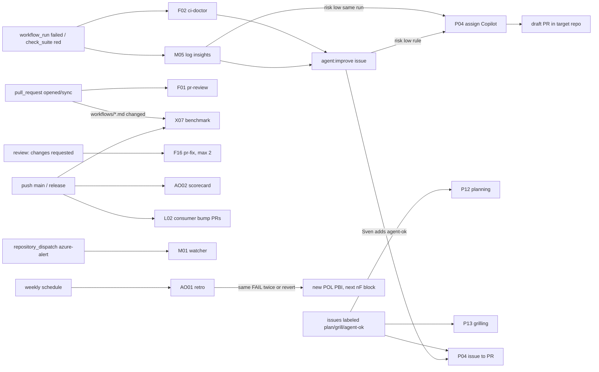
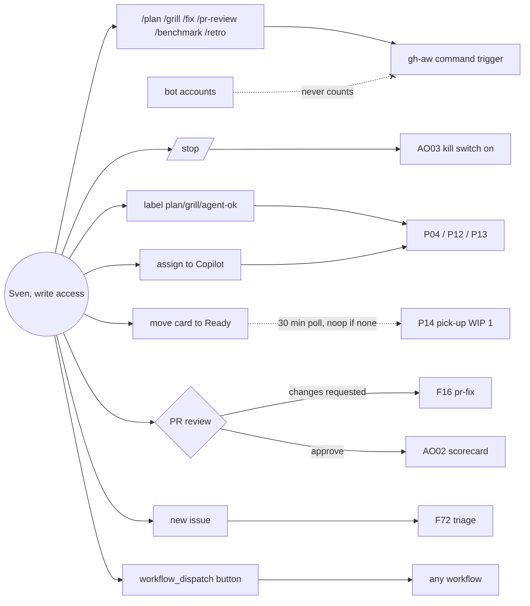
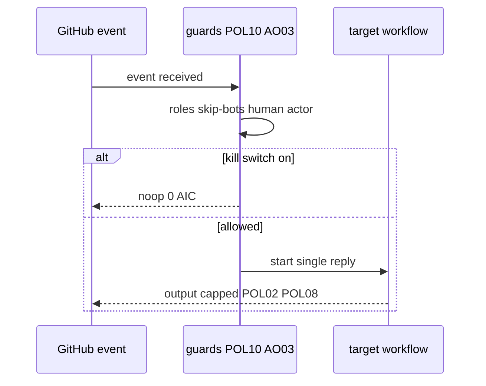
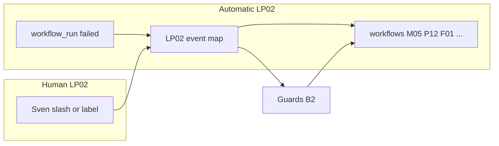

# LP02: Event map
- Status: todo
- Area: loops
- Wave: PR 0
- Block: 0
- Lane: Builder
- Depends on: R01, R02, R03, R04, R06, M05, P04, P12, P13, P14, F01, F01b, F16, AO01, AO02, AO03, M01, L02
- proof: test -f docs/pbi/loops/LP02-event-map.md && grep -q 'M05 risk:low handoff' docs/pbi/loops/LP02-event-map.md
- door: two-way
## Goal
Map who starts what: automatic GitHub events, human triggers (slash commands, labels, board poll), shared guards, and every one-way door in the loop system.
## Context
Extends trigger PBIs R01-R06. F76 log insights folded into [M05](../monitoring/M05-github-log-watcher.md); F77 issue-to-PR folded into [P04](../multi-repo/P04-research-plan-assign-copilot.md) assign-only. Human go label is `agent-ok` only. LP02 guards apply to LP00 and LP01.

Block 0 map: guards ship in B2 (POL10 actor check, concurrency, [AO03](../agent-ops/AO03-kill-switch.md) as guard dependency); first event triggers in B3 (M05, P12, P13, AO01 weekly, AO02); the rest in B5 (P04, P14, F16, L02 bump PRs, M05 risk:low handoff).

### A. Automatic events (self-improvement)

| Event | Starts | Output | Block | Door |
|---|---|---|---|---|
| `workflow_run` completed with failure, or `check_suite` red | F02 ci-doctor + M05 log insights | one `agent:improve` issue, deduped | B3 | one-way |
| M05 `risk:low` handoff to P04 | bot-started, rule-gated, same run, no label | P04 assigns Copilot | B5 | one-way |
| `issues` labeled `plan` / `grill` / `agent-ok` (by a human) | P12 planning / P13 grilling / P04 issue to PR | comment / question round / draft PR | B3 (plan, grill), B5 (agent-ok) | one-way |
| `pull_request` opened or synchronize | F01 pr-review; X07 only when `workflows/*.md` changed (paths filter) | review COMMENT, benchmark row | B3 after F01b yes | one-way |
| `pull_request_review` with FAIL (changes requested) | F16 pr-fix, max 2 rounds per PR | fix commit | B5 | one-way |
| `push` to main or `release` published | X07 benchmark, AO02 scorecard update, L02 consumer bump PRs | benchmark row, scorecard, bump PRs | B3 (scorecard, script), B5 (bump PRs) | one-way |
| `repository_dispatch` type `azure-alert` | M01 watcher | issue | B4 | one-way |
| weekly `schedule` | AO01 retro; same FAIL twice or a revert becomes a POL PBI (A5 findings rule) | retro issue, POL PBI draft | B3 | one-way |

### B. Human activity

| Human action | Mechanism | Starts | Door |
|---|---|---|---|
| `/plan` `/grill` `/fix` `/pr-review` `/benchmark` `/retro` in a comment | `issue_comment` via gh-aw `command:` trigger | P12, P13, P04, F01, X07, AO01 | two-way (Sven types it) |
| `/stop` | `command:` trigger, deterministic job, no agent | sets AO03 global kill var, 0 AIC | two-way |
| label `plan`, `grill`, `agent-ok` | `issues: labeled`, label actor must be a human with write | P12, P13, P04 | one-way for `agent-ok` |
| assign issue to Copilot | `issues: assigned` (Copilot cloud agent) | P04 | one-way |
| move card to Ready on P05 | **short poll**, see below | P14 pick-up, WIP 1 | one-way |
| human review "changes requested" | `pull_request_review` | F16 pr-fix | one-way |
| human review approve | `pull_request_review` | AO02 scorecard update only (script, 0 AIC) | two-way |
| new issue by a human | `issues: opened` | F72 triage | one-way |
| button | `workflow_dispatch` on every workflow | that workflow | two-way |

**Board decision:** poll, not webhook. GitHub Actions has no Projects (v2) event trigger, and a webhook needs a receiver we would have to host. So P14 runs on `schedule` every 30 minutes with a deterministic pre-step (`gh api graphql` lists Ready items without a linked PR). Nothing new means noop and 0 AIC. Pick-up latency is max 30 minutes, which is fine at WIP 1. Revisit as a webhook at the org switch (G05). P14 stays OFF until Sven's exact yes (B5). When on, 48 runs per day of Actions minutes count toward measured cost.

### Guards (every trigger, automatic and human)

- Roles gate: `on.roles: [admin, write]` (POL10); today that is only Sven. Bot actors never count: `skip-bots`, plus an actor check that the label or comment came from a human.
- No loops: writes made with GITHUB_TOKEN do not start new workflow runs (GitHub default). Labels or comments a bot sets never start a workflow, enforced by the actor check. Exception: M05 `risk:low` handoff to P04 in the same run (explicit, rule-gated, listed above).
- Concurrency group per issue or PR (`aw-${{ github.event.issue.number || github.event.pull_request.number }}`), cancel-in-progress false.
- Daily caps: `max-daily-ai-credits` per workflow (POL02) plus safe-output `max` (POL08). Each trigger answers with one reply.
- Kill switch AO03: a pre-step reads the global repo var and the per-workflow var and noops. `/stop` sets the global var (AO03 ships B2 as guard dependency for `/stop`).
- Rollout like F01: manual (`workflow_dispatch` and slash) first. An event trigger turns on only after 3 audited runs, measured AIC and Sven's yes.

### Rollout and doors

Manual first: `workflow_dispatch` and slash commands. Each automatic `on:` event enables only after 3 audited runs, measured AIC, and Sven's exact yes (named ask in that workflow's block).

| One-way door | What | Block | Rollback hint |
|---|---|---|---|
| `agent-ok` label on improvement issue | Starts P04 issue-to-PR path (human actor) | B5 | Remove label; disable P04 trigger |
| P04 assign (incl. M05 handoff) | Assigns Copilot cloud agent; `P04_ASSIGN_TOKEN` | B5 | Revoke or rotate token; disable workflow |
| P14 poll enabled | 30 min `schedule` pick-up | B5 | Disable schedule trigger until Sven yes again |
| F01b | `pull_request` opened/sync auto review | B3 | Remove pull_request trigger |
| M05 rollout step 1 | Report-only issues on 1 repo | B4 | Turn off M05 workflow |
| M05 rollout step 2 | Writes `agent:improve` on all allowlisted repos | B4 | AO03 off or shrink `m05.repos` |
| M05 rollout step 3 | Auto-fix `risk:low` via P04 same run | B5 | Disable handoff job; issues only |
| `M05_READ_TOKEN` | Cross-repo Actions read, Issues write | B4 | Remove secret; M05 noops |
| `P04_ASSIGN_TOKEN` | Cross-repo Issues assign | B5 | Remove secret; assign skipped |
| Copilot cloud agent per repo | Required for assign path | B5 | Disable agent in repo settings |

**Blocks:** the map in PR 0; the guards in B2 (POL10 actor check, concurrency, AO03 pulled forward from B3 as a guard dependency); the first event triggers in B3 (M05, P12, P13, AO01 weekly, AO02); the rest in B5 (P04, P14, F16, L02 bump PRs, M05 risk:low handoff).

## Steps
1. Keep automatic and human tables aligned with deployed workflow triggers (manual and slash first per rollout rule).
2. Add LP02 row and mermaid edge for M05 `risk:low` handoff to P04 (bot-started, rule-gated, same run, no label).
3. Document board poll decision for P14 (no Projects v2 webhook).
4. List guards and one-way doors for Sven review before each block exit.

## Definition of Done
- [ ] Automatic events table includes M05 risk:low handoff row
- [ ] Both automatic and human mermaid diagrams render
- [ ] Board poll, noop pre-step, OFF until Sven yes, 48 runs per day cost note present
- [ ] Guards section matches loops strategy
- [ ] Rollout and doors table lists every one-way door named in strategy
- [ ] Blocks line matches PR 0 block plan
## Technical design
- Components and files: `workflows/*.md` per trigger; `aw.yml` allowlists; [AO03](../agent-ops/AO03-kill-switch.md) repo variables; gh-aw `command:` handlers for slash; [P14](../multi-repo/P14-board-pick-up.md) scheduled poll; POL10 check scripts in B2.
- Interfaces: GitHub webhooks (`workflow_run`, `check_suite`, `issues`, `pull_request`, `pull_request_review`, `push`, `repository_dispatch`, `schedule`); slash `/plan`, `/grill`, `/fix`, `/pr-review`, `/benchmark`, `/retro`, `/stop`; labels `plan`, `grill`, `agent-ok`; M05 to P04 in-run assign for `risk:low`.
- Sequence:

- Failure modes: bot label or comment triggers workflow (blocked by actor check); GITHUB_TOKEN write starts loop (GitHub default prevents); kill switch not read (AO03 pre-step required); P14 runs before Sven yes (must stay disabled).
- Security: POL10 `on.roles: [admin, write]` today only Sven; `/stop` deterministic 0 AIC sets global kill; no bot-started workflows except documented M05 risk:low handoff.
- Observability: B01 audit every run; AO02 scorecard on approve; AO01 weekly retro and POL PBI on repeat FAIL (A5).
- Cost: Map doc 0 AIC; per-trigger AIC in child PBIs; P14 schedule 48 runs per day counted in measured cost when enabled.
- Rollback: Map doc two-way; disable triggers per child PBI rollback; AO03 global off via `/stop` or var.
- Proof: `grep -q 'M05 risk:low handoff' docs/pbi/loops/LP02-event-map.md`
- Door: two-way (map doc; individual triggers keep their own one-way doors)
## Evidence
- Mermaid render check for LP02 diagrams
- After B3/B5: trigger inventory matches compiled workflow `on:` blocks
## Flow

## Named asks for Sven
- Exact yes per one-way door in the table below (each block named ask)
- F01b yes before `pull_request` auto trigger
- P14 yes before 30 minute schedule on
## Cost
0 AIC for this map doc
## Sources
- Plan v3.8b (LP02 event map)
- Plan v3.9 (M05 cross-repo, risk classes)
- Plan v3.9b (P04 assign token)
- pr0-adds/loops.md
